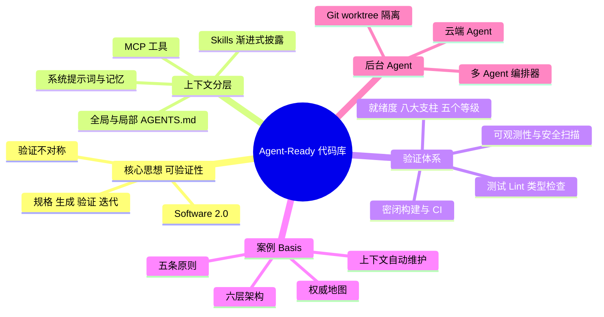
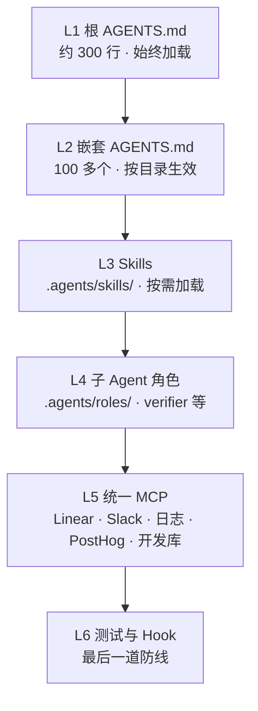
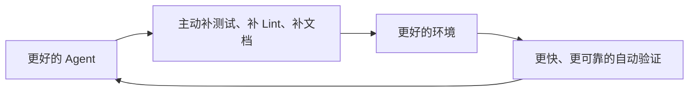

# 让代码库为 AI Agent 就绪：从 AGENTS.md 到后台并行 Agent

> **Stanford CS146S · Lecture 10 学习文档（2026 版）**
>
> - **主题**：Agent-Ready Codebase（为 Agent 就绪的代码库）与 Background Coding Agents（后台编码 Agent）
> - **核心来源**：CS146S《The Modern Software Developer》第 10 讲课件（Mihail Eric，2026 秋季）[^ppt]；Factory AI 联合创始人 Eno Reyes 的演讲《Making Codebases Agent Ready》[^eno]；Basis 工程博客《Making Our Monorepo Ergonomic for Agents》[^basis]
> - **扩展资料**：Factory Agent Readiness，Karpathy 与 Jason Wei 关于“可验证性”的文章，AGENTS.md、Agent Skills、MCP 三项开放标准，Claude Code、Conductor、Cursor 官方文档
> - **适合读者**：用过 Cursor、Claude Code、Codex 等编码 Agent，想从“一个 Agent 帮我写代码”走向“多个 Agent 并行交付”的开发者和技术负责人
> - **预备知识**：Git 分支与 PR 流程、CI/CD 基本概念、单元测试
> - **建议用时**：精读 60–80 分钟

## 📖 阅读指南

| 标记 | 含义 | 阅读建议 |
|---|---|---|
| ⭐⭐⭐ | 必会：核心概念与可直接落地的方法 | 精读，能用自己的话复述 |
| ⭐⭐ | 理解：背后的原理与权衡 | 读懂即可 |
| ⭐ | 了解：背景数据、评分细节、工具生态 | 浏览，用时再查 |

| 提示框 | 用途 |
|---|---|
| 💡 **直觉** | 用类比建立直观理解 |
| 🔭 **2026 视角** | 站在当下的判断与趋势 |
| ⚠️ **易错点** | 常见误区与陷阱 |
| 🛠️ **动手** | 可以直接照做的操作 |

**时间紧的读法**：🎯 先看结论 → 第 3 章（就绪清单）→ 第 5 章（后台 Agent）→ 第 7 章速查表。

## 🗺️ 知识地图



## 🎯 先看结论：6 句话带走核心

1. **瓶颈不在模型，在验证**。Eno Reyes 的核心论断是：“限制因素不是编码 Agent 的能力，而是你所在组织的验证标准。”[^eno]
2. **人能绕过的坑，Agent 绕不过**。测试不足、文档过期、构建不稳定，人类靠手测、问同事、多试几次来弥补；Agent 没有这些“后门”，只会在错误方向上越走越远[^ppt]。
3. **上下文是分层的**。从系统提示词、记忆、环境信息、MCP 工具、Skills 到全局和局部 AGENTS.md，越靠近代码越具体；每个自动加载的 token 都要“挣到”自己的位置[^basis]。
4. **代码库本身就是产品**。Basis 把代码库当作 Agent 的上下文来经营：区分“权威”与“非权威”信息，搭建六层架构并自动维护。三个月内，人均 token 用量涨了 5 倍以上，提交速度提高到 2.5 倍[^basis]。
5. **就绪度可以度量**。Factory 的 Agent Readiness 按八大支柱、五个等级给仓库打分，Level 3（标准化）是多数团队的目标线[^factory]。
6. **并行是回报，隔离是前提**。从 Tab 补全（约 15% 提效）到同步单任务（25–35%），再到后台多任务（2 倍以上），每一步都要求更强的环境隔离和更可靠的自动验证[^ppt]。

## 1️⃣ 核心思想：为什么“可验证性”决定 Agent 的上限 ⭐⭐⭐

> **学习目标**：理解编码 Agent 为何是目前最成熟的 Agent；掌握“验证不对称”的五个属性；理解开发流程正从“写代码”转向“写规格 + 做验证”。

### 1.1 Software 2.0：自动化你能验证的东西

Karpathy 在 2025 年 11 月的短文《Verifiability》里给出一个框架[^karpathy]：

| 范式 | 能自动化的任务 | 典型手段 |
|---|---|---|
| Software 1.0 | 你能**写清规则**的任务 | 手写程序、算法 |
| Software 2.0 | 你能**验证结果好坏**的任务 | 神经网络 + 训练与强化学习 |

他认为，AI 要高效攻克一个任务，任务环境最好满足三个条件：**可重置**（resettable，能反复从头尝试）、**高效**（efficient，每次尝试成本低）、**可奖励**（rewardable，能自动判断好坏）。满足得越多，进展越快。这也解释了 AI 能力为什么是“锯齿状”（jagged）的：数学、编程突飞猛进，难以验证的领域却进展缓慢[^karpathy]。

> 💡 **直觉**：AI 像一个可以无限次模拟考试的学生。有标准答案的科目（编程、数学）它能刷到满分；作文这种没有统一评分标准的科目，它就进步得慢。

### 1.2 验证不对称：好任务的五个属性

Jason Wei 提出了“验证不对称”（Asymmetry of Verification）：很多任务**验证远比求解容易**。比如数独，解题要花很久，核对答案几秒钟。他进一步提出“验证者法则”（Verifier's Law）：**训练 AI 解决一个任务的难易程度，与这个任务的可验证程度成正比**[^wei]。可验证性好的任务有五个属性：

| 属性 | 含义 | 在软件开发中的对应 |
|---|---|---|
| 客观真值 | 对错有明确标准 | 测试通过或失败、类型检查结果 |
| 验证快 | 几秒到几分钟就有结论 | 单元测试、pre-commit hook |
| 可规模化 | 能同时验证大量候选方案 | CI 并行执行 |
| 低噪声 | 结果稳定，不随机 | 不 flaky 的测试与构建 |
| 连续反馈 | 不只有对错，还能衡量“有多好” | 覆盖率、性能基准、Lint 告警数 |

Eno Reyes 据此指出：软件开发恰好是**高度可验证**的领域，这正是编码 Agent 成为目前最先进 Agent 的原因[^eno]。

> 🔭 **2026 视角**：把这个结论反过来用更有价值——**在你的仓库里，Agent 的能力上限约等于仓库的可验证程度**。没有测试、构建时好时坏的仓库，会把最强的模型拉低成“只会写看起来对的代码”。

### 1.3 开发流程的转变：规格驱动开发

| 维度 | 传统流程 | Agent 时代的流程 |
|---|---|---|
| 步骤 | 理解 → 设计 → 编码 → 测试 | **写规格约束 → 生成 → 验证 → 迭代** |
| 人的主要工作 | 写代码 | 写规格、设计验证、判断结果 |
| 验证方式 | 人工评审 + 手动测试 | 自动化验证 + 人的直觉 |
| 工具形态 | IDE | 规格模式与计划模式（如 Factory Droid 的 Spec Mode、Claude Code 的 Plan Mode） |

**规格驱动开发**（Spec-Driven Development）：先用自然语言写清目标、约束和验收标准，让 Agent 生成实现，再用自动检查加上人的判断来验证，不达标就迭代。验收标准越清晰、越能自动执行，这个循环就转得越快[^eno]。

### 1.4 一句话记住本章

> “The limiter is not the capability of the coding agent. The limit is your organization's validation criteria.”
>
> 限制你的不是编码 Agent 的能力，而是组织的验证标准。[^eno]

Eno 给组织的忠告是：不要花 45 天比较哪个工具在 SWE-bench（衡量模型修复真实 GitHub issue 能力的基准测试）上高出 10%，而是**改进组织的工程实践，让任何 Agent 都能成功**[^eno]。

## 2️⃣ 上下文的故事：Agent 每次工作时在“看”什么 ⭐⭐⭐

> **学习目标**：说清 Agent 上下文的分层结构；理解 AGENTS.md、Skills、MCP 各自解决什么问题；掌握“渐进式披露”和“默认否定”两条上下文经济学原则。

### 2.1 上下文分层栈

课件用一张图概括了 Agent 每次工作时“看到”的信息[^ppt]。按从通用到具体排列如下：

| 层 | 是什么 | 谁来维护 | 加载方式 |
|---|---|---|---|
| System Prompt（系统提示词） | Agent 产品内置的身份、行为规则、工具用法 | 工具厂商 | 始终加载 |
| Memory（记忆文件） | 跨会话积累的用户偏好与经验 | 用户或 Agent 自动写入 | 通常始终加载 |
| Env info（环境信息） | 操作系统、当前目录、Git 状态、日期等 | Agent 运行时自动采集 | 始终加载 |
| MCP tools（MCP 工具） | 通过协议接入的外部能力，如工单、日志、数据库 | 团队或第三方 | 工具描述通常常驻，调用时才取数据 |
| Skills（技能包） | 可复用的流程手册与脚本 | 团队 | 按需加载 |
| AGENTS.md（全局） | 仓库根目录的总规则 | 团队 | 始终加载 |
| AGENTS.md（局部） | 子目录的专属规则 | 子模块负责人 | 在该目录工作时加载 |

> 课件中的 Memory.md 泛指 Agent 的记忆文件。各工具命名不同，比如 Claude Code 有自动记忆机制，理解成“跨会话的笔记本”即可。

两个基础术语：

- **上下文窗口**（Context Window）：模型一次能“看到”的输入上限，以 token 计。
- **Token**：模型处理文本的基本单位，中英文都会被切成若干 token。上下文不是越多越好：无关信息会稀释注意力、增加成本，长会话中输出质量下降的现象常被称为“上下文腐烂”（Context Rot）。

> 💡 **直觉**：上下文窗口像一张办公桌。桌面越乱，越难找到关键文件。好的上下文设计就是“桌上只放这次要用的东西，其余放进抽屉，需要时再拿”。

### 2.2 三项开放标准：AGENTS.md、Agent Skills、MCP

| 标准 | 解决的问题 | 形态 | 归属 |
|---|---|---|---|
| AGENTS.md | 这个仓库该怎么干活 | 仓库中的 Markdown 文件，可以嵌套 | OpenAI 发起，2025 年 12 月捐给 AAIF |
| Agent Skills | 某类任务该按什么流程做 | 文件夹：SKILL.md + 可选的脚本和参考资料 | Anthropic 发起，2026 年 10 月加入 AAIF |
| MCP（Model Context Protocol，模型上下文协议） | Agent 如何连接外部系统 | 客户端与服务器之间的通信协议 | Anthropic 发起，2025 年 12 月捐给 AAIF |

**AAIF**（Agentic AI Foundation，智能体 AI 基金会）是 2025 年 12 月由 Anthropic、Block、OpenAI 在 Linux 基金会下共同成立的组织，创始项目为 MCP、goose 和 AGENTS.md[^aaif]。2026 年 10 月 22 日，AAIF 又纳入 Agent Skills、Open Responses、OpenEnv、OpenSandbox 四个项目，总数达到 10 个[^aaif2]。

> 🔭 **2026 视角**：这三项标准已是厂商中立的事实标准。你为仓库写的 AGENTS.md 和 Skills，换用 Claude Code、Codex、Cursor、Copilot 等工具时基本都能复用。这也是 Basis “互操作性”原则（见第 4 章）的底气。

#### AGENTS.md：写给 Agent 的 README

- **定位**：README 面向人类介绍项目；AGENTS.md 面向 Agent，说明构建命令、测试方式、代码规范和禁区[^agentsmd]。
- **嵌套**：monorepo 的每个子包都可以放自己的 AGENTS.md。Agent 读取**离被编辑文件最近**的那一份，近者优先[^agentsmd]。
- **兼容**：Claude Code 读取的是 CLAUDE.md。Basis 的做法是建一个软链接（symlink，指向另一个文件的快捷方式），让两个文件名指向同一份内容[^basis]。

#### Agent Skills：渐进式披露

一个 Skill 就是一个文件夹[^skills]：

```text
.agents/skills/db-migration/
├── SKILL.md        # 必需：YAML 头（name、description）+ 操作说明
├── scripts/        # 可选：可执行脚本
└── references/     # 可选：详细参考资料
```

**渐进式披露**（Progressive Disclosure）指先给索引，按需再展开细节。Skills 分三级加载[^skills]：

1. 启动时只加载每个 Skill 的 `name` 和 `description`，约 100 token；
2. 任务匹配时才加载完整的 SKILL.md，正文建议控制在 5000 token 以内；
3. 执行中确有需要，才读取 `scripts/`、`references/` 里的文件。

> 💡 **直觉**：Skills 像公司的操作手册书架。Agent 平时只看书脊上的书名，需要时才抽出一本、翻到相关章节，而不是每天把整个书架背一遍。

据 Anthropic 披露，Agent Skills 已获得 70 多个平台支持，已发布的 Skill 超过 100 万个、安装量近 2.8 亿次[^skillsdonate]。

#### MCP：连接外部世界的“USB-C 接口”

MCP 让 Agent 用统一协议调用外部系统，如 Linear 工单、Slack 消息、日志平台、开发数据库。要注意的是，**工具描述本身也占上下文**，接入的工具越多，留给任务的窗口就越小。这正是下一节“默认否定”原则要约束的对象。

### 2.3 上下文经济学：两条原则

| 原则 | 含义 | 实践 |
|---|---|---|
| 渐进式披露 | 先给索引，按需展开细节 | 根 AGENTS.md 保持精简，细节下沉到局部 AGENTS.md 和 Skills |
| 默认否定（Default-no） | 自动加载的内容必须证明自己有用 | 每加一行都问一句：删掉它，Agent 的表现会变差吗？ |

Basis 的说法很犀利：**不能改变 Agent 行为的 token，是对每一次会话征收的税**[^basis]。

> ⚠️ **易错点**：把 AGENTS.md 当知识库，什么都往里堆。结果是窗口被占满，关键规则反而被淹没。正确的分工是：AGENTS.md 只放“每次都需要”的指令，领域知识放进 Skills，背景资料放进 docs/。

## 3️⃣ Agent-Ready 代码库：人能绕过的坑，Agent 绕不过 ⭐⭐⭐

> **学习目标**：对比人类和 Agent 面对技术债时的差异；掌握 Agent 就绪环境清单及每一项的含义；了解 Factory Agent Readiness 的八大支柱与五级模型。

### 3.1 为什么要专门为 Agent 优化

课件给出三个理由[^ppt]：

- 大多数代码库**没有为 Agent 的成功做好准备**；
- LLM 的很多“困惑”其实来自**混乱或不完整的开发环境**，并非模型能力不足；
- 目标是让**人和 Agent 都能看懂正在发生什么**。对 Agent 友好的仓库，对新同事同样友好。

### 3.2 人能绕过 vs Agent 会卡死

课件把两边的差异对照整理如下[^ppt]：

| 环境缺陷 | 人类的绕行方式 | Agent 会怎样 |
|---|---|---|
| 测试覆盖不足 | 手动测一下 | 无法验证正确性 |
| 文档过期 | 去问同事 | 照着过期信息做，无法保证一致性 |
| 没有 Linter | 自己检查分号和格式 | 风格漂移，越改越乱 |
| 构建不稳定 | 重试一次 | 无法确认改动是否生效 |
| 环境搭建复杂 | 找同事帮忙配置 | 环境无法复现，第一步就失败 |
| 缺少可观测性 | 自己翻日志 | 无法调试 |
| 没有安全扫描 | “这个先别管了……” | 悄悄引入漏洞 |
| 编程模式不一致 | 靠没写下来的“部落知识” | 随机模仿其中一种，放大不一致 |

- **部落知识**（Tribal Knowledge）：只存在于老员工脑子里、从未写成文档的知识。
- **Flaky**（不稳定）：同一份代码，测试或构建时而通过、时而失败。

课件特别提醒，**“混乱的仓库”可能很不起眼**：数据库访问有三种写法、变量命名风格不统一、多个函数做同一件事。人类知道“用新的那个”，Agent 看到的却是三种写法都合法[^ppt]。

Eno 补充了一个现实：50%–60% 的测试覆盖率、“每三次构建就挂一次”，在许多组织里是默认的常态，连拥有 4.4 万名以上工程师的大公司也不例外。人能忍，但这会让 Agent 在整个 SDLC（Software Development Life Cycle，软件开发生命周期，包括评审、文档、测试等环节）中处处失效[^eno]。

> 💡 **直觉**：人类工程师像老司机，路况再差也能凭经验开；Agent 像严格按导航行驶的自动驾驶，地图（文档）错了、路标（测试）缺了，它会很自信地开进沟里。

### 3.3 Agent 就绪环境清单

课件给出的清单如下（“常见落地”一列为补充示例）[^ppt]：

| 清单项 | 含义 | 常见落地 |
|---|---|---|
| 充分的测试覆盖 | 关键路径都有自动化测试 | 单元测试 + 集成测试 + E2E 测试 |
| 密闭构建系统 | 构建结果只取决于声明过的输入 | 锁文件、容器化、Bazel 或 Nix |
| 文档完善、设计模式一致 | 同一类问题只有一种推荐写法 | 架构文档 + 约定 + 示例代码 |
| 没有过期的 README | 文档与代码保持同步 | 文档 owner、CI 检查失效链接 |
| 可验证的检查 | 每个改动都能被机器判定 | Lint、类型检查、测试、安全扫描 |
| Agent 专用手册 | 写给 Agent 的操作说明 | AGENTS.md、Skills |

关键术语：

- **E2E 测试**（End-to-End，端到端测试）：模拟真实用户从头到尾走一遍完整流程，比如打开页面、登录、下单。
- **密闭构建**（Hermetic Build）：构建不依赖宿主机上没声明的状态，比如全局安装的工具、环境变量、会漂移的依赖版本；同样的输入永远得到同样的输出。它对 Agent 的意义是：**在任何沙箱里都能一键复现**，构建失败一定是代码的问题，而不是环境的问题。
- **可观测性**（Observability）：通过日志（Logs）、指标（Metrics）、链路追踪（Traces）了解系统内部状态。Agent 通过 MCP 读取日志平台，才能参与线上问题排查。
- **Pre-commit hook**（预提交钩子）：Git 提交前自动运行的检查脚本。Factory 指出它约 5 秒就能给出反馈，不必等 10 分钟的 CI[^factory]。对高频迭代的 Agent 来说，这是最便宜的一层验证。
- **Linter、Formatter、Type Checker**：分别是静态检查代码问题的工具、自动统一格式的工具、静态检查类型的工具，例如 Ruff、ESLint、Prettier、Pyright。

> 🔭 **2026 视角：让 Linter “有主见”**。Eno 建议再进一步：Linter 要严格到 Agent 写出的代码**总是**符合资深工程师的写法；测试要在引入“AI slop”（AI 生成的低质、冗余、看似合理的代码）时失败，在高质量代码上通过[^eno]。规则写进工具，比写进文档可靠：文档 Agent 可能不读，检查它绕不过去。

#### 验证要分层：从秒级到小时级

Eno 在演讲中提到的验证手段包括：单元测试、端到端测试与 QA 测试；借助浏览器或计算机操作的验证；OpenAPI 规范这类文档[^eno]。按反馈速度从快到慢，可以归纳成下面几层：

| 层次 | 典型手段 | 反馈速度 | 能抓住什么 |
|---|---|---|---|
| 提交前 | 格式化、Lint、类型检查、密钥扫描 | 秒级 | 风格问题、低级错误、泄露的密钥 |
| 单元测试 | 只跑与改动相关的测试 | 秒级到分钟级 | 函数级的逻辑错误 |
| 集成与 E2E 测试 | 服务间调用、完整用户流程 | 分钟级 | 模块之间的协作问题 |
| 浏览器与计算机操作验证 | Agent 打开页面点击、截图核对 | 分钟级 | 界面与交互问题 |
| 契约与文档 | OpenAPI 规范等接口契约 | 随 CI 执行 | 接口不兼容 |
| 人工判断 | 评审关键的设计决策 | 小时级 | 方向性、产品层面的问题 |

- **OpenAPI 规范**：描述 HTTP API 的标准格式，写明有哪些接口、参数和返回值。它既是文档，也是能自动校验的契约。
- **计算机操作**（Computer Use）：让 Agent 像人一样操作浏览器或桌面界面，用来确认界面真的能用。

> 💡 **直觉**：越快的检查越要往前放。让 Agent 几秒内就知道自己错了，而不是等十分钟后的 CI，更不是等第二天的人工评审。

### 3.4 就绪之后能解锁什么

课件列出了环境就绪后能解锁的五类工作[^ppt]：

- **大型任务**：框架迁移、依赖批量升级；
- **团队级并行**：团队里每个人同时运行多个 Agent；
- **自动化代码评审**；
- **结果可验证的长时间运行任务**；
- **棕地代码库上的 Agent 工作**：棕地（Brownfield）指背着大量历史代码的存量项目，与从零开始的绿地（Greenfield）项目相对。

Eno 的推论是：没有自动化的 PR 验证，你就没法并行运行 Agent，也没法把现代化改造项目拆给 Agent；**先让单任务执行接近 100% 可靠，再谈并行**。AI 代码评审同样离不开文档，因为评审 Agent 需要知道“什么才算对”[^eno]。

### 3.5 让就绪度可度量：Factory Agent Readiness ⭐⭐

Factory 在 2026 年 1 月推出 Agent Readiness：在其 Droid CLI 中运行 `/readiness-report`，即可得到仓库的就绪度评估[^factory]。课件的演示环节也链接了 Factory 为 vercel/next.js 生成的报告[^ppt]。

**八大支柱**（“检查示例”一列为常见检查项，具体以官方清单为准）：

| 支柱 | 检查示例 |
|---|---|
| Style & Validation（风格与校验） | Linter、Formatter、类型检查 |
| Build System（构建系统） | 构建命令清晰、可复现 |
| Testing（测试） | 单元测试与集成测试，能在本地运行 |
| Documentation（文档） | README、AGENTS.md 是否存在且未过期 |
| Dev Environment（开发环境） | devcontainer（容器化开发环境）、环境变量模板 |
| Code Quality（代码质量） | 复杂度、重复代码、死代码 |
| Observability（可观测性） | 结构化日志、追踪、指标 |
| Security & Governance（安全与治理） | 分支保护、密钥扫描、代码归属 |

> 注：Factory 产品页和文档中的支柱划分略有出入，有的版本用 Task Discovery（任务发现）替代 Code Quality，文档中还扩展到九项，以官方最新文档为准[^factorydocs]。

**五个等级**[^factory]：

| 等级 | 名称 | 典型特征 |
|---|---|---|
| L1 | Functional（可运行） | 代码能跑，但需手动配置，没有自动验证 |
| L2 | Documented（有文档） | 有 AGENTS.md、devcontainer、pre-commit hook、分支保护 |
| L3 | Standardized（标准化） | 有 E2E 测试、持续维护的文档、安全扫描、可观测性 |
| L4 | Optimized（已优化） | CI 快、部署频繁、能检测 flaky 测试 |
| L5 | Autonomous（自治） | 环境能自我改进 |

**L3 是多数团队的目标线**：到这一级，Agent 能可靠地完成修 bug、补测试、更新文档、升级依赖等常规维护。FastAPI、GitHub CLI、pytest 都是 L3 的例子[^factory]。

**评分机制**（了解即可）⭐：

- 共 60 多项二元标准（只判通过或不通过）。某一级通过 80%、且之前各级都达标，才能解锁下一级；
- 区分仓库级和应用级评估，monorepo 里可能显示“4 个应用中 3 个达标”；
- 为了降低 LLM 评分的随机性，评估时会参考上一次报告，评分波动从 7% 降到 0.6%；
- 公开案例：CockroachDB 为 L4（74%），FastAPI 为 L3（53%），Express 为 L2（28%）；
- 能自动发起修复 PR，例如补 AGENTS.md、Linter、pre-commit hook。组织层面看的指标是“活跃仓库中达到 L3 及以上的比例”[^factory]。

课件备注里还列了开源项目 kodustech/agent-readiness[^kodus]，可以作为不绑定厂商的自查参考。

### 3.6 两句值得贴在墙上的话

> “A slop test is better than no test.”
>
> 粗糙的测试也好过没有测试。（Eno 引用的 Factory 工程师 Alvin 的话）[^eno]

原因是 Agent 会**模仿仓库里已有的测试模式**。先有测试，Agent 才会跟着写测试；仓库越有主见，迭代越快[^eno]。

> “every PR triggers 40+ CI checks, all finishing in under 6 minutes… you can 'merge recklessly'. This is agent-native development.”
>
> 每个 PR 触发 40 多项 CI 检查，全部在 6 分钟内跑完……你可以“放心大胆地合并”。这才是 Agent 原生的开发方式。（Alvin Sng）[^alvin]

当验证足够快、足够全，“大胆合并”就不再鲁莽，人也才敢把更多信任交给 Agent。

> ⚠️ **易错点**：“粗糙的测试好过没有测试”不等于“可以接受粗糙的代码”。它的意思是**先搭起验证骨架**，再逐步提高测试质量；同时要用 Lint 和评审规则，防止 AI 写出“永远通过”的空洞测试。

## 4️⃣ 案例精读：Basis 如何让 Monorepo 对 Agent 友好 ⭐⭐⭐

> **学习目标**：掌握 Basis 的五条上下文原则和“权威地图”；理解六层上下文架构的分工；学会按五条规则改写 AGENTS.md；了解如何用 Agent 维护 Agent 的上下文。

### 4.1 背景：代码库就是产品

这篇文章由 Basis 的 Atlas 团队技术负责人 Michael Crabtree 于 2026 年 5 月发布。Atlas 团队负责公司内部的 Agent 与上下文建设，他们的口号是：“**我们的产品就是代码库本身**”[^basis]。

核心观察：**代码库有双重身份**，它既是生产代码，也是 Agent 做决策时读取的上下文[^basis]。

- Basis 三年前创立时就押注“大部分代码将由 Agent 编写”，大约九个月前已成为现实；
- Agent 的每一次运行轨迹（Trajectory，即一次任务从开始到结束的完整执行过程）都相当于一次“新人入职”，**入职次数从每月几次变成每月几千次**；
- 所以任何微小的不一致，都会被放大成千上万次。

**成果**：三个月内，人均 token 用量涨到原来的 5 倍以上（正是他们给自己定的季度目标），每周提交数提高到 2.5 倍，100% 的工程师同时使用多个 worktree[^basis]。

改造围绕两大杠杆展开：**上下文**（Agent 知道什么）和**工具**（Agent 能做什么）。

> 💡 **为什么是 Monorepo？** Monorepo（单体仓库）指把多个项目放进同一个 Git 仓库。Nx 的分析认为，monorepo 让 Agent 能看到整个系统的全貌，跨项目改动可以在一次提交里完成并统一验证，这类跨项目提交可占到约 20%[^nx]。代价是上下文更庞大，这正是 Basis 要用分层架构解决的问题。

### 4.2 五条原则

| 原则 | 一句话定义 | 解决什么问题 |
|---|---|---|
| 规范性（Canonicality） | 每个产物要么描述“今天的事实”，要么记录“意图或历史”，不能两者兼任 | 防止 Agent 把计划当成现实 |
| 本地化（Localization） | 上下文尽量靠近使用它的地方，只有更通用时才往上移 | 子目录的规则就写在子目录 |
| 可验证性（Verifiability） | 规则要能被检查 | 用子 Agent 角色、pre-commit hook、测试来落实 |
| 互操作性（Interoperability） | 没有任何一层把团队绑死在某个厂商上 | 采用 AGENTS.md、Skills、MCP 等开放标准 |
| 默认否定（Default-no） | 自动加载的上下文必须挣到自己的位置 | 故意用否定句式，抬高准入门槛 |

以上五条均出自 Basis 原文[^basis]。

### 4.3 权威地图：什么才算“事实”

Basis 把仓库里的信息分成两类[^basis]：

| 类别 | 产物 | 用途 |
|---|---|---|
| ✅ 权威（Canon） | 根目录与嵌套的 AGENTS.md | 指令与规则 |
| ✅ 权威 | Skills | 跨领域的操作流程，匹配任务时加载 |
| ✅ 权威 | docs/ | 长期有效的架构与入职文档 |
| ✅ 权威 | Docstring | 函数的契约、不变量、副作用 |
| ✅ 权威 | 代码注释 | 不显而易见的局部推理 |
| ❌ 非权威 | .specs/ | 规格与设计意图 |
| ❌ 非权威 | Linear 工单 | 任务与计划 |
| ❌ 非权威 | .notes/ | 某次改动的取舍记录 |
| ❌ 非权威 | PR 描述、Slack 讨论 | 历史沟通记录 |

- **Docstring**（文档字符串）：写在函数或类定义处的说明，描述输入输出、前置条件等。
- **不变量**（Invariant）：程序运行中始终必须成立的条件，比如“账户余额永不为负”。

**为什么要分开？** 把非权威信息当成权威，会误导 Agent。比如 Agent 读到一张描述某功能的 Linear 工单，就以为这个功能已经实现，可实际上它从未上线[^basis]。

**非权威信息依然有用**：它回答的是“**当初为什么这么写**”，这类问题以前得在 Slack 上私信同事。Basis 的事故排查 Agent Clueso 就会结合 specs 和 notes，判断一个现象到底是 bug 还是有意为之的设计[^basis]。

> 💡 **直觉**：权威信息是现行法律条文，非权威信息是立法记录和会议纪要。判案依据条文，必要时再查立法原意，但不能把草案当法律执行。

### 4.4 六层上下文架构



| 层 | 内容 | 设计要点 |
|---|---|---|
| L1 根 AGENTS.md | 约 300 行，始终加载 | 每一行都经过反复争论；用软链接兼容 Claude |
| L2 嵌套 AGENTS.md | 100 多个文件，按目录生效 | 只写该目录特有的规则 |
| L3 Skills | `.agents/skills/` 下的后端、前端、测试、文档、领域知识 | 承载跨目录的知识与流程 |
| L4 子 Agent 角色 | `.agents/roles/` 下的 6 个以上角色 | 专职验证与规范检查 |
| L5 统一 MCP | Linear、Slack、Better Stack 日志、PostHog、开发数据库 | 一套工具接入所有 Agent |
| L6 测试与 Hook | Ruff、BasedPyright、ESLint、Prettier；检测大文件、私钥、合并冲突 | **最后一道防线** |

以上分层与数据均出自 Basis 原文[^basis]。

**L2 规则示例**（意译自 Basis 原文中的两条规则）[^basis]：

```markdown
## Imports
- 不要用函数内的 inline import 规避循环依赖，去修正模块结构。
- 唯一例外：该导入有高昂的加载期副作用，且只在很少执行的路径上使用。

## Migrations
- 永远不要修改已提交的数据库迁移文件；需要变更时，新增一个迁移。
```

**L4 子 Agent 角色**[^basis]：

- **verifier（验证者）**：只针对本次 diff 运行相关测试和 pre-commit hook，报告通过或失败。它的 frontmatter（文件开头用 `---` 包起来的 YAML 元数据）指定了模型和较低的推理强度，原文示例为 `codex_model: gpt-5.5`。验证是机械性工作，用不着最强的配置。
- **standards-enforcer（规范执行者）**：对照 AGENTS.md 和 Skills 检查改动，揪出过度防御的代码、死代码和缺失的测试。

> 🔭 **2026 视角**：子 Agent（Sub-agent）是由主 Agent 派生、拥有独立上下文和专门职责的 Agent。把“写”和“查”拆开，可以避免同一个上下文既当运动员又当裁判；子 Agent 的上下文也是干净的，不会被主任务的长对话污染。

### 4.5 重写 AGENTS.md：旧文件的三个毛病

Basis 原有约 20 个遗留的 AGENTS.md，问题集中在三点[^basis]：

| 问题 | 表现 | 改法 |
|---|---|---|
| 只描述、不指令 | “SRC 是我们存放所有源代码的地方” | 改成能执行的指令：“新业务逻辑放在某处，不要放在某处” |
| 条条都是“必须遵守” | 所有规则同样重要，等于没有规则重要 | 精简，只留能改变行为的规则 |
| 跨目录知识无处安放 | 比如“Tasks 产品”横跨多个目录 | 移进 Skills |

第三点有个细节：他们把跨目录知识**从 /docs 搬进 Skills**，因为模型在后训练（Post-training，预训练之后的指令微调与强化学习阶段）中已被训练成会主动加载 Skills；docs/ 则转为主要面向人类[^basis]。

### 4.6 五条写作规则

Basis 总结的 AGENTS.md 写作规则如下[^basis]：

1. **指令质量**：写给 Agent 看，而不是写给人看的介绍；
2. **层级优先**：先想清楚放在哪一层，再动笔；
3. **抗变化的引用**：用描述性名称引用，不写文件路径，因为路径会随重构失效；
4. **纯文本、易搜索**：不画 ASCII 图，Agent 靠搜索定位信息；
5. **默认否定**：证明不了有用，就不加。

改写前后对比（示意）：

| ❌ 改写前 | ✅ 改写后 |
|---|---|
| src/ 是我们存放所有源代码的地方。 | 新的业务逻辑放在对应的领域模块里，不要写在路由层。 |
| 必须遵守代码规范！必须写测试！必须…… | 修改公共函数时，同步更新其 docstring 里的副作用说明。 |
| 详见 `backend/utils/db_helpers.py` | 数据库访问统一走仓储层（Repository）封装，不要直接写原生 SQL。 |

Basis 保留下来的通用指令里，有两条很有代表性[^basis]：

- “**优先用提前返回（Early Return），避免深层嵌套。**”
- “**写出不看其他文件也能读懂的代码；要明确，不要耍聪明。**”

### 4.7 用 Agent 清理 Agent 留下的问题

- 工程师 Ryan Moffat 用 Agent 审计各个目录，在 9 个项目里发现了数千行违反规范的代码；
- 接着让 Agent 去修。很多问题正是 Agent 之前照着坏样例复制出来的；
- 这次重写触及了约 20%–30% 的代码库；
- 局限在于，部分结构性技术债仍需人工处理。他们的优先级是：最显眼且 Agent 能修的，最显眼但需人工的，其余交给日常流程。

以上过程详见 Basis 原文[^basis]。

> “An agent-native codebase demands more local correctness than a human-only one.”
>
> Agent 原生的代码库，比只有人类协作的代码库要求更高的**局部正确性**。[^basis]

### 4.8 让上下文自动保鲜：Automatic Context

文档会过期，这是人类团队几十年都没解决的老问题。Basis 的解法分四步[^basis]：

1. **明确归属**：每个权威产物都在 YAML frontmatter 里写明 owner 字段，CI 强制新增的 Skill 和 Markdown 文件声明 owner；
2. **CI 检查**：校验确定性的规范，如 frontmatter 格式、文风、语法；
3. **每日扫描**：找出过期、矛盾、重复、失效引用和缺失的上下文，自动生成工单；
4. **每日修复**：由 Agent 组成的 Worker 自动处理扫描器生成的工单。

**关键前提**：这一切之所以可行，是因为权威内容被要求**自洽**。只有先明确“什么是事实”，机器才能检查“事实之间有没有矛盾”。

### 4.9 验证闭环与下一步

- **测试基础设施**：工程师 Bhavdeep Sethi 搭建了单元测试、集成测试、fixture 与 marker（测试夹具与标记）以及 CI；Atlas 团队把测试规范写进“测试 Skill”。他们发现 Agent 的毛病两头都有：有时过于啰嗦，有时又偷懒[^basis]。
- **下一步方向**：基于证明的开发（Proof-based Development）、重新设计代码评审、代码的自动化维护[^basis]。

> ⚠️ **易错点**：不要只照抄 Basis 的目录结构。真正能迁移的是**原则**：区分权威与非权威，规则放在离使用处最近的地方，每条上下文都能被验证和维护。

## 5️⃣ 后台编码 Agent 工作流：从“一个助手”到“一支队伍” ⭐⭐⭐

> **学习目标**：理解编码 Agent 能力演进的三个阶段；掌握 git worktree 隔离的用法和局限；能按场景在本地编排器和云端 Agent 之间做选择。

### 5.1 能力演进的三个阶段

| 阶段 | 时间 | 形态 | 效率提升（课件估计） |
|---|---|---|---|
| Tab 补全 | 2021 | 行内代码补全 | 约 15% |
| 同步单任务 | 2024 | 人盯着一个 Agent 完成一个任务 | 约 25%–35% |
| 后台多任务 | 2026 起 | 多个 Agent 在后台并行，人负责派活和验收 | 2 倍以上 |

上表数据来自课件[^ppt]。Eno 的判断更激进：在验证体系完备的组织里，“客户反馈问题 → 自动建工单 → Agent 执行 → 开发者批准 → 1–2 小时内合并部署”今天在技术上已经可行。这样的回报是 5–7 倍，而不是 1.5–2 倍，足以让组织跻身工程速度最快的前 1%–5%[^eno]。

> 💡 **直觉**：同步 Agent 像坐在你旁边的结对程序员；后台 Agent 像你带的一个小团队。你的角色从“写代码的人”变成“派活、定标准、做验收的人”。

### 5.2 后台 Agent 需要什么

课件在这一页自嘲“基本是同一张幻灯片”：后台 Agent 需要的，是**隔离的开发环境**，加上第 3 章那份就绪清单（测试、密闭构建、一致的模式、最新的文档、可验证的检查、Agent 手册）[^ppt]。

道理很直接：

- 你不在旁边盯着，**唯一能替你把关的是自动验证**；
- 多个 Agent 同时干活，**唯一能防止它们互相踩踏的是隔离**。

### 5.3 本地隔离：Git Worktree ⭐⭐⭐

**Git Worktree**（工作树）能把同一个仓库的多个分支，同时检出到不同目录。各目录共享同一个 `.git` 对象库，但工作区、暂存区和当前分支互相独立。和多次 clone 相比，它更省空间，分支信息也天然同步[^gitwt]。

🛠️ **动手**：

```bash
# 新建分支 my-new-branch，并检出到相邻目录（课件示例）
git worktree add -b my-new-branch ../my-new-branch

# 查看所有工作树
git worktree list

# 任务完成、分支合并后，删除工作树
git worktree remove ../my-new-branch

# 清理已被手动删除的工作树留下的记录
git worktree prune
```

在每个 worktree 里各开一个 Agent，就得到了最朴素的“并行 Agent”。Claude Code 也内置了 `claude --worktree`，可以直接在独立工作树里启动会话[^ccagents]。

**Worktree 隔离不了的东西**：

| 共享资源 | 冲突表现 | 缓解办法 |
|---|---|---|
| 端口 | 两个 Agent 都想在 3000 端口启动服务 | 用环境变量给每个工作树分配不同端口 |
| 数据库 | 迁移和测试数据互相污染 | 每个工作树用独立的数据库或 schema，或者容器化 |
| 依赖与缓存 | 每个目录都要重新安装依赖 | 共享包缓存，把初始化写成脚本 |
| 被忽略的文件 | `.env` 等被 gitignore 的文件不会出现在新工作树里 | 初始化脚本自动复制配置模板 |

> ⚠️ **易错点**：同一个分支默认不能同时在两个 worktree 里检出。更重要的是，worktree 只隔离文件，不隔离进程、端口和外部服务。

### 5.4 多 Agent 编排器

编排器（Orchestrator）把“建 worktree、开终端、看 diff、提 PR”这些底层操作封装起来，让你专注于派活和验收[^ppt]：

| 工具 | 形态 | 特点 |
|---|---|---|
| Conductor | Mac 应用 | 并行运行 Claude Code、Codex、Cursor、OpenCode 等；每个工作区自带 worktree、分支、终端、diff 和 PR 流程[^conductor] |
| Cursor 并行 Agent | IDE 内的 Agents Window | 本地与云端 Agent 可以互相交接；可从手机、网页、Slack、GitHub、Linear 发起任务[^cursor] |
| Claude Code | 命令行工具 | 支持子 Agent、worktree、Agent Teams 等多种并行方式[^ccagents] |
| 自己搭 | 脚本 + tmux 等 | 最灵活，维护成本也最高 |

**Claude Code Agent Teams**（课件中的 “Claude Code Swarms”）目前是实验特性，默认关闭，需要设置环境变量 `CLAUDE_CODE_EXPERIMENTAL_AGENT_TEAMS=1` 开启。它由一个 lead（负责人）协调多个 teammate（队友），大家共享任务列表、可以互发消息。每个 teammate 会加载 CLAUDE.md、MCP 和 Skills，但**不继承 lead 的对话历史**，所以派活时必须把任务写清楚[^ccteams]。

Conductor 文档里有条实用的判断规则：**彼此独立的任务开不同工作区；需要共享状态的任务，在同一个工作区里开多个对话**[^conductor]。

编排器的利弊[^ppt]：

- ✅ 屏蔽底层细节（如创建 worktree），降低并行的门槛；
- ❌ UI 有时比较死板；数据库、端口等共享资源并没有完全隔离；在终端、IDE、云端之间切换也不顺畅。

### 5.5 云端 Agent：把隔离交给平台

云端 Agent 在远程沙箱里为每个任务准备好完整环境，处理了“带着所需环境启动 Agent”的全部复杂性，并接入各种工作入口[^ppt]：

| 入口 | 课件列举的产品 |
|---|---|
| 浏览器 | Codex、Claude Code、Devin |
| 代码评审 | Graphite、Claude、Devin Review |
| 即时通讯 | 在 Slack 里调用 Claude Code、Codex |
| 移动端 | 原生 App，或通过 Slack |
| 任务追踪 | 在 Linear issue 里指派 Agent |

**本地还是云端？**

| 维度 | 本地（worktree + 编排器） | 云端 Agent |
|---|---|---|
| 隔离程度 | 隔离文件，共享端口和数据库 | 每个任务一个独立沙箱 |
| 环境要求 | 依赖本机配置 | **必须**能用脚本复现，即密闭构建 |
| 适合的任务 | 需要频繁交互和调试的任务 | 定义清楚、能自动验证的任务 |
| 并行规模 | 受本机资源限制 | 弹性扩展 |
| 主要风险 | 资源冲突 | 密钥与权限管理、成本 |

> 🔭 **2026 视角**：云端 Agent 让“能否在干净环境里一键跑起来”从加分项变成了入场券。这再次说明：**环境就绪是因，并行 Agent 是果**。

### 5.6 给后台 Agent 派活：任务说明就是规格 🛠️

你不在旁边盯着，任务说明就是 Agent 唯一的规格。课件和 Eno 的思路可以落到一个简单模板上：**目标、背景、约束、可执行的验收标准**。

```markdown
## 目标
把订单服务的日期处理从 moment.js 迁移到 date-fns。

## 背景
moment.js 已进入维护模式。本次只改订单服务，其他服务不动。

## 约束
- 不改变公开 API 的入参和返回格式。
- 不新增其他第三方依赖。

## 验收标准
- `pnpm test -- services/order` 全部通过。
- `pnpm lint && pnpm typecheck` 零报错。
- 代码中不再出现 moment 的导入。
```

哪些任务适合交给后台 Agent（归纳）：

| ✅ 适合 | ❌ 暂不适合 |
|---|---|
| 目标清楚、能自动验收：修有复现步骤的 bug、补测试、升级依赖 | 需求模糊、需要反复讨论的产品设计 |
| 影响范围可控，能拆成独立的 PR | 牵一发而动全身的架构重构 |
| 仓库里有现成模式可以模仿 | 仓库里还没有任何先例的全新领域 |

> ⚠️ **易错点**：验收标准写成“功能正常”“代码质量好”等于没写。要写成 Agent 能自己运行、能得到明确结果的命令或检查。

## 6️⃣ 2026 视角：把“就绪”变成飞轮 ⭐⭐

> **学习目标**：理解“更好的 Agent 与更好的环境”互相促进的飞轮；认识工程师角色的变化；拿到一份能照着做的落地路线和模板。

### 6.1 新的开发者体验飞轮



Eno 的几点建议[^eno]：

- 领导者要投资**环境的反馈循环**，而不只是靠多招人（增加运营支出）来提速；
- 编码 Agent 应该**主动寻找** Linter 和测试；反过来，Agent 也能帮你补齐缺口，比如编写有主见的 Lint 规则、生成测试；
- **一个有主见的工程师，就能改变整个公司的研发速度。**

### 6.2 工程师角色的变化：从写代码到当“园丁”

Agent 不会凭空发明验证标准。开发者要成为环境的**策展人**，像园丁一样决定什么是好代码、把标准写成检查、持续修剪过期的上下文[^eno]。

Eno 举了一正一反两个例子[^eno]：

- **反例**：初级开发者用 Agent 容易失败，往往因为仓库里有大量“只有老员工知道”的小众做法，却没有对应的验证；
- **正例**：在 Google、Meta，应届生入职不久就敢给 YouTube 这样的大产品提交改动，靠的是层层自动验证兜底。

下表是对这一转变的归纳：

| 过去的核心能力 | 2026 年的核心能力 |
|---|---|
| 写出正确的代码 | 定义什么是“正确”，并把它变成自动检查 |
| 记住项目里的隐性约定 | 把隐性约定写成 AGENTS.md、Skills 和 Lint 规则 |
| 一次专注一个任务 | 拆解任务、并行派发、批量验收 |
| 修 bug | 修“让 bug 溜进来的环境” |

### 6.3 风险与应对

| 风险 | 表现 | 应对 |
|---|---|---|
| 上下文腐烂 | AGENTS.md 越写越长、前后矛盾 | owner 制度 + 定期扫描 + 默认否定 |
| 评审瓶颈 | Agent 产出的 PR 远超人能评审的量 | 自动化评审 + 分层验证，人只看关键决策 |
| 测试被“刷” | Agent 写出永远通过的空洞测试，或改测试去迁就代码 | 规范检查子 Agent、变异测试、保护关键测试文件 |
| 安全 | 引入漏洞、泄露密钥、遭遇提示词注入 | 密钥扫描、依赖扫描、最小权限、沙箱运行 |
| 共享资源冲突 | 并行 Agent 抢端口、污染数据库 | 每个任务独立环境 |
| 厂商锁定 | 规则写死在某个工具的私有格式里 | 采用 AGENTS.md、Skills、MCP 等开放标准 |

- **提示词注入**（Prompt Injection）：网页、Issue 评论等外部内容里夹带恶意指令，诱导 Agent 做出意料之外的操作。
- **变异测试**（Mutation Testing）：故意往代码里植入小错误，看测试能不能发现，用来衡量测试是不是“真的在测”。
- **最小权限**（Least Privilege）：只给 Agent 完成任务所必需的权限，例如只读数据库、受限的 API 令牌。

### 6.4 四周落地路线图 🛠️

| 阶段 | 目标 | 行动 |
|---|---|---|
| 第 1 周：摸底 | 知道差在哪里 | 跑一次就绪度评估；让 Agent 列出“同一件事的多种写法” |
| 第 2 周：基础验证 | 达到 L2 | 统一 Formatter 和 Linter；加 pre-commit hook；写根 AGENTS.md（先写构建、测试命令和禁区） |
| 第 3 周：可靠验证 | 冲击 L3 | 修好 flaky 测试；给关键路径补测试；接入安全扫描；把环境搭建写成脚本 |
| 第 4 周：规模化 | 开始并行 | 拆出局部 AGENTS.md 和 Skills；配置 verifier 子 Agent；用 worktree 或云端 Agent 并行处理常规任务 |

### 6.5 用指标衡量进展

| 指标 | 含义 | 说明 |
|---|---|---|
| L3 及以上仓库占比 | 组织整体的就绪度 | Factory 推荐的组织级指标[^factory] |
| CI 总时长 | 跑完一次完整验证要等多久 | 越短，Agent 迭代越快；可参考“40 多项检查 6 分钟跑完”[^alvin] |
| Flaky 测试比例 | 验证信号里的噪声 | 噪声越低，验证结果越可信 |
| Agent PR 一次通过率 | Agent 首次提交就通过检查与评审的比例 | 反映上下文和规则是否到位 |
| 人均 token 用量与提交数 | Agent 的使用强度和产出 | Basis 采用的指标[^basis] |
| 上下文问题工单数 | 扫描出的过期、矛盾、失效引用 | 反映上下文的健康程度 |

> ⚠️ **易错点**：token 用量是“投入”不是“产出”。Basis 是把它和提交速度放在一起看的；只盯 token 消耗，容易鼓励无效的长对话。

### 6.6 模板：根 AGENTS.md

```markdown
# AGENTS.md

## Commands
- 安装依赖：`pnpm install`
- 运行相关测试：`pnpm test -- <被修改的文件或目录>`
- 提交前检查：`pnpm lint && pnpm typecheck`

## Rules
- 新的业务逻辑放在领域层模块中，不要写在 API 路由层。
- 数据库访问只通过仓储层（Repository），不要直接写原生 SQL。
- 不要修改已提交的迁移文件；需要变更时新增迁移。
- 优先提前返回，嵌套不超过 3 层。

## Definition of Done
- 相关测试全部通过，新增逻辑有对应测试。
- Lint 与类型检查零报错。
```

写法要点：命令能直接复制执行；规则是指令而不是描述；引用用描述性名称而不是路径；用“完成标准”（Definition of Done）告诉 Agent 什么时候才算做完。

### 6.7 模板：SKILL.md 与 verifier 子 Agent

```markdown
---
name: db-migration
description: 新增或修改数据库表结构时使用。说明迁移文件的生成、命名与验证流程。
metadata:
  owner: platform-team
---

# 数据库迁移
1. 运行 `make migration name=<变更描述>` 生成迁移，不要手写文件名。
2. 只新增迁移，不修改已提交的迁移。
3. 运行 `make migrate-test`，验证升级与回滚都能成功。
```

按 Agent Skills 规范，`name` 只能用小写字母、数字和连字符，并与所在文件夹同名；`description` 要写清“什么时候用”，因为 Agent 靠它决定是否加载。owner 这类自定义信息放在 `metadata` 字段里[^skills]。

下面是一个只读验证者，采用 Claude Code 子 Agent 的写法（文件放在 `.claude/agents/verifier.md`）：

```markdown
---
name: verifier
description: 代码改动完成后使用。对当前 diff 运行相关测试与 pre-commit hook，报告通过或失败。
tools: Read, Grep, Glob, Bash
model: haiku
---
你是只读验证者，不修改任何文件。
1. 找出本次 diff 涉及的文件和对应测试。
2. 只运行这些测试和 pre-commit hook。
3. 输出：通过或失败、失败的用例、错误摘要（不超过 20 行）。
```

设计思路与 Basis 的 verifier 一致：职责单一、只读、用便宜快速的模型，把“写”和“查”彻底分开[^basis]。

## 7️⃣ 总结与自测 ⭐⭐⭐

### 7.1 全文总结

| 主题 | 核心结论 | 关键动作 |
|---|---|---|
| 可验证性 | Agent 的上限取决于仓库的可验证程度 | 规格驱动：约束 → 生成 → 验证 → 迭代 |
| 上下文 | 分层加载、渐进式披露、默认否定 | 精简根 AGENTS.md，细节下沉到局部文件和 Skills |
| 就绪环境 | 人能绕过的技术债会让 Agent 失效 | 补齐测试、密闭构建、Lint、可观测性、安全扫描 |
| 度量 | 八大支柱、五个等级，L3 是目标线 | 定期评估，跟踪 L3 及以上仓库的比例 |
| Basis 案例 | 代码库就是 Agent 的上下文产品 | 区分权威与非权威，用 Agent 自动维护上下文 |
| 后台 Agent | 并行是回报，隔离和验证是前提 | worktree → 编排器 → 云端 Agent |

### 7.2 速查表

| 我想…… | 用这个 |
|---|---|
| 告诉 Agent 仓库的构建和测试命令 | 根 AGENTS.md |
| 写某个子目录的特殊规则 | 嵌套 AGENTS.md |
| 沉淀跨目录的流程知识 | Skills |
| 让 Agent 查工单、日志、数据库 | MCP |
| 拿到秒级反馈 | pre-commit hook |
| 独立验证一次改动 | verifier 子 Agent |
| 在本机并行跑多个 Agent | git worktree、Conductor、Cursor |
| 完全隔离地并行 | 云端 Agent |
| 评估仓库的就绪度 | Factory `/readiness-report` |

### 7.3 自测题

**Q1：为什么说编码 Agent 是目前最先进的 Agent？**

> 答：软件开发高度可验证。测试、类型检查、构建结果有客观真值，验证快，也能规模化。按“验证者法则”，任务越可验证，越容易被 AI 攻克。

**Q2：举出三个“人能绕过、Agent 绕不过”的环境缺陷，并说明 Agent 会怎样。**

> 答：例如测试不足，Agent 无法验证正确性；构建不稳定，Agent 无法确认改动是否生效；编程模式不一致，Agent 会随机模仿其中一种，让不一致越来越多。

**Q3：什么是密闭构建？为什么它对云端 Agent 特别重要？**

> 答：密闭构建指构建结果只取决于声明过的输入，不依赖宿主机的隐含状态。云端 Agent 每次都在全新沙箱里启动，环境必须能一键复现；否则构建失败时，分不清是代码的问题还是环境的问题。

**Q4：AGENTS.md、Skills、MCP 分别解决什么问题？**

> 答：AGENTS.md 说明“这个仓库怎么干活”，始终加载或按目录加载；Skills 是“某类任务的流程手册”，按需加载；MCP 是“连接外部系统的协议”，用来访问工单、日志、数据库等。

**Q5：Basis 的“默认否定”原则是什么意思？**

> 答：自动加载的上下文必须证明自己能改变 Agent 的行为，才能留下。不产生行为变化的 token，是每次会话都要交的税。

**Q6：为什么 Linear 工单不能当作“权威”上下文？**

> 答：工单记录的是意图和计划，不代表现状。Agent 如果把它当成事实，可能会以为一个从未实现的功能已经存在。

**Q7：git worktree 能隔离什么、不能隔离什么？**

> 答：能隔离工作区文件、暂存区和当前分支；不能隔离端口、数据库、外部服务等共享资源，这些需要额外配置。

**Q8：Factory Agent Readiness 的 L3 意味着什么？**

> 答：L3 是标准化级别，仓库具备 E2E 测试、持续维护的文档、安全扫描和可观测性。Agent 能可靠完成修 bug、补测试、更新文档、升级依赖等常规维护，这也是多数团队的目标线。

**Q9：怎么理解 “A slop test is better than no test”？**

> 答：Agent 会模仿仓库里已有的测试模式，先有测试骨架，Agent 才会持续补测试。同时要配合 Lint 和评审，防止出现空洞测试。

**Q10：Eno Reyes 认为组织该把 AI 投入放在哪里？**

> 答：与其花大量时间比较工具在基准测试上的细微差距，不如投资验证环境和反馈循环，让任何 Agent 都能成功。真正的限制是组织的验证标准，而不是 Agent 的能力。

### 7.4 延伸阅读

| 资料 | 推荐理由 |
|---|---|
| Karpathy《Verifiability》[^karpathy] | “可验证性决定 AI 进展”的原始论述，篇幅很短 |
| Jason Wei《Asymmetry of verification and verifier's law》[^wei] | 验证不对称与五个属性的完整推导 |
| Factory Agent Readiness 文档[^factorydocs] | 完整的评估标准，可直接当作改进清单 |
| AGENTS.md 官网[^agentsmd] | 格式说明与真实项目示例 |
| Agent Skills 规范[^skills] | Skills 的目录结构与字段定义 |
| Claude Code 并行 Agent 文档[^ccagents] | 子 Agent、worktree、Agent Teams 的用法对比 |
| Nx《The Monorepo Advantage for AI Agents》[^nx] | Monorepo 为什么对 Agent 更友好 |

## 📚 术语表

| 术语 | 英文 | 解释 |
|---|---|---|
| 编码 Agent | Coding Agent | 能自主阅读和修改代码、运行命令、根据结果迭代的 AI 系统 |
| 上下文窗口 | Context Window | 模型单次能处理的输入上限，以 token 计 |
| 上下文腐烂 | Context Rot | 上下文过长或混杂时，模型输出质量下降的现象 |
| 渐进式披露 | Progressive Disclosure | 先给摘要和索引，需要时再加载细节 |
| 默认否定 | Default-no | 自动加载的上下文必须证明有用才能保留 |
| 权威信息 | Canon | 描述“当前事实”、Agent 应当遵循的上下文 |
| 技能包 | Agent Skills | 由 SKILL.md、脚本和参考资料组成的可复用流程包 |
| 模型上下文协议 | MCP | Agent 连接外部工具与数据的开放协议 |
| 子 Agent | Sub-agent | 由主 Agent 派生、拥有独立上下文和专门职责的 Agent |
| 编排器 | Orchestrator | 统一管理多个并行 Agent 的工具 |
| 运行轨迹 | Trajectory | Agent 完成一次任务的完整执行过程 |
| 验证不对称 | Asymmetry of Verification | 许多任务验证起来远比求解容易 |
| 规格驱动开发 | Spec-Driven Development | 先写目标、约束和验收标准，再让 Agent 生成并验证 |
| 密闭构建 | Hermetic Build | 构建结果只取决于声明的输入，能在任何环境复现 |
| 不稳定测试 | Flaky Test | 代码没变，却时而通过、时而失败的测试 |
| 可观测性 | Observability | 通过日志、指标、链路追踪了解系统内部状态 |
| 预提交钩子 | Pre-commit Hook | Git 提交前自动运行的检查 |
| 持续集成 | Continuous Integration | 每次提交都自动构建和测试，简称 CI |
| 端到端测试 | E2E Test | 模拟真实用户走完整流程的测试 |
| 部落知识 | Tribal Knowledge | 只存在于人脑中、没有写下来的团队知识 |
| AI 劣质产出 | AI Slop | AI 生成的低质、冗余但看似合理的内容 |
| 棕地项目 | Brownfield | 背着大量历史代码的存量项目 |
| 单体仓库 | Monorepo | 多个项目共用一个 Git 仓库 |
| 工作树 | Git Worktree | 把同一仓库的多个分支同时检出到不同目录 |
| 前置元数据 | Frontmatter | 文件开头用 `---` 包起来的 YAML 元数据 |
| 后训练 | Post-training | 预训练之后的指令微调与强化学习阶段 |
| 软件开发生命周期 | SDLC | 从需求、设计、编码、测试到部署运维的全过程 |
| SWE-bench | SWE-bench | 用真实 GitHub issue 评测模型修复能力的基准测试 |

## 🔗 参考资料

[^ppt]: Mihail Eric，Stanford CS146S《The Modern Software Developer》Lecture 10 课件（Fall 2026）。课程网站：<https://themodernsoftware.dev>
[^eno]: Eno Reyes（Factory AI），《Making Codebases Agent Ready》，YouTube：<https://www.youtube.com/watch?v=ShuJ_CN6zr4>
[^basis]: Michael Crabtree（Basis），《Making Our Monorepo Ergonomic for Agents》，2026-05-19。博客：<https://www.getbasis.ai/blogs/how-we-made-our-monorepo-ergonomic-for-agents>；X 原帖：<https://x.com/trybasis/status/2056881705269580023>（X 页面无法直接访问，正文以官网博客版本为准）
[^factory]: Factory，Agent Readiness 发布文章，2026-01-20：<https://factory.ai/news/agent-readiness>
[^factorydocs]: Factory Docs，Agent Readiness Overview：<https://docs.factory.ai/agent-readiness/overview>
[^alvin]: Alvin Sng 的 X 帖子，2026-03-06：<https://x.com/alvinsng/status/2030056110317818206>
[^karpathy]: Andrej Karpathy，《Verifiability》，2025-11：<https://karpathy.bearblog.dev/verifiability>
[^wei]: Jason Wei，《Asymmetry of verification and verifier's law》，2025-07-15：<https://www.jasonwei.net/blog/asymmetry-of-verification-and-verifiers-law>
[^aaif]: Anthropic，捐赠 MCP 并成立 Agentic AI Foundation，2025-12：<https://www.anthropic.com/news/donating-the-model-context-protocol-and-establishing-of-the-agentic-ai-foundation>
[^aaif2]: Linux Foundation 新闻稿，AAIF 新增 Agent Skills、Open Responses、OpenEnv、OpenSandbox 四个项目，2026-10-22：<https://www.linuxfoundation.org/press/agentic-ai-foundation-announces-four-new-projects-agent-skills-open-responses-openenv-and-opensandbox>
[^skills]: Agent Skills Specification：<https://agentskills.io/specification>
[^skillsdonate]: Anthropic，将 Agent Skills 捐赠给 Agentic AI Foundation：<https://www.anthropic.com/news/donating-agent-skills-to-the-agentic-ai-foundation>
[^agentsmd]: AGENTS.md 官网：<https://agents.md>
[^ccagents]: Claude Code 文档，并行运行 Agent：<https://code.claude.com/docs/en/agents>
[^ccteams]: Claude Code 文档，Agent Teams：<https://code.claude.com/docs/en/agent-teams>
[^conductor]: Conductor 文档：<https://docs.conductor.build>
[^cursor]: Cursor 文档，Agents Window：<https://cursor.com/docs/agent/agents-window>
[^nx]: Nx Blog，《The Monorepo Advantage for AI Agents》，2026-07-22：<https://nx.dev/blog/the-effect-of-monorepos-on-the-effectiveness-of-ai-agents>
[^kodus]: kodustech/agent-readiness（GitHub）：<https://github.com/kodustech/agent-readiness>
[^gitwt]: Git 官方文档，git-worktree：<https://git-scm.com/docs/git-worktree>
