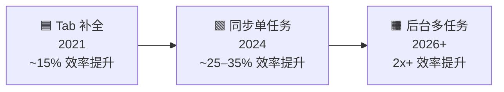
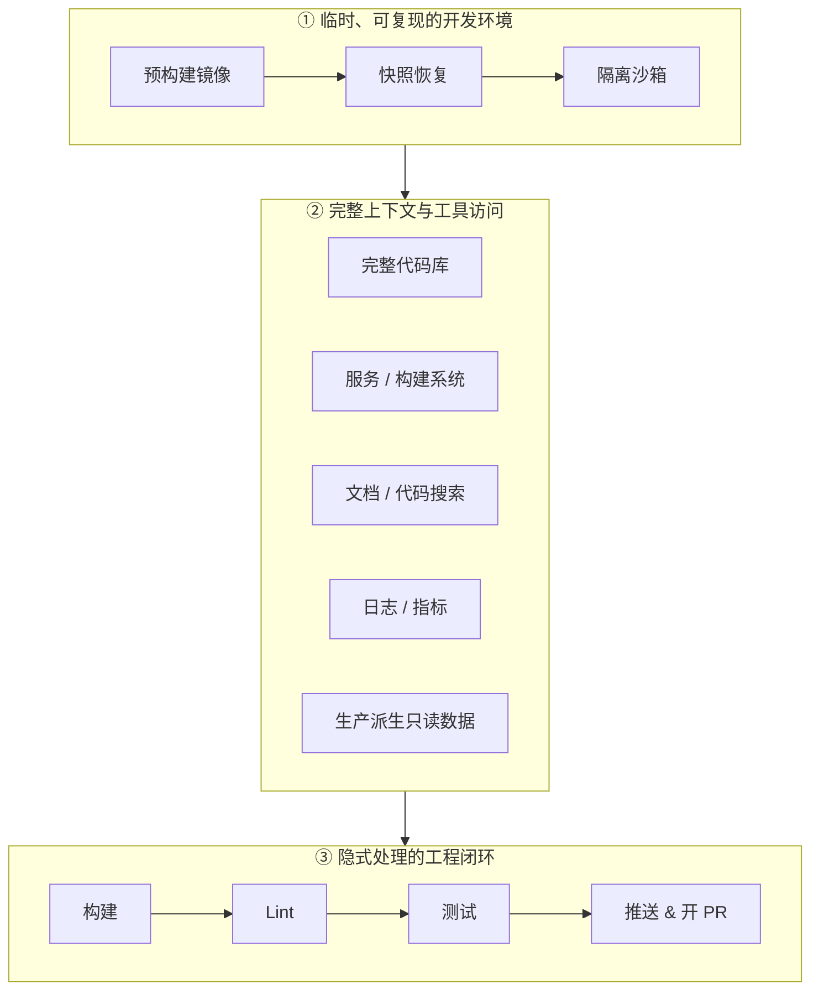
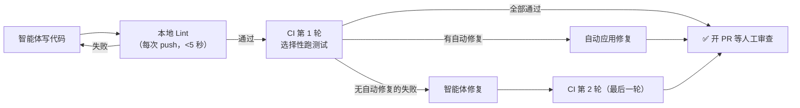
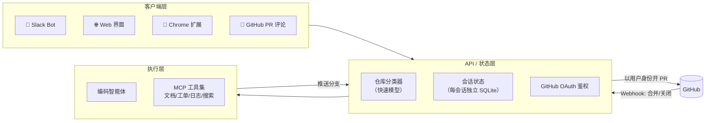
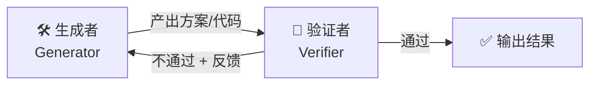
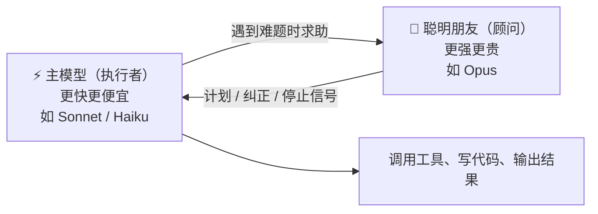
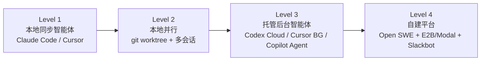

# 🤖 后台编码智能体（Background Coding Agents）学习文档

> **课程来源**：Stanford CS146S《The Modern Software Developer》Fall 2026 · Lecture 11/10（讲师 Mihail Eric）
> **扩展阅读**：Spotify Honk、Stripe Minions、Ramp Inspect、LangChain Open SWE、Claude Code Agent Teams、Anthropic Advisor 策略
> **适合人群**：已用过 Copilot / Cursor / Claude Code 等 AI 编码工具，想理解"下一阶段"AI 工程化的开发者

---

## 📑 目录

1. [一句话总览](#1-一句话总览)
2. [核心术语速查表](#2-核心术语速查表)
3. [演进脉络：从 Tab 补全到后台多任务](#3-演进脉络从-tab-补全到后台多任务)
4. [为什么需要后台智能体：本地开发的终结](#4-为什么需要后台智能体本地开发的终结)
5. [自建后台智能体平台：架构拆解](#5-自建后台智能体平台架构拆解)
6. [沙箱（Sandbox）：一切的地基](#6-沙箱sandbox一切的地基)
7. [以 Slackbot 为入口的系统架构](#7-以-slackbot-为入口的系统架构)
8. [工业界四大案例深度对比](#8-工业界四大案例深度对比)
9. [多智能体协作模式（Multi-Agent Patterns）](#9-多智能体协作模式multi-agent-patterns)
10. [元技能：如何驾驭多智能体](#10-元技能如何驾驭多智能体)
11. [挑战、风险与权衡](#11-挑战风险与权衡)
12. [动手实践路线图](#12-动手实践路线图)
13. [自测题与参考答案](#13-自测题与参考答案)
14. [参考资料](#14-参考资料)

---

## 1. 一句话总览

> 💡 **后台编码智能体 = 接收一个任务 → 自动启动一个"类生产"的开发环境 → 端到端完成全部工作流 → 交回一个可审查的 Pull Request。**

它的本质不是"更聪明的模型"，而是**工程基础设施 + 模型能力**的组合：把开发者从"一次盯一个 AI 会话"解放成"同时指挥十几个 AI 并行干活"。

本讲的三条主线：

| 主线 | 关键问题 | 核心结论 |
| --- | --- | --- |
| **Why** | 为什么要从本地走向云端后台？ | 可复现、可控、可无限并行 |
| **How** | 如何搭建这样一个平台？ | 沙箱 + 完整上下文 + 自动化反馈闭环 + 多入口客户端 |
| **Patterns** | 多个智能体如何协作？ | Agent Teams、Generator-Verifier、Primary + Smart Friend |

---

## 2. 核心术语速查表

> 先扫一遍，后文遇到时可回查。

| 术语 | 英文 | 通俗解释 |
| --- | --- | --- |
| **编码智能体** | Coding Agent | 能自主"读代码→改代码→跑命令→看结果→再改"循环执行的 AI 程序，而不只是一次性生成代码片段 |
| **后台智能体** | Background Agent | 在云端异步运行、无需人一直盯着的编码智能体，完成后通知你结果 |
| **同步 / 异步** | Synchronous / Asynchronous | 同步：你发指令后等它做完再继续；异步：发完就去忙别的，它在后台独立完成 |
| **无人值守** | Unattended | 中途不需要人批准或回答问题，一口气跑完 |
| **一次成功** | One-shot | 一次运行就产出可合并的结果，无需多轮人工修正 |
| **拉取请求** | Pull Request (PR) | 向代码仓库提交的"合并申请"，需经代码审查后才进入主分支 |
| **沙箱** | Sandbox | 一个隔离的、临时的运行环境，智能体在里面怎么折腾都不会影响真实系统 |
| **临时环境** | Ephemeral Environment | 用完即销毁的环境，每次都从干净状态启动 |
| **可复现** | Reproducible | 同样的输入在任何时候、任何机器上得到同样的环境与结果 |
| **快照** | Snapshot | 某一时刻文件系统/环境状态的"存档"，可随时恢复 |
| **预热** | Pre-warming / Warm Pool | 提前启动好一批环境放在"池子"里，用户请求时直接分配，省去冷启动时间 |
| **持续集成** | CI (Continuous Integration) | 每次提交代码自动构建、跑测试的流水线 |
| **代码检查** | Lint / Linter | 自动检查代码风格与常见错误的工具（如 ESLint、RuboCop） |
| **MCP** | Model Context Protocol | Anthropic 提出的开放协议，让 AI 用统一方式调用外部工具和数据源，可类比为"AI 的 USB 接口" |
| **上下文窗口** | Context Window | 模型一次能"看到"的最大文本量，超出就会遗忘 |
| **上下文工程** | Context Engineering | 精心挑选、组织喂给模型的信息，让它在有限窗口内拿到最关键的内容 |
| **LLM 评审** | LLM-as-a-Judge | 用一个大模型来评价另一个模型输出的质量 |
| **抽象语法树** | AST (Abstract Syntax Tree) | 代码被解析后的树状结构表示，传统自动重构工具基于它改代码 |
| **Git Worktree** | Git Worktree | Git 功能，同一仓库可同时检出多个工作目录，常被用来本地并行跑多个智能体 |
| **子智能体** | Subagent | 由主智能体派生出来、处理子任务后把结果汇报回来的智能体 |
| **首 Token 时间** | TTFT (Time To First Token) | 从发送请求到模型输出第一个字的延迟，衡量"响应快不快" |
| **左移** | Shift Left | 把检查/反馈尽量提前到开发流程的早期（如在本地 push 时就跑 lint，而非等 CI） |
| **舰队管理** | Fleet Management | Spotify 用语：对公司成千上万个代码仓库批量施加统一修改 |

---

## 3. 演进脉络：从 Tab 补全到后台多任务



| 阶段 | 代表产品 | 交互方式 | 人的角色 | 瓶颈 |
| --- | --- | --- | --- | --- |
| **① Tab 补全** (2021) | GitHub Copilot 早期 | 边打字边给下一行建议 | 写代码的人 | 只能补全局部，不懂全局意图 |
| **② 同步单任务** (2024) | Cursor Agent、Claude Code | 对话驱动，AI 改多个文件，人在旁边盯着 | 结对编程的"驾驶员" | **人的注意力**：一次只能盯一个会话 |
| **③ 后台多任务** (2026+) | Stripe Minions、Ramp Inspect | 发出任务即离开，后台并行执行，回来收 PR | **调度者 / 审查者** | **代码审查**成为新瓶颈 |

### 🔑 关键洞察

- **从①到②**是"AI 能力"的飞跃；**从②到③**主要是"**工程基础设施**"的飞跃——模型可能是同一个，但运行方式变了。
- 效率翻倍的来源是**并行（Parallelism）**：在异步环境里同时派出多个任务，产出 = 单任务效率 × 并发数。
- 讲师指出：我们**已经在"智能体代码审查"（Agentic Code Review）中见过这种模式**——PR 一提交，后台 AI 自动审查并留评论，人无需发起。

> 📌 Stripe 的原话很好地概括了动机："在我们最稀缺的资源是**开发者注意力**的世界里，无人值守的智能体让任务得以并行化。"[Stripe Minions]

---

## 4. 为什么需要后台智能体：本地开发的终结

讲义标题叫 **"End of Localhost"（本地主机的终结）**。核心论点有四：

### 4.1 告别依赖地狱（"在我电脑上能跑"）

- 传统痛点：新人入职配环境一两天，版本冲突、系统差异、缺少某个环境变量……
- 后台环境由**镜像（Image）**统一定义，所有人、所有智能体拿到的是完全一致的环境。

### 4.2 一切可复现、可控制

- 每个任务都从同一个干净快照启动 → 出了问题可以精准复现。
- 权限、网络、可访问的数据都由平台统一管控 → 安全团队可以放心。

### 4.3 测试在专用实例上完成

- 不再占用笔记本 CPU 跑庞大测试套件。
- Stripe 有 **300 万+** 个测试，不可能在本地全跑，只能由云端 CI 选择性执行。

### 4.4 "无限"并行

- 本地并行的天花板：笔记本性能、端口冲突、`git worktree` 的管理成本。
- 云端：每个任务一个独立 VM/容器，想开多少开多少。

> 📊 **对比：本地并行 vs 云端并行**
>
> | 维度 | 本地（worktree 方案） | 云端后台沙箱 |
> | --- | --- | --- |
> | 并发上限 | 受 CPU/内存/端口限制，通常 2–5 个 | 理论无上限 |
> | 环境一致性 | 依赖个人机器 | 统一镜像 |
> | 启动速度 | 需要安装依赖 | 预热快照，秒级启动（Stripe 约 10 秒） |
> | 笔记本是否需在线 | 必须 | 不需要，可合上电脑回家 |
> | 安全隔离 | 智能体可触及你的个人文件与凭据 | 与生产和互联网隔离 |

Ramp 的说法："当后台智能体足够快时，它们**严格优于本地**：同样的智能、更强的能力、无限的并发。"[Ramp Inspect]

---

## 5. 自建后台智能体平台：架构拆解

### 5.1 定义

> 一个能够**接收任务**、**启动类生产开发环境**、**端到端执行完整工作流**并**返回 PR** 的系统。

这已成为众多公司的流行趋势，头部团队**每周全自动产出 1000+ 个 PR**。

### 5.2 三大核心组件



#### ① 临时、可复现的开发环境（Ephemeral, Reproducible Dev Environment）

- 每个任务独享，用完销毁。
- 这是实现**大规模智能体并行**的关键。

#### ② 完整的上下文与工具访问

智能体需要拿到"一个真正的工程师在工位上能拿到的一切"：

| 资源 | 用途 | 案例 |
| --- | --- | --- |
| 完整代码库 | 理解现有实现 | Stripe：数亿行代码 |
| 服务 & 构建系统 | 实际运行和编译 | Ramp：Vite、Postgres、Temporal |
| 文档 & 代码搜索 | 查内部 API 用法 | Stripe 用 Sourcegraph |
| 日志 & 指标 | 定位线上问题、验证效果 | Ramp 接入 Sentry、Datadog |
| 生产派生（只读）数据 | 用真实数据形态验证 | 必须**只读**，防止误操作 |

> 💡 **Stripe 的设计哲学**："对人有益的，对 LLM 也有益。"——Minions 用的就是人类工程师同款工具链。
>
> 💡 **Ramp 的设计哲学**："智能体应该有能动性，所以 Inspect 永远不会被缺失的上下文或工具所限制，**只受模型智力本身的限制**。"

#### ③ 构建、Lint、测试、推送——隐式自动处理

- 这些步骤**不依赖智能体"记得去做"**，而是由平台用**确定性代码（Deterministic Code）**强制执行。
- Stripe 的做法：把"智能体循环"和"确定性步骤"**交错编排**，既保留 AI 的创造力，又保证必选步骤（如 lint）一定会执行。

### 5.3 自动化反馈闭环：以 Stripe 为例



**为什么 CI 最多只跑两轮？**
- CI 消耗 Token、算力和时间；
- 让 LLM 反复跑完整 CI 循环，**边际收益递减**；
- 原则："**通常一轮，最多两轮 CI——并且只在本地能修的都修完之后**。"

### 5.4 基础构件选型

讲义给出的起点：

| 方案 | 说明 |
| --- | --- |
| **[Coder](https://coder.com/)** | 自托管云开发环境平台，可作为沙箱的基础构件 |
| **[Gitpod](https://github.com/gitpod-io/gitpod)** | 曾经的热门选项（开源云 IDE 环境） |
| **[Open SWE](https://github.com/langchain-ai/open-swe)** | LangChain 开源的异步编码智能体框架，可直接参考整套实现 |

---

## 6. 沙箱（Sandbox）：一切的地基

### 6.1 主流沙箱提供商

| 提供商 | 特点（扩展说明） |
| --- | --- |
| **Coder** | 基于 Terraform 定义工作区，适合企业自托管，贴近"工程师的云端工位" |
| **Vercel Sandbox** | Vercel 提供的临时计算环境，适合运行不受信任的 AI 生成代码 |
| **Daytona** | 面向 AI 的开源开发环境管理，主打极速启动 |
| **E2B** | 专为 AI 智能体设计的云端代码执行沙箱，基于 Firecracker 微虚拟机 |
| **Modal** | Serverless AI 基础设施，沙箱近乎即时启动，支持文件系统快照（Ramp 选用） |

### 6.2 Ramp 的沙箱最佳实践（可直接借鉴）

**镜像与快照流水线：**

1. 每个代码仓库定义一个镜像，存入**镜像仓库（Image Registry）**；
2. **每 30 分钟重建一次镜像**：克隆仓库 → 安装依赖 → 执行初始构建；
3. 将完成状态保存为**快照**；
4. 会话启动时从快照恢复 → 代码最多落后 30 分钟，只需同步少量增量；
5. 智能体完成后**再拍一次快照**，用户追问时可从这里恢复。

**提速三板斧：**

| 技巧 | 做法 | 效果 |
| --- | --- | --- |
| **输入即预热** | 用户**开始打字时**就启动沙箱、拉取最新代码 | 用户按下回车时环境已就绪 |
| **先读后写** | 同步未完成时允许智能体**读文件**做调研，但**阻塞写入**直到同步完成 | 消除 git 同步带来的等待 |
| **能前移的都前移** | 把一切准备工作放进镜像构建阶段，甚至预先跑一遍应用和测试以生成缓存 | 构建再慢也无所谓，用户用的是上一版镜像 |

> 📌 Ramp 的目标：**会话速度只应受限于模型提供商的首 Token 时间（TTFT）**，其他一切都应提前完成。

### 6.3 智能体内核选择

| 公司 | 智能体内核 | 选择理由 |
| --- | --- | --- |
| Stripe | Fork 自 Block 的开源智能体 **goose** | 早期最广泛使用的编码智能体之一，可深度定制编排 |
| Ramp | **OpenCode**（开源） | 服务端优先架构、完整类型化 SDK、插件系统；智能体可直接读 OpenCode 源码理解自身行为 |
| Spotify | 自研内部 CLI 封装 | 可无缝切换不同智能体与 LLM，在快速变化的 GenAI 领域保持可插拔 |
| LangChain | **Deep Agents** + LangGraph | 提供规划、文件系统、Shell、技能和子智能体原语，LangGraph 负责持久化执行 |

> 💡 **共同点**：没有一家直接"拿来即用"现成的商业智能体，都选择**自己掌控编排层**——因为"它只需要在你自己的代码上工作"（Ramp）。

---

## 7. 以 Slackbot 为入口的系统架构

讲义专门讲了 **"Slackbot 架构"**——为什么是 Slack？因为**工程讨论本来就发生在那里**。在讨论问题的线程里 @机器人，就能把整个线程和其中链接作为上下文交给智能体。

### 7.1 整体架构图（综合 Ramp 规范）



### 7.2 关键设计要点

**① 仓库分类器（Repository Classifier）**
- 用户不该被迫记住"在哪个仓库干活"的语法。
- 把用户消息 + 线程上下文 + 频道名 + 所有仓库描述交给一个**快速模型**判断目标仓库。
- 必须包含 **"unknown"（未知）选项**，不确定时反问用户。

**② 状态同步与多人协作（Multiplayer）**
- Ramp 使用 **Cloudflare Durable Objects**：每个会话一个独立 SQLite 数据库，数百个并行会话互不干扰。
- 任何人都能加入同一个会话，每条触发代码变更的提示都**归属到具体作者**。
- 用途：教产品/设计同学使用 AI；团队实时 QA；审查别人的 PR 时直接让 AI 改。

**③ 以用户身份开 PR（安全关键！）**
- ❌ 错误做法：用机器人 App 身份开 PR → 任何人都能**自己批准自己的改动**。
- ✅ 正确做法：用 GitHub 认证拿到用户 Token，**以发起人身份**开 PR → 必须由另一个人审查。

**④ 清晰的状态反馈**
- 给智能体一个"发 Slack 消息"的工具，在关键节点汇报进度。
- 用 Block Kit 设计美观布局，明确区分"进行中"与"已完成"。

**⑤ 病毒式传播循环（Virality Loop）**
- 在公共频道使用 → 同事看到 → 学会使用 → 更多人使用。
- Ramp 没有强制任何人使用，几个月内就达到**约 30% 的合并 PR 由 Inspect 编写**。

### 7.3 Spotify 的两段式交互

Spotify 把入口拆成两个智能体：

1. **交互式工作流智能体**：在 Slack/GitHub 中与用户对话，收集任务信息，生成高质量提示词；
2. **后台编码智能体**：接收提示词，独立产出 PR。

> 好处：把"澄清需求"和"执行任务"解耦，后台智能体拿到的永远是一个**清晰、完整的任务描述**。

---

## 8. 工业界四大案例深度对比

| 维度 | 🎵 Spotify **Honk** | 💳 Stripe **Minions** | 🟨 Ramp **Inspect** | 🦜 LangChain **Open SWE / Robin** |
| --- | --- | --- | --- | --- |
| **起源场景** | 大规模代码迁移（Fleet Management） | 无人值守的日常工程任务 | 全栈开发 + 视觉验证 | 开源通用框架 |
| **规模数据** | 1,500+ 合并 PR；迁移节省 60–90% 时间 | 每周 1,000+ 合并 PR，零人写代码 | ~30% 合并 PR 由其编写 | GitHub 1.1 万+ Star |
| **入口** | Slack、GitHub Enterprise（经 MCP 暴露） | Slack 为主，CLI、Web、内部工具（工单、文档、特性开关平台） | Slack、Web、Chrome 扩展、PR、Web VS Code、语音 | Dashboard、GitHub Issue/PR、Slack、Linear |
| **运行环境** | 容器化作业环境 | 预热 devbox，10 秒启动，隔离生产与互联网 | Modal 沙箱 VM + 快照 | 每线程持久 Linux 沙箱（默认 LangSmith） |
| **智能体内核** | 自研 CLI，可切换智能体/LLM | Fork 的 goose | OpenCode | Deep Agents + LangGraph |
| **工具接入** | 本地 MCP（格式化、Lint） | 中央 MCP 服务 **Toolshed**，400+ 工具 | Sentry、Datadog、LaunchDarkly、Buildkite 等 | 分层 MCP（实例/工作区/个人） |
| **质量保障** | LLM-as-Judge 评估 diff；MLflow 追踪 | 本地 Lint → 最多两轮 CI → 自动修复 | 跑测试、看遥测、截图视觉验证 | Planner + Reviewer 多智能体；`/baby-sit` 监控 CI |
| **独特亮点** | 把确定性 AST 脚本换成自然语言提示 | "Shift Left" 反馈；规则按子目录条件加载 | 多人协作会话；智能体可自己派生子会话 | 开源、可自部署；学习仓库特定审查偏好 |

### 8.1 Spotify：从"写转换脚本"到"写提示词"

- **背景**：Fleet Management 自 2024 年中起已自动化了 Spotify **约一半的 PR**，但只适用于简单任务（升级依赖、改配置、替换废弃方法）。
- **痛点**：复杂改动需要操作 AST 或正则，门槛极高——一个 Maven 依赖升级脚本竟膨胀到 **2 万多行代码**。
- **解法**：只替换"代码转换"这一环为 AI 智能体，**周边基础设施（选仓库、开 PR、审查、合并）完全不变**。
- **已攻克的复杂任务**：Java 值类型改 records、Scio 破坏性升级、Backstage 前端系统迁移、遵循 schema 的 YAML/JSON 配置修改。

> 🎯 **启示**：引入 AI 不必推倒重来，**找到流程中最需要帮助的那一环**替换即可。

### 8.2 Stripe：在高风险代码库中做到"一次成功"

- **挑战**：数亿行代码、Ruby + Sorbet（少见技术栈）、大量自研库（LLM 不熟悉）、每年处理**超 1 万亿美元**支付量。
- **关键手段**：
  - **条件化规则**：智能体规则文件按子目录生效，避免把所有规则塞进上下文；
  - **上下文预填充（Hydrate）**：运行前**确定性地**对消息中的链接调用相关 MCP 工具，提前拉取上下文；
  - **不完美也有价值**：即使不完全正确，也常是工程师专注工作的绝佳起点。

### 8.3 Ramp：把验证闭环做到极致

- **后端**：跑测试、查遥测、查特性开关；**前端**：视觉验证，给用户截图和实时预览。
- **智能体派生会话**：给智能体"启动新会话"和"查询会话状态"两个工具，让它自己拆分大任务或跨仓库调研。
- **最重要的指标**：**会话 → 合并 PR 的转化率**——合并意味着真正产生了价值。

### 8.4 Open SWE：开源参考实现

- 工作流：`Issue/对话/PR/定时任务 → 规划与调研 → 隔离沙箱中实现 → 验证并交付 PR → 审查/CI/反馈 → 后续工作`
- 多智能体架构：**Planner（规划者）** 先研究代码库形成策略，**Programmer** 写代码，**Reviewer（审查者）** 检查错误、跑测试和格式化器后才开 PR。
- 人在回路（Human-in-the-loop）：生成计划后可中断，让人接受/编辑/删除计划。
- ⚠️ 安全提醒（官方 README）：沙箱拥有强大工具且可能联网，应使用**最小权限凭据**，限制可访问的仓库与集成。

---

## 9. 多智能体协作模式（Multi-Agent Patterns）

当单个智能体不够用时，就需要让多个智能体分工协作。讲义介绍了三种模式：

### 9.1 模式一：智能体团队（Agent Teams）

**定义**（Claude Code 实验性功能）：协调多个 Claude Code 实例协作。一个会话担任**团队负责人（Team Lead）**，负责分配任务、汇总结果；**队友（Teammates）**各自拥有独立上下文窗口，并且**可以直接相互通信**。

**架构组成：**

| 组件 | 作用 |
| --- | --- |
| **Team Lead** | 主会话，派生队友并协调工作 |
| **Teammates** | 独立的智能体实例，各自执行任务 |
| **Task List** | 共享任务列表（待办 / 进行中 / 已完成），支持任务依赖 |
| **Mailbox** | 智能体之间的消息系统 |

**讲义中的两个经典用例：**

> 🔬 **用例 A：科学辩论式排障**
> "用户反馈应用发一条消息后就退出而不是保持连接。派出 5 个队友调查不同假设，让他们互相交流、**试图推翻彼此的理论**，像科学辩论一样。把达成的共识更新到调查文档中。"

> 🔍 **用例 B：多视角代码审查**
> "创建一个团队审查 PR #142，派出三个审查者：① 专注安全影响 ② 检查性能影响 ③ 验证测试覆盖率。各自审查并汇报发现。"

**Agent Teams vs 子智能体（Subagents）：**

| | 子智能体 | 智能体团队 |
| --- | --- | --- |
| 通信 | 只把结果返回给调用者 | 队友之间直接对话 |
| 协调 | 主智能体管理一切 | 通过消息 + 共享任务列表自我协调 |
| 适用 | 只关心结果的聚焦任务 | 需要讨论、互相挑战的复杂工作 |
| Token 成本 | 较低 | **较高**（每个队友都是独立实例） |

**何时用 / 何时不用：**
- ✅ 适合：并行研究与审查、各自负责独立模块、竞争假设式调试、跨前后端+测试的协同变更
- ❌ 不适合：顺序依赖强的任务、多人改同一个文件、依赖关系复杂的工作
- 📏 官方建议：**大多数场景从 3–5 个队友开始**；15 个独立任务配 3 个队友就是不错的起点。

> 💡 **为什么"辩论"有效？** 单个模型容易陷入**确认偏差（Confirmation Bias）**——找到一个看似合理的解释就停下。多个智能体互相"挑刺"，能更快排除错误假设。

### 9.2 模式二：生成者-验证者（Generator-Verifier）



- **思想**：一个智能体负责"做"，另一个负责"检查"，循环直至通过。
- **为什么有效**：**验证通常比生成容易**（判断一段代码是否正确，比从零写出正确代码简单）。拆开后各自专注，且验证者不受生成过程中"自我说服"的影响。
- Anthropic 在《Building Effective Agents》中称之为 **Evaluator-Optimizer（评估者-优化者）** 工作流。
- **验证者的形态**：
  - 确定性验证：编译器、测试、Linter（最可靠）
  - LLM 验证：LLM-as-a-Judge（如 Spotify 用 LLM 评估 diff）
  - 混合：Open SWE 的 Reviewer 既跑测试又做反思
- **对应案例**：Stripe 的 "本地 Lint + CI" 就是一种以确定性工具为验证者的 Generator-Verifier 闭环。

### 9.3 模式三：主模型 + 聪明朋友（Primary Model with Smart Friend）



- **思想**：大部分轮次是机械操作（读文件、跑命令、改代码），只有少数关键决策需要强推理（选架构、走出死胡同、判断是否真正完成）。让**便宜的模型主导执行**，只在关键时刻**咨询强模型**。
- **工业实现**：Anthropic 的 **Advisor Tool / Advisor Strategy**——执行者模型在生成中途调用顾问模型，顾问读取完整上下文后返回策略指导，**顾问从不调用工具、也不直接输出给用户**。
- **效果数据**（Anthropic 官方）：Sonnet + Opus 顾问在 SWE-bench Multilingual 上比 Sonnet 单独高 **2.7 个百分点**，同时每个智能体任务成本**降低 11.9%**。
- **与常见"编排者-工人"模式的区别**：

| | 编排者-工人（Orchestrator-Workers） | 主模型 + 聪明朋友（Advisor） |
| --- | --- | --- |
| 谁主导 | 大模型拆解任务，派给小模型 | **小模型主导**，按需向上求助 |
| 编排逻辑 | 需要任务分解、工人池 | 无需分解，无需编排 |
| 成本特征 | 大模型全程参与 | 大模型只在关键时刻参与 |

- **何时该求助**：反复遇到同一错误、做出影响深远的架构决策前、宣布"完成"前。

> 🧩 **三种模式的一句话区分**
> - **Agent Teams**：横向分工，多人并行 + 互相讨论
> - **Generator-Verifier**：纵向把关，一个做一个查
> - **Primary + Smart Friend**：能力分层，平时自己干，难时问高手

---

## 10. 元技能：如何驾驭多智能体

> 讲义的核心观点：**当 AI 能并行干活时，人的价值转向"调度"和"审查"。** 以下是新时代开发者需要刻意练习的元技能（Meta Skills）。

### 10.1 委派与多线程（Delegation & Multi-threading）

- 像技术负责人带团队一样思考：**哪些活可以交出去？哪些必须自己做？**
- 同时维持多条任务线，而不是串行等待。

### 10.2 规划、界定范围、架构设计（Planning, Scoping, Architecting）

- **保持对任务的控制与上下文**：你是唯一掌握全局的人，智能体只看得到它的那一块。
- **开工前花时间判断任务复杂度**：
  - 简单、边界清晰 → 直接丢给后台智能体一次搞定
  - 复杂、模糊 → 先规划拆解，或自己同步参与
- **规划窗口 + 快速任务窗口**：
  - 开一个窗口专门与 AI 深度规划（同步、高注意力）
  - 其余窗口派发小而明确的任务（异步、低注意力）

### 10.3 阅读代码与计划（Code/Plan Reading）

> ⚠️ **代码审查是新的瓶颈（Code review is the new bottleneck）**

- 智能体每周能产出上千 PR，但每个 PR 仍需人审。
- 需要提升的能力：
  - **快速读懂陌生代码**的能力
  - **审查计划**而非只审查代码——在动手前纠偏成本最低
  - 借助 AI 辅助审查（如多视角审查团队）减轻负担

### 10.4 循序渐进地扩展智能体数量

- **不要第一天就开 20 个**。先 1 个 → 熟练后 2–3 个 → 逐步增加。
- 每增加一个，你的审查和协调负担也在增加；找到自己的"最佳并发数"。

### 10.5 写好任务描述（扩展）

后台智能体是"一次性"执行的，**提示词质量决定成败**。一个好的任务描述应包含：

```text
【目标】要达成什么结果（而非怎么做）
【范围】涉及哪些模块/文件，明确不要动什么
【验收标准】怎样算完成：哪些测试要通过、行为如何变化
【上下文】相关工单、文档链接、讨论线程
【约束】性能、兼容性、代码风格等要求
```

---

## 11. 挑战、风险与权衡

| 挑战 | 具体表现 | 应对思路 |
| --- | --- | --- |
| **性能** | 智能体运行时间长 | 预热沙箱、镜像预构建、读写分离同步 |
| **可预测性** | 输出不稳定、质量参差 | 确定性步骤强制执行、反馈闭环、LLM-as-Judge |
| **安全** | 智能体拥有强大权限 | 沙箱隔离（隔离生产与互联网）、最小权限凭据、只读生产数据、以用户身份开 PR |
| **成本** | 大规模运行 LLM 开销巨大 | 限制 CI 轮数、Advisor 模式分层用模型、统一管理 LLM 配额 |
| **审查瓶颈** | PR 太多审不过来 | AI 辅助审查、小 PR 快速通道、提升审查技能 |
| **上下文局限** | 不熟悉内部库和约定 | 条件化规则文件、MCP 工具、上下文预填充 |

> 📌 Spotify 坦言："我们还没有所有答案"——后续研究重点是**有效的上下文工程**和**用反馈循环获得更可预测的结果**。

---

## 12. 动手实践路线图



**建议练习：**

1. **体验后台模式**：用任意托管后台智能体，从 GitHub Issue 发起一个小任务，观察它如何独立产出 PR。
2. **尝试 Agent Teams**：在 Claude Code 中设置 `CLAUDE_CODE_EXPERIMENTAL_AGENT_TEAMS=1`，复现讲义里的"三视角 PR 审查"用例。
3. **搭建最小原型**：
   - 选一个沙箱（E2B / Modal / Daytona）
   - 接入开源智能体（OpenCode 或 Open SWE）
   - 写一个最简单的 Slack 机器人：收到消息 → 启动沙箱 → 运行智能体 → 推送分支 → 开 PR
4. **度量**：记录"任务 → 合并 PR"转化率，持续优化。

---

## 13. 自测题与参考答案

<details>
<summary><b>Q1：从"同步单任务"到"后台多任务"，效率提升主要来自哪里？</b></summary>

主要来自**并行化**而非模型变聪明。异步环境中可同时派发多个任务，把瓶颈从"人的注意力"中解放出来；其底层依赖的是可复现、可无限扩展的云端沙箱基础设施。
</details>

<details>
<summary><b>Q2：一个后台智能体平台的三大核心组件是什么？</b></summary>

① 临时、可复现的开发环境；② 对完整代码库、服务、构建系统、文档、代码搜索、日志、指标及只读生产派生数据的访问；③ 隐式自动处理构建、Lint、测试和推送。
</details>

<details>
<summary><b>Q3：为什么 PR 应该以用户身份而不是机器人身份创建？</b></summary>

若以机器人 App 身份创建，发起任务的用户就可以自己批准该 PR，从而绕过"另一人审查"的机制，形成未审代码进入代码库的漏洞。
</details>

<details>
<summary><b>Q4：Stripe 为什么限制 CI 最多两轮？</b></summary>

CI 消耗 Token、算力和时间，让 LLM 多轮运行完整 CI 的边际收益递减；应先把本地能修的都修完（Shift Left），再用一到两轮 CI 收尾。
</details>

<details>
<summary><b>Q5：Agent Teams 与 Subagents 的最大区别？</b></summary>

子智能体只向调用者返回结果，由主智能体统一管理；智能体团队中的队友可直接相互通信、共享任务列表并自我协调，适合需要讨论和互相挑战的工作，但 Token 成本更高。
</details>

<details>
<summary><b>Q6："主模型 + 聪明朋友"模式为什么能同时提升效果、降低成本？</b></summary>

大多数轮次是机械操作，由便宜的执行者模型完成；只有少数关键决策才咨询强模型。这样强模型的推理能力只用在刀刃上，整体成本接近小模型，而关键决策质量接近大模型。
</details>

<details>
<summary><b>Q7：为什么说"代码审查是新的瓶颈"？你会如何应对？</b></summary>

智能体产出速度远超人类审查速度。应对：审查计划而非只审代码、使用 AI 多视角辅助审查、拆小 PR、提升快速阅读代码的能力、循序渐进增加并发智能体数量。
</details>

---

## 14. 参考资料

**课程**
- Stanford CS146S: The Modern Software Developer — https://themodernsoftware.dev

**工业案例**
- Spotify Engineering：*1,500+ PRs Later: Spotify's Journey with Our Background Coding Agent (Honk, Part 1)* — https://engineering.atspotify.com/2025/11/spotifys-background-coding-agent-part-1
- Stripe：*Minions: Stripe's one-shot, end-to-end coding agents* — https://stripe.dev/blog/minions-stripes-one-shot-end-to-end-coding-agents
- Ramp Builders：*Why We Built Our Own Background Agent* — https://builders.ramp.com/post/why-we-built-our-background-agent
- LangChain：*open-swe*（现名 Robin） — https://github.com/langchain-ai/open-swe
- LangChain Blog：*Introducing Open SWE* — https://blog.langchain.com/introducing-open-swe-an-open-source-asynchronous-coding-agent

**多智能体模式**
- Claude Code Docs：*Orchestrate teams of Claude Code sessions* — https://code.claude.com/docs/en/agent-teams
- Anthropic：*The advisor strategy* — https://claude.com/resources/articles/the-advisor-strategy
- Anthropic Docs：*Advisor tool* — https://platform.claude.com/docs/en/agents-and-tools/tool-use/advisor-tool
- Anthropic Engineering：*Building Effective Agents* — https://www.anthropic.com/engineering/building-effective-agents

**沙箱与基础设施**
- Coder — https://coder.com ｜ Gitpod — https://github.com/gitpod-io/gitpod
- E2B — https://e2b.dev ｜ Modal — https://modal.com ｜ Daytona — https://daytona.io ｜ Vercel Sandbox — https://vercel.com/docs/vercel-sandbox

---

> ✍️ **一句话复盘**：未来的开发者不再是"写代码最快的人"，而是**最会拆任务、给上下文、审结果、调度一群 AI 的人**。
