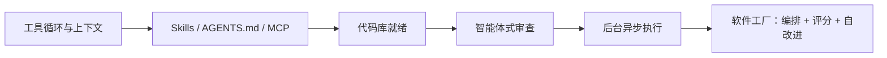
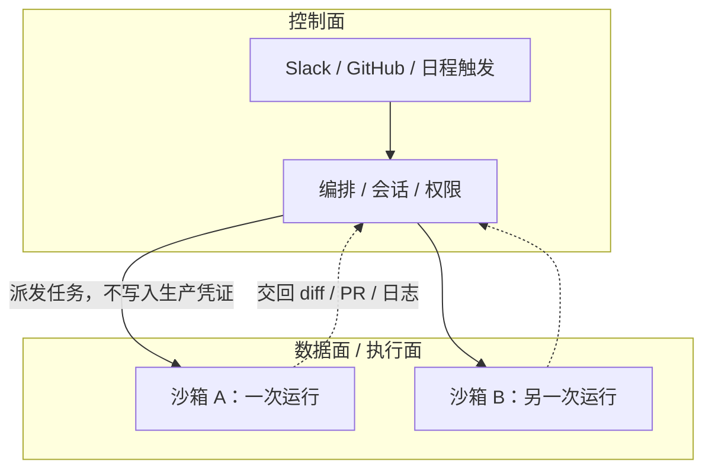
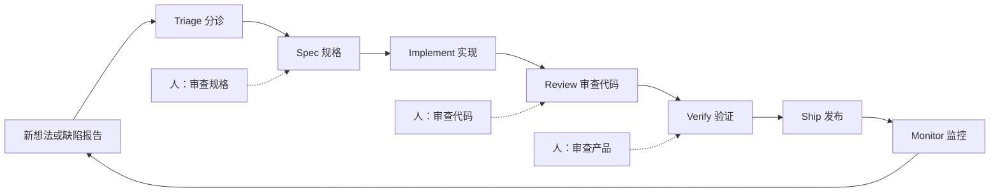
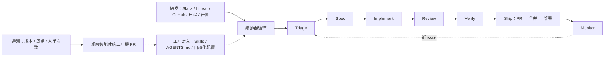
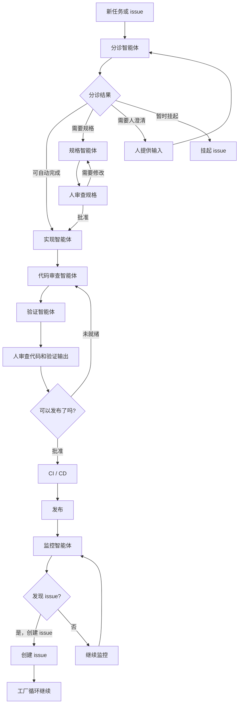
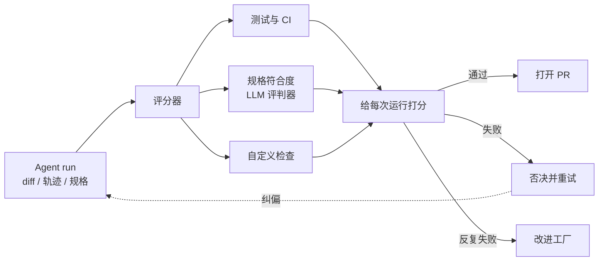
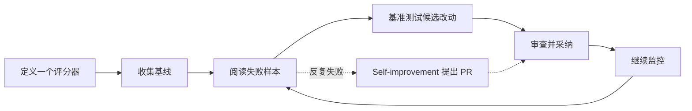
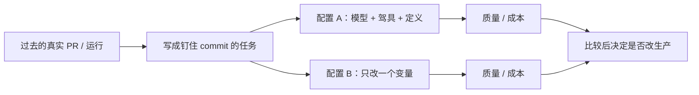
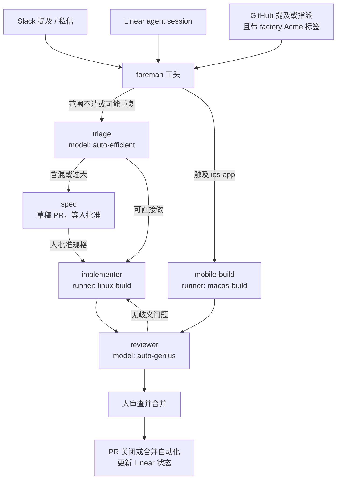

# 软件工厂（The Software Factory）：用后台智能体把软件交付变成可度量、可改进的流水线

> **Stanford CS146S · The Modern Software Developer · Fall 2026 学习文档**
>
> - **主题**：软件工厂（software factory）——把已经学过的编码智能体、代码库就绪、智能体式代码审查和后台智能体，焊成一条可编排、可评分、可改进的云端交付流水线
> - **课程与主讲**：[CS146S](https://themodernsoftware.dev)，Mihail Eric，Stanford University，2026 年秋季
> - **核心来源**：本讲 17 页课件《The Software Factory》（含讲者备注）；课件未印上课日期。[课程官网的 Fall 2026 Syllabus](https://themodernsoftware.dev/) 将本讲列在第 9 周周二（2026-11-17），同周周四（11 月 19 日）是 Michele Catasta 的嘉宾课。
> - **概况性补充**（按课程要求，只取关键概念，不是对每个页面的摘抄）：[WarpBench](https://www.warp.dev/factories/benchmarks/warpbench)、[warp-factory-examples / 02-sdlc-issue-to-pr](https://github.com/warpdotdev/warp-factory-examples/tree/main/examples/02-sdlc-issue-to-pr)、[OpenInspect / Background Agents](https://openinspect.dev/)、[software-factory.dev](https://www.software-factory.dev)
> - **权威扩展**：课件讲者备注引用的 [Warp 工厂落地与 crawl-walk-run 博客](https://www.warp.dev/blog/rolling-out-software-factories)、[Spotify Honk 第三篇](https://engineering.atspotify.com/2025/12/feedback-loops-background-coding-agents-part-3)、[Warp 工厂即代码文档](https://docs.warp.dev/factories/factory-as-code/)
> - **适合读者**：已学过编码智能体、后台智能体和智能体式代码审查的软件工程同学（不必再从「Agent 是什么」学起）
> - **建议用时**：通读约 4–5 小时。时间紧时，先走文首的「有限时间路径」，不必按页码从头抄一遍。

**标记约定**

| 标记 | 含义 |
|---|---|
| 📎 | 课件之外、经检索核对的扩展，并标明来源 |
| （示例） | 讲解用的演示数据或演示规模，不是某篇论文或某家公司的实测结果 |
| 💡 / ⚠️ / 📌 | 要点、易错、章末小结 |
| ⭐ / 🔹 / ▫️ | 只出现在下面这张优先级地图里，用来安排阅读顺序，不是给每一节另打一套分数 |

文中的数字若来自公司博客或产品页，一律视为**自评的内部数据**，并标出文章日期；同一指标在不同文章里出现过不一致时，只把它当作趋势，不把某一个数字写成「标准答案」。

### 优先级地图与有限时间路径

| 标记 | 含义 | 建议 |
|---|---|---|
| ⭐ 核心必学 | 没有它就画不出工厂，也算不清一次交付好不好 | 精读，能用自己的话复述，并能走通文中的例子 |
| 🔹 重要理解 | 把原则接到真实配置或引入策略上 | 通读，弄清「为什么这样设计」 |
| ▫️ 了解即可 | 公开案例、后勤与术语备查 | 浏览，用到时再查 |

| 优先级 | 章节 |
|---|---|
| ⭐ | 第 1–2 章（为何需要工厂、三条定义），第 5–6 章（解剖图与一条任务怎么走），第 8–11 章（人的位置、评判器、私有基准、指标） |
| 🔹 | 第 3 章（开工前提），第 7 章（先自动化什么），第 12–13 章（工厂即代码与 crawl-walk-run） |
| ▫️ | 第 0 章的课表背景，第 14 章两则公开实践，第 15 章术语表与勘误 |

**如果时间有限：** 约 90 分钟内，按「第 2 章 → 第 5–6 章 → 第 9–11 章」走一遍，再花 20 分钟看第 12 章的 `factory.yaml` 走查。第 8 章四条人事原则很短，建议顺手读完。其余章节用对比表和术语表补洞即可。

---

## 学习目标

学完以后，你应能独立做到下面五件事：

1. 用自己的话说明软件工厂的三个构成——生产线（production line）、质量控制（quality control）、反馈回路（feedback loop）——并分清人在环内（in the loop）和人在环上（on the loop）。
2. 画出从触发到监控的闭环，指出人守的三道门（批准规格、按风险审查、产品验收），以及「监控产生新问题」和「观察智能体改进工厂定义」两条回路。
3. 解释为什么要用自己的历史任务做私有基准（private benchmark），而不是只看 SWE-bench、Terminal-Bench 这类公开基准；并能说出密闭重放（hermetic replay）要固定哪些东西。
4. 会计算并解释四项工厂指标：单次拉取请求（pull request，PR）成本、周期时间（cycle time）、每次 PR 的人手次数（human touches）、经工厂合并的 PR 占比；知道主指标不该是代码行数或 token 数。
5. 对比「科学怪人」（Frankenstein）拼装和「工厂即代码」（factory as code / infrastructure-as-code）两种建厂方式，并能对着公开的 issue-to-PR 示例，说明工头（foreman）如何把任务路由到分诊、规格、实现和审查。

---

## 目录

- [第 0 章 前置知识与本讲在课程中的位置](#第-0-章-前置知识与本讲在课程中的位置)
- [第 1 章 为什么现在要谈软件工厂](#第-1-章-为什么现在要谈软件工厂)
- [第 2 章 软件工厂是什么：三条定义，一个角色转变](#第-2-章-软件工厂是什么三条定义一个角色转变)
- [第 3 章 开工之前要具备什么](#第-3-章-开工之前要具备什么)
- [第 4 章 一张图看懂云端工厂闭环](#第-4-章-一张图看懂云端工厂闭环)
- [第 5 章 工厂解剖：编排、沙箱、验证和两条虚线](#第-5-章-工厂解剖编排沙箱验证和两条虚线)
- [第 6 章 一条任务如何走完全流程](#第-6-章-一条任务如何走完全流程)
- [第 7 章 工厂里先自动化哪些工作](#第-7-章-工厂里先自动化哪些工作)
- [第 8 章 人在工厂里做什么](#第-8-章-人在工厂里做什么)
- [第 9 章 评判器给每一次运行打分](#第-9-章-评判器给每一次运行打分)
- [第 10 章 用自己的历史做基准，而不是用别人的考卷](#第-10-章-用自己的历史做基准而不是用别人的考卷)
- [第 11 章 工厂该看哪些指标（以及不该看哪些）](#第-11-章-工厂该看哪些指标以及不该看哪些)
- [第 12 章 两种建厂方式，再对照一条公开的 issue-to-PR 流水线](#第-12-章-两种建厂方式再对照一条公开的-issue-to-pr-流水线)
- [第 13 章 爬、走、跑：怎样把工厂引进团队](#第-13-章-爬走跑怎样把工厂引进团队)
- [第 14 章 两则公开实践：持续自驾的代码库，与面向全员的后台智能体](#第-14-章-两则公开实践持续自驾的代码库与面向全员的后台智能体)
- [第 15 章 总对比、术语表、参考文献与质检说明](#第-15-章-总对比术语表参考文献与质检说明)

---

## 第 0 章 前置知识与本讲在课程中的位置

**本章要解决的问题：** 这节课是不是「再讲一遍后台 Agent」？它和你已经学过的代码审查、常驻/后台智能体是什么关系？

### 0.1 先建立直觉

可以把前几讲看成「零件」，本讲看成「把零件装成车间」。

你已经知道：单个编码智能体（coding agent）能在一个循环里读代码、改文件、跑测试；代码库就绪（agent readiness）决定它能不能自己把环境拉起来并验证改动；智能体式代码审查（agentic code review）决定输出会不会被另一双「眼睛」检查；后台智能体（background agent）则让任务不必盯在本地终端里同步完成。

本讲问的是下一问：若任务从 issue、Slack、告警里源源不断进来，怎样让**一队**云端后台智能体在隔离环境里接活、做活、交 PR，并且用统一标准验收，再把漏掉的缺陷写回文档、技能（skill）或检查规则，让缺陷率随时间下降？

课件把这个系统叫做软件工厂。

### 0.2 和前几讲的概念线

不必在这里重学下列内容，遇到时请回到已有笔记：

- 智能体的工具循环、系统提示词和上下文工程
- Agent Skills、`AGENTS.md` / 规则文件、MCP（Model Context Protocol，模型上下文协议）工具
- 代码库就绪：可运行、可验证、文档和测试是否跟得上无人值守的执行
- 智能体式代码审查：审查的是 diff，要有工具去核对调用方、测试和意图，而不是把 diff 贴进一次对话里问「有没有 bug」
- 后台 / 常驻智能体：人同步计划、智能体异步执行

本讲新增的，是把这些零件放进**同一条可度量的流水线**：统一的工厂定义（factory definition）、分阶段的智能体、人只守关键门、每次运行都打分，并且用自己的历史任务做基准，反向改进模型搭配和工厂配置。

没有这条线，前面几讲会停在「我有一个很强的助手」：审查是一次性的，后台任务是一次性的，改进也停留在某个人的提示词里。工厂要解决的是：同样的失败下周还会不会再出现，以及团队能不能共同改进那份工艺，而不是各自收藏一套私有技巧。



> 📎 扩展
> 课程主页把 software factory 写进了课程目标：学生应能「把软件工厂原则用到以更高速度和规模构建并演进软件」。见 [themodernsoftware.dev](https://themodernsoftware.dev)。公开课表曾把主题写作 “The Software Factory: self-running, self-improving systems”。课件正文用的是更短的标题 “The Software Factory”，强调的也是「自运行 + 自改进」，但没有在幻灯片上重复后半句。

### 0.3 本讲课件覆盖了什么

17 页幻灯片的结构可以记成四段：

| 页码 | 内容 | 类型 |
|---|---|---|
| 1–2 | 课程封面与后勤（作业 6、周四嘉宾课地点与讲者） | 文字 |
| 3–6 | 标题、Why、定义、开工前提 | 文字 |
| 7–9、12–13 | 闭环图、工厂解剖图、任务流程图、评判器流程图、私有基准图 | **图为主**，文字提取不全，需读图 |
| 10–11、14–16 | 适合工厂的任务、人的职责、指标、两种模式、crawl-walk-run | 文字 |
| 17 | Questions? | 结束页 |

第 9 页几乎没有标题，是一张从上到下的流程图；讲者备注给出了逐步说明，并指向一张 X 上的原图来源。第 7、8、12、13 页的细节都在图里，本文按渲染后的幻灯片和图注还原，不补充课件没有的框。

### 📌 本章小结

- 本讲是 CS146S 把「单个会写代码的智能体」升级为「可编排、可验收、可改进的交付系统」的一课。
- 读后续各章时，把已学过的审查、就绪和后台执行当作默认背景，把注意力放在流水线、门禁、指标和改进回路上。

<details>
<summary>自测 0.1：为什么「让一个后台 Agent 通宵改 bug、早上交 PR」还不算软件工厂？</summary>

因为这只具备生产线的一截：有输入、有隔离环境、有一份 PR。工厂还要求：对所有产物用同一套质量控制（测试、静态分析、CI、AI 审查），并且在缺陷漏过时把原因写回文档、技能或规则，使以后同类缺陷变少。没有统一标准和反馈回路，它只是一次成功的后台任务。
</details>

---

## 第 1 章 为什么现在要谈软件工厂

**本章要解决的问题：** 编码智能体已经很强了，为什么还要再引入「工厂」这个词？人从环内走到环上，到底改变了什么？

### 1.1 先建立直觉

想象一条汽车装配线。早期每辆车都是工匠围着转，人既做决策也动手；后来标准工序稳定了，人转向设计工艺、抽检质量和处理异常，日常装配交给流水线和质量控制。

课件的 Why 页给出两句判断：

- 编码智能体已经足够好，我们正在走向一种新工作方式：人在环上编排软件任务，而不是在环内一步步执行。
- 大多数软件工作形态相对可预测，所以这是自动化工作流的下一步。

「相对可预测」不是说需求不会变，而是说交付动作会反复出现：接到一个问题，弄清范围，写出改动，审查，验证，合并，观察上线后的信号。正因为格式稳定，才值得把它做成流水线，而不是每次从空白聊天窗口重来。

### 1.2 两个位置：in the loop 与 on the loop

这两个短语是本讲的第一对关键词。

- **人在环内（in the loop）**：智能体的每一步（或几乎每一步）都等人点头。人是执行链上的工位，延迟和上下文切换都由人承担。
- **人在环上（on the loop）**：流水线自己运转，人在关键门禁处介入——批准规格、按风险审查、对产品做最终判断，并对上线结果负责。人不再是默认的「下一行代码作者」。

> 📎 扩展
> 「从 in the loop 走到 on the loop」这个说法，在 [software-factory.dev](https://www.software-factory.dev) 第 4 场直播摘要里也明确出现：Ona 的 Lou 用它来讨论合规的自动批准。课件把它当作本讲的出发点，而不是某一家产品的广告语。关键不在口号，而在：哪些步骤可以默认自动走完，哪些步骤必须停下来等人。

### 1.3 不要把「工厂」听成「全自动、无人负责」

Why 页没有许诺零人工。后面的定义页、解剖图和「人做什么」页会反复收回这个误解：工厂的目标是提高交付的质量、速度和效率，不是把责任从人身上卸走。

> ⚠️ 易错
> 「可预测的工作格式」很容易被听成「需求已经写死」。课件说的是交付动作的格式（issue → 改动 → PR → 验证 → 监控），不是产品方向不会变。方向、取舍和品味仍然是人的工作；工厂只是让这些判断不必再夹在每一行代码中间。

### 📌 本章小结

- 工厂出现的前提是：智能体已经能完成大量可预测的交付动作，人值得从执行位退到编排位和治理位。
- in the loop 与 on the loop 的差别，是人出现的频率和位置，不是人是否还要负责。

<details>
<summary>自测 1.1：一个工程师盯着终端，随时打断 Claude Code 或 Codex，这是 in the loop 还是 on the loop？</summary>

这是典型的 in the loop：人仍在执行链上同步驾驶。on the loop 的形态更接近：人在 Slack 或 issue 里把意图说清楚（必要时先批规格），智能体在云端沙箱里异步做完并交 PR，人按风险决定是否审查和合并。
</details>

---

## 第 2 章 软件工厂是什么：三条定义，一个角色转变

**本章要解决的问题：** 如果有人问「软件工厂到底指什么」，你能否给出可以检查的定义，而不是一个模糊的比喻？

### 2.1 先建立直觉

工厂这个比喻要成立，至少得同时有三条东西：有进料和出货的生产线，有不看「是谁发起的」都同一标准的质检，有出了次品就改工艺的反馈。少任何一条，它只是「很多个 Agent」。

课件 Definitions 页把这三条写得很清楚，并补上人的位置变化。

### 2.2 生产线（production line）

> 一队基于云的后台智能体，从工作的源头接任务——issue、Slack 帖、Sentry 告警、cron 定时任务——在隔离环境里做完，然后交回一个拉取请求（pull request，PR）。

把这句话拆开，有四个可检查的要点：

1. **源头多样**：工作不一定从工程师的本地仓库开始，而可能来自问题跟踪、聊天、监控或日程。
2. **云端后台**：任务不绑在某个人的笔记本上，发起之后可以离开。
3. **隔离环境**：一次运行有自己的沙箱（sandbox），不直接碰生产凭证。
4. **交付物是 PR**：工厂的标准输出不是「一段聊天回复」，而是可以审查、可以回滚、可以进入 CI 的变更。

这和你已经见过的后台智能体是同一类能力，只是现在被明确安置在流水线的「工位」上，而不是一次性的云会话。

### 2.3 质量控制（quality control）

> 持续集成（continuous integration，CI）、静态分析（static analysis）、测试，以及一位 AI 审查者（AI reviewer），用同一套标准检查每一件产物，不管是谁、或是什么系统发起的这次改动。

注意后半句：标准不因发起者是产品经理、设计师、值班工程师还是定时任务而降低。工厂若对「自己人」松、对「智能体」严，质检就失效了；反过来只严查智能体、放行人手写的漏洞，也同样失效。

这直接接上你已经学过的智能体式代码审查：审查要针对意图和证据，而不是只做风格点评。本讲把它升级为流水线上的固定工位。

### 2.4 反馈回路（feedback loop）

> 当缺陷漏过时，系统要记下原因，并把它变成一份文档、一项技能（skill）、一条 lint 规则，或一个工具，从而使缺陷率随时间下降。

这是工厂和「自动化脚本集合」的分界线。脚本可以反复跑；工厂还要**从失败中改自身**。后面第 5 章的观察智能体（observer agents）给工厂定义提 PR，第 9 章「反复失败就改进工厂」，第 10 章用历史任务做基准，都是这条回路的具体化。

### 2.5 人向哪里移动

> 人从执行，转向意图（intent）、判断（judgment）、治理（governance）和系统设计（system design）。

四个词可以记成职责清单：

| 人更该做的 | 含义 | 典型动作 |
|---|---|---|
| 意图 | 要做成什么、不做什么 | 写/批规格，澄清范围 |
| 判断 | 在不确定处做取舍 | 高风险审查、产品是否可接受 |
| 治理 | 谁能做什么、什么必须停下来等人 | 权限、风险分级、合并权 |
| 系统设计 | 改进工厂本身 | 改技能、规则、评分器、路由 |

缺一条会怎样，可以用下面这张表自检。它不是新定义，只是把三条定义翻成失败模式：

| 只具备 | 看起来像 | 实际会怎样 |
|---|---|---|
| 只有生产线 | 很多云端 Agent 在开 PR | 质量不齐，人被低质量 PR 淹没 |
| 只有质量控制 | CI 和审查很严 | 工作仍要从人的笔记本里手动推进，无法规模化 |
| 只有反馈但没有统一质检 | 写了很多「事后总结」 | 总结落不进下一次运行，缺陷率不一定下降 |
| 三条都有，但人退出责任 | 「全自动合并」 | 出了事没有负责人，高风险变更失去最后一道门 |

> 💡 要点
> 三句话可以检查你是否真的理解了定义：有没有稳定的进料和出货（PR）？有没有不看发起者的同一套质检？失败之后，工艺有没有被改写？人都点头，才配叫工厂。

### 📌 本章小结

- 软件工厂 = 云端后台智能体生产线 + 统一质检 + 把缺陷写回系统的反馈回路。
- 人退出默认执行，但不退出责任；他们负责意图、判断、治理和工厂本身的设计。

<details>
<summary>自测 2.1：团队用 GitHub Action 在每次 PR 上跑测试和 linter，这算不算已经有了「质量控制」？还缺什么才构成工厂？</summary>

这已经有质检的一部分（CI 和静态检查），但仍可能缺少：从多种源头自动接活并在隔离环境交出 PR 的生产线，以及「漏过的缺陷被写成技能或规则、使同类问题减少」的反馈回路。只有 CI，更接近传统自动化，还不是课件意义上的软件工厂。
</details>

---

## 第 3 章 开工之前要具备什么

**本章要解决的问题：** 为什么不建议「先买一个工厂平台，再补测试和环境」？开工的前提到底是哪几件事？

### 3.1 先建立直觉

工厂不能修建在还没有电源、没有安全围栏、没有质检仪器的空地上。课件 Factory Prerequisites 页只列了三条，没有展开，但每一条都对应你已经见过的能力：

- **工具访问（tool access）**：智能体够得着完成任务所需的外部上下文和工具（仓库、issue、CI、监控、内部 API 等）。
- **隔离的控制面（isolated control plane）**：编排、权限和会话管理与实际改代码的执行环境分开，智能体不能直接持有生产凭证。
- **智能体就绪（agent readiness）**：仓库和环境本身允许智能体在无人值守时启动、修改和自检。

第三条你已经在「代码库就绪」那一讲里学过，这里不要再把它降成「多写一份 README」；它是工厂能否规模化的前提，而不是工厂的结果。

### 3.2 讲者备注里的另一组三问

讲者备注在前提页引用了 Cursor 的 Eric Zakariasson 在 AIE Europe 2026 的一次演讲，给出三个更口语化的检验问题（备注中带有视频时间戳）：

- **可运行（runnable）**：智能体能不能在没有人介入的情况下把开发环境拉起来？如果可以，才能把它扩到一台台独立的虚拟机上。
- **可访问（accessible）**：智能体能不能够到与任务相关的外部上下文和工具？
- **可验证（verifiable）**：它能不能验证自己的改动？Eric 的原话大意是：人们应该把更多时间花在建设可验证的系统上。

> 📎 扩展
> 来源写在讲者备注中：[Eric Zakariasson (Cursor), AIE Europe 2026](https://www.youtube.com/watch?v=rnDm57Py54A)。课件三条标题和这三问并非逐字一一对应（「隔离的控制面」在演讲三问里没有作为标题出现），但精神一致：先有可运行、可访问、可验证的基础，再谈规模化编排。不要把两组术语强行画成三对同义词。

### 3.3 控制面和执行面为什么要分开

后面 OpenInspect 的架构会把这点说得更工程化：控制面（control plane）管会话、权限、与 GitHub 的集成；数据面 / 执行面（data plane）才是跑智能体的沙箱。Warp 的工厂栈里也有类似分层：编排与访问在上，计算沙箱在下，工厂定义则是版本化的代码。

为什么要拆开？因为「决定派谁去干活」和「干活时能碰到什么」是两类风险。控制面被攻破，攻击者也许能发起更多任务；执行面被放过大权，一次任务就可能读到生产密钥或改到不该改的系统。拆开之后，即使某个沙箱里的智能体「跑偏」，爆破半径也被权限框住。



隔离不只是「用了 Docker」——课件第 8 页会把隔离直接写成权限：每次智能体运行一个沙箱，没有生产凭证。缺这一条，生产线越忙，事故面越大。

> ⚠️ 易错
> 「智能体连得上生产数据库，修复会更快」看起来很诱人，但这恰恰取消了隔离。第一轮排查可以在只读副本或脱敏数据上进行；写生产必须仍走人负责的发布门。工具访问（够得着任务所需的上下文）和「持有生产写权限」不是一回事。

### 📌 本章小结

- 开工前提是工具访问、隔离控制面、代码库对智能体就绪；就绪是前置，不是工厂跑起来之后再补的装饰。
- 用 Zakariasson 的三问做自检很有用，但不要和课件三个标题逐条对号入座。

<details>
<summary>自测 3.1：一个仓库测试很少、开发环境必须有人手工配数据库，却已经接上了云端 Agent 平台。先补哪一条前提？为什么？</summary>

先补智能体就绪 / 可验证性。没有可靠的启动方式和测试，智能体只能「看起来在干活」，质检没有仪器，反馈回路也没有信号。平台只能提供控制面和沙箱，不能代替仓库自己的可验证性。
</details>

---

## 第 4 章 一张图看懂云端工厂闭环

**本章要解决的问题：** 工厂里的工作按什么顺序转一圈？人在哪些点出现，而不是在每一个箭头上出现？

### 4.1 先建立直觉

第 7 页是一张环形图，中心写着 “A cloud software factory”（云端软件工厂）。工作从「新的产品想法或缺陷报告」进入，顺时针经过分诊、规格、实现、验证、发布和监控，再回到入口。人不是站在环的每一段上，而是从环外伸进三道审查。

讲者备注把图的来源标为 Zach Lloyd 的一则帖子。

> 📎 扩展
> 讲者备注：[Zach Lloyd 的 X 帖](https://x.com/zachlloydtweets/status/2099941244063432720)。环形上的阶段与 Warp 后来在 [crawl-walk-run 一文](https://www.warp.dev/blog/adopting-the-software-factory-model-crawl-walk-run) 中写的 `triage → spec → implement → review → verify → monitor` 一致。本文以课件图为准。

### 4.2 环上的六个阶段

按课件图的顺时针顺序（从顶部入口开始）：

| 阶段 | 英文 | 在环上做什么 |
|---|---|---|
| 分诊 | Triage | 弄清这是什么、能否复现、是否自动可做、要不要先写规格、要不要问人、还是先挂起 |
| 规格 | Spec | 把含混或大范围的工作写成可批准的说明，作为后续实现的合同 |
| 实现 | Implement | 在隔离环境里改代码、自证、打开 PR |
| 验证 | Verify | 测试、CI、计算机使用（computer-use）检查、产品侧查看 |
| 发布 | Ship | 合并并部署（图把发布放在「审查产品」附近） |
| 监控 | Monitor | 观察错误、告警和用量，必要时代开新的问题，让环转下一圈 |

环的底部还有一个明确的人机接口：**审查代码（Reviewing the code）**。也就是说，实现和验证之间（以及验证前后）并不是完全无人；代码审查是环上的固定停留点，只是默认可以由智能体先做、再按风险交给人。

### 4.3 人从环外伸进来的三道门

图上用虚线框标出三个「人」的审查位：

1. **审查规格（Reviewing the spec）**：出现在分诊之后、实现之前。含混的工作不能直接开工。
2. **审查代码（Reviewing the code）**：出现在实现与验证附近。这是变更进入主分支前的技术门。
3. **审查产品（Reviewing the product）**：出现在验证与发布附近。技术正确不等于产品可接受。

这三道门在第 8 页解剖图里会再出现一次，名称略有不同：批准规格（Approve spec）、按风险分级的审查（Risk-tiered review）、产品检查（Product check）。两张图说的是同一件事。



> 💡 要点
> 记这张图时不要只背六个单词。真正要记住的是：环自己会转；人出现在规格、代码和产品三处，而不是出现在每一个箭头上。

### 📌 本章小结

- 云端工厂是一个从想法/缺陷回到监控的闭环，而不是一条「写完就结束」的直线。
- 人的默认位置是三道门，不是流水线上的每一个工位。

<details>
<summary>自测 4.1：为什么「审查产品」不能被「测试全绿」代替？</summary>

测试和 CI 检查的是规格里已经写清、并且能够自动判定的行为。产品审查问的是另一类问题：交互是否说得通、设计是否可接受、是不是做了不该做的功能。第 14 章会看到一个公开案例：运行时错误可以被监控自动抓住，视觉和交互问题往往仍要人指出来。
</details>

---

## 第 5 章 工厂解剖：编排、沙箱、验证和两条虚线

**本章要解决的问题：** 第 7 页的圆环，在工程上究竟由哪些模块组成？什么东西「统治」每一个阶段？

### 5.1 先建立直觉

第 8 页是本讲信息密度最高的一张图，标题是 “Anatomy of a software factory”。讲者备注建议从左到右读：工作从各种源头进来，编排器（orchestrator）带着它走分诊、规格、实现、审查、验证，然后发布并监控；顶上的工厂定义（作为代码）统治每一个阶段；人只守三道门；两条虚线把监控和度量送回系统。

### 5.2 从左到右：触发、编排、发布

**触发（Triggers）** 在图的左侧，包括：

- Slack
- Linear
- GitHub issues
- 日程（Schedules）
- 告警（Alerts）

它们对应定义页里的「工作从源头进来」。要点是：工厂要到人已经在工作的地方接活，而不是先发明一个新的门户再让全员搬家。第 13 章会把这写成引入策略。

**编排器循环（orchestrator loop）** 是中间那一排深色阶段：

`Triage → Spec → Implement → Review → Verify`

然后进入发布（Ship）：拉取请求 → 合并（Merge）→ 部署（Deploy），再进入监控（Monitor：errors · alerts · usage）。

和环状图相比，解剖图把「审查」从「人的门口」拉回到主链上，成为一个正式阶段。这并不矛盾：智能体可以先做对抗式审查，人再按风险决定是否亲自看。

把这张图收成一条可以从左读到右的结构如下。它不能替代原图里的注释，只用来帮助记忆模块之间的箭头：



### 5.3 工厂定义：像工艺规程一样放在代码里

图的顶部是 **Factory definition (code)**，里面有三类东西：

- 技能（Skills）
- 规则 / `AGENTS.md`（Rules · AGENTS.md）
- 自动化配置（Automations config）

右侧有一句竖直的注释：**governs every stage**（统治每一个阶段）。

这意味着工厂不是「聊天窗口里的一组口头习惯」，而是一份可版本化的定义：改技能、改规则、改触发条件，都应该能被 diff、被审查、被回滚。第 12 章会把它和 Terraform 式的基础设施即代码（infrastructure-as-code，IaC）对照。

### 5.4 沙箱和验证：生产线的安全围栏与质检台

编排器下方有两个白色面板。

**隔离沙箱（Isolated sandbox）**

- 一次智能体运行使用一个沙箱（One per agent run）
- 没有生产凭证（No prod credentials）
- 隔离就是权限（Isolation = permissions）

第三句特别重要：隔离不是一种「感觉更安全的部署方式」，而是权限模型本身。智能体在这次运行里能看见什么、能调用什么，应当被这次沙箱的权限框死。

一个具体对照（示例，用来想清楚，不是某次事故复盘）：实现智能体需要读应用代码、跑测试、打开草稿 PR，因此沙箱里可以有仓库写权限和 CI 令牌；它不需要生产支付密钥，也不需要「直接在主分支上 push」。若这两个权限被放进同一个环境，一次「超出规格的创造性修复」就可能碰到真实资金或跳过审查。隔离要按工位授予最小权限，而不是给整条工厂一张万能通行证。

**验证（Verification）** 包含三项：

- AI 评判器 / 评分器（AI judges · scorers）
- 测试与 CI（Tests · CI）
- 计算机使用检查（Computer-use checks）

「计算机使用」指让智能体像人一样操作图形界面或浏览器，用来复现缺陷、做视觉验收或证明改动真的可点击，而不仅仅是单元测试绿了。第 9 章会把评分器展开成一条独立的流程图。

### 5.5 人的三道门，再记一次

解剖图把人标在主链下方：

- 规格阶段后：批准规格（Approve spec）
- 审查阶段下：按风险分级的审查（Risk-tiered review）
- 验证阶段下：产品检查（Product check）

「按风险分级」是后面第 8、13 章的伏笔：安全、数据和支付由人看；低风险杂务可以自动通过。不是所有 PR 都走同一深度的人工审查。

### 5.6 两条虚线：工厂真正「活」起来的地方

图上有两条虚线回路，讲者备注特意写了出来：

1. **监控 → 分诊**：`new issues feed triage`。上线后的错误、告警和用量问题，会变成新的工作项，重新进入分诊。没有这条线，工厂只是一条「能发版」的单向管道。
2. **遥测 → 工厂定义**：底部是遥测与指标（Telemetry & metrics），列出本讲关心的三项——单 PR 成本（Cost per PR）、周期时间（Cycle time）、每次 PR 的人手次数（Human touches per PR）。右下角写着 **observer agents PR the factory**：观察智能体根据这些信号，向工厂定义本身提出 PR，再由人合并。

第二条线把第 2 章的「反馈回路」做成了可操作的机制：工厂不仅生产产品代码，还生产对自己工艺的改进。

> 💡 要点
> 读这张解剖图，可以用一句话抓住结构：源头进料 → 编排器按工厂定义走五个阶段 → 沙箱里干活、验证台上验收 → 发布并监控；人守三道门；监控把新问题送回分诊，观察智能体把改进送回工厂定义。

> ⚠️ 易错
> 不要把「观察智能体给工厂提 PR」理解成工厂可以擅自改自己的规则。图和备注都写了：改进以 PR 的形式出现，由人合并。自改进仍然在治理之下。

### 📌 本章小结

- 工厂定义（技能、规则、自动化配置）以代码形式统治所有阶段。
- 隔离是权限；验证同时包含确定性检查（测试 / CI）和智能体检查（评判器、计算机使用）。
- 两条虚线分别关闭「产品运行」和「工艺改进」两个环。

<details>
<summary>自测 5.1：如果只做第一条虚线（监控发现缺陷就自动开 issue），不做第二条（观察智能体改进工厂定义），工厂会停在哪一种水平上？</summary>

它能持续处理新缺陷，但工艺本身不进化：同样的误判、同样缺失的技能、同样昂贵的模型搭配会反复出现。这是一条会跑的生产线，还不是一条会改进的生产线。
</details>

---

## 第 6 章 一条任务如何走完全流程

**本章要解决的问题：** 面对一个具体的 issue，工厂如何分支——自动做、先写规格、问人，还是先挂起？「还没准备好发布」时回到哪里？

### 6.1 先建立直觉

第 9 页几乎是一张纯流程图，幻灯片上没有标题。它把第 7–8 页的结构展开成「一个任务的决策树」。讲者备注按 10 步说明了它，并注明来源是另一则 Zach Lloyd 的帖子。流程与 Warp 的 crawl-walk-run 文章中的 10 步几乎相同。

下面按课件图还原。图中的文字是渲染后读图得到的；讲者备注用于核对，不替代图本身。

> 📎 扩展
> 讲者备注来源：[Zach Lloyd 的流程图帖](https://x.com/zachlloydtweets/status/2069789929073262945)。同结构的文字版见 [Adopting the software factory model: crawl, walk, run](https://www.warp.dev/blog/adopting-the-software-factory-model-crawl-walk-run)（2026-09-15）中 “Walk” 一节的 10 步。备注里的编号在「人审查代码和验证输出」之后跳到了「8. CI / CD」，少写了数字 7；这是备注对博客编号的一次抄写跳号，流程图本身是完整的，并不缺步。

### 6.2 入口：分诊的四种出路

一切从 “New task or issue”（新任务或 issue）开始，接着是 **Triage agent runs**（分诊智能体运行），然后进入菱形 **Triage outcome**（分诊结果）。图上有四条出路：

| 分诊结果 | 下一跳 | 含义 |
|---|---|---|
| Automatable（可自动完成） | 直接进入实现智能体 | 范围清楚、不必先写规格 |
| Needs specs due to scope or ambiguity（因范围或含混而需要规格） | 规格智能体运行 | 先把合同写清楚 |
| Needs human clarification（需要人澄清） | 人提供输入，再回到分诊 | 还不能判断该自动做还是该写规格 |
| Park for now（暂时挂起） | 把 issue 挂起 | 现在不做；图上另有一条弧线回到分诊，表示以后可以再拾起 |

「需要规格」这条线并不是写完就开工：规格智能体跑完后，进入 **Human reviews specs**（人审查规格）。若需要修改，则沿 “Needs revision” 回到规格智能体；只有 **Approved** 之后，才进入实现。

> 💡 要点
> 分诊的价值不是「分类好看」，而是保护实现智能体不要在含混任务上乱跑。含混时先写规格或问人，比事后拆掉一大堆 PR 更便宜。

### 6.3 实现之后：审查、验证、人看，然后决定是否发布

实现智能体运行之后，顺序是：

1. **Code review agent runs**（代码审查智能体运行）
2. **Verification agent runs**（验证智能体运行）
3. **Human reviews code and verification output**（人审查代码和验证输出）
4. 菱形 **Ready to ship?**（可以发布了吗？）

如果答案是 **Not ready**，图上的箭头回到代码审查智能体——也就是在审查 / 验证 / 人看这一段上再走一遍，而不是无条件从头分诊。

讲者备注写得更宽：必要时可以回到步骤 2、3、4 或 5（规格、实现、审查、验证）。读图时以课件箭头为准（回到审查）；理解策略时可以记住备注的更宽回退：问题出在规格，就该回到规格，而不是在审查阶段空转。

若 **Approved**，则进入 **CI / CD → Ship it**。

### 6.4 发布之后：监控把环闭上

发布后 **Monitoring agent runs**（监控智能体运行），再进入菱形 **Issue detected?**：

- **Yes — create issue**：创建 issue，图的终点写着 **Factory loop continues**（工厂循环继续）——新 issue 会回到顶部的入口。
- **No**：继续监控，并回到监控智能体。

这就是第 5 章第一条虚线的逐步版。



### 6.5 用一个（示例）故事把图走一遍

假设产品经理在 Slack 里说：「结账按钮在手机上太小，希望全宽显示。」这是（示例），用来走路，不是某个真实工单。

1. 分诊智能体去仓库里定位样式文件，确认这是一次范围清楚的 UI 调整，标记为可自动完成，跳过规格。
2. 实现智能体在隔离沙箱里改样式、补一个针对窄屏的检查，打开草稿 PR。
3. 审查智能体按意图看 diff，确认没有误改桌面布局。
4. 验证智能体用计算机使用在窄屏视口里点一遍。
5. 人做一次低风险的产品确认——按钮是否真的更好按。
6. CI 通过后合并；监控若在真机上报出新的遮挡问题，就开一条新 issue，环继续转。

若分诊时发现「全宽」会和即将上线的新结账设计冲突，这条任务就不应直接实现，而应写成规格或先问人。

再走一条相反的（示例），看分诊为什么不能总是「直接实现」。假设有人只说：「搜索不太好用，改进一下。」

1. 分诊去复现，会发现「不好用」可能指排序、时效、拼写纠错或移动端键盘，范围并不清楚。于是出路不是 Automatable，而是 Needs specs 或 Needs human clarification。
2. 若先问人，产品经理补充：只要改善拼写纠错，不改排序，也不做个性化推荐。分诊带着这个澄清再跑一次，再进入规格。
3. 规格写明期望行为、非目标和验证方法（例如一组故意拼错的查询），等人批准后才实现。
4. 若跳过这两步直接实现，智能体很可能会一并改排序或加上推荐——测试也许仍是绿的，但产品方向已经被悄悄改写。第 9 章会看到：这类失败正是规格符合度评分器要抓的问题。

### 📌 本章小结

- 分诊有四种出路：自动做、先写规格（并等人批）、问人后再分诊、暂时挂起。
- 实现之后是审查 → 验证 → 人看 → 是否发布；未就绪时图上回到审查，必要时应按问题源头回退。
- 发布不是结束：监控要么继续观察，要么开出新 issue，让工厂再转一圈。

<details>
<summary>自测 6.1：分诊已经判定「可自动完成」，是否意味着人不再出现在这条任务里？</summary>

不是。可自动完成只是跳过规格阶段。图上在验证之后仍有「人审查代码和验证输出」，以及「可以发布了吗？」这道门。低风险任务可以把这道门做得更轻，但课件没有把「可自动完成」画成「自动合并」。公开的 Warp 示例同样写明：人始终负责合并。
</details>

---

## 第 7 章 工厂里先自动化哪些工作

**本章要解决的问题：** 既然流水线能从 issue 做到 PR，是不是一开始就该让工厂消化全部待办？课件为什么先列了一组「杂务」？

### 7.1 先建立直觉

第 10 页 Tasks in the Factory 列出五类工作：

- PR 审查（PR reviews）
- CI 失败（CI failures）
- 合并冲突（Merge conflicts）
- 生产事故的第一轮排查（First pass investigation into production incidents）
- 安全漏洞（Security vulnerabilities）

这些大多是工程师认为的杂务（chores）：重复、有一定结构、失败了也不至于立刻毁掉产品方向。课件把它们放在「人做什么」之前，是在暗示：工厂的第一批任务，不是「替产品经理规划下一个季度」，而是先把已有工作流里又烦又标准的段落接过来。

### 7.2 为什么是这五类，而不是「整个待办列表」

这五类有三个共同特征：

1. **输入相对清楚**：一份 PR、一次 CI 日志、一次冲突、一次告警、一条漏洞报告，都比「做个更好用的搜索」更可检验。
2. **已有验证手段**：测试、CI、复现步骤、扫描器，能给智能体反馈。
3. **即使做错，也有退路**：审查意见可以被忽略或再改；CI 修复可以再跑；第一轮排查不等于自动在生产上执行修复。

「安全漏洞」出现在列表里，并不等于安全改动可以自动合并。第 8 章会写：安全、数据和支付仍由人负责。工厂可以做初检、拟修复、跑扫描，但高风险门禁还在人手里。

把这五类对照「输入是否清楚、有没有验证器、做错了如何退回」，可以看清课件为什么先选它们：

| 任务 | 输入相对清楚吗 | 自动验证器 | 失败时的退路 | 适合作为第一批？ |
|---|---|---|---|---|
| PR 审查 | 有 diff 和描述 | 测试、lint、审查清单 | 评论可被忽略或再改 | 是 |
| CI 失败 | 有日志和失败提交 | 再跑 CI | 修复提交或回滚 | 是 |
| 合并冲突 | 有冲突文件 | 合并后再跑 CI | 放弃合并，回到分支 | 是 |
| 事故第一轮排查 | 有告警和复现线索 | 通常有日志 / 监控 | 只出报告或草稿，不写生产 | 是，但止于第一轮 |
| 安全漏洞 | 有扫描或报告 | 扫描器、回归测试 | 必须人审查后才能合并 | 可进工厂，不可自动过门 |
| 对比：重做首页视觉 | 「更好看」含混 | 很难自动判定品味 | 合并后才发现方向错了 | 不适合作第一批 |


> 📎 扩展
> Warp 的落地文章把同一策略写得更直白：先从工程师视为杂务的低风险自动化开始，例如 Sentry 崩溃修复、问题分诊、更新文档和 changelog；不要一上来就让智能体清空整个待办，否则容易变成无人看的「垃圾 PR 大炮」（slop cannon）。见 [Tactics for rolling out software factories](https://www.warp.dev/blog/rolling-out-software-factories)（2026-10-15）。

### ⚠️ 易错

「第一轮排查」容易被听成「智能体已经负责事故」。课件的用词是 first pass：它负责收集线索、提出假设、也许准备一份修复草稿，而不是独自宣布事故结束。生产凭证在沙箱规则里本来就不该交给它。

### 📌 本章小结

- 工厂的第一批对象是结构化、可验证、有退路的杂务，不是全部产品工作。
- 安全类任务可以进工厂，但不等于可以自动过风险门。

<details>
<summary>自测 7.1：把「根据一句模糊的口号重做首页视觉」放到工厂的第一批任务里，主要会在哪一环失败？</summary>

主要会在规格和产品检查两环失败：输入不可检验，成功标准是品味而不是测试。分诊应当把它送去写规格或先挂起，而不是直接交给实现智能体。第 14 章的公开直播里，也出现过「看起来像 Notion 克隆」这种只有人才能提出的设计问题。
</details>

---

## 第 8 章 人在工厂里做什么

**本章要解决的问题：** 人从执行里退出来以后，具体还要做哪些事？智能体「跑偏」应该被看成事故，还是看成改进工厂的信号？

### 8.1 先建立直觉

第 11 页 What humans do 只有四条，但几乎是本讲的人事章程：

- 从工人到管理者：同步地计划，异步地执行（Worker to manager: plan synchronously, execute asynchronously）
- 审查按风险路由：人负责安全、数据和支付（Review is routed by risk: humans own security, data and payments）
- 智能体跑偏，是改进工厂的信号（An agent going off the rails is a signal to improve the factory）
- 人对最终上线的东西负责（Humans stay accountable for what ships）

前两句讲分工，第三句讲心态，第四句讲责任始终不转移。

### 8.2 同步计划，异步执行

「从工人到管理者」不是头衔变化，是时间盒的变化。计划、澄清、批准规格，仍然值得人在同一段时间里集中做完——因为这是在设定意图。执行则交给云端沙箱，人不必同步盯着每一步工具调用。

这和后台智能体那一讲是同一运动方向，只是现在被放进了有门禁的流水线：计划的产出最好是规格或一张写清验收标准的 issue，而不是聊天窗口里一句「你看着办」。

### 8.3 按风险路由审查

不是所有 PR 都值得同样深度的人工审查。课件点名的三类高风险是：**安全（security）、数据（data）、支付（payments）**。它们涉及攻击面、隐私和资金，判断失败的代价远高于一次文案修改。

低风险杂务可以更轻地通过；高风险必须停在人面前。第 13 章会把这写成风险分级（risk tiers）：分级决定什么仍需要人看，而不是决定「工厂能不能碰」。

一张（示例）分级表，用来把原则落到审查深度上。具体边界应由团队自己写进工厂定义，不要把这张表当成通用标准：

| 分级 | 典型变更 | 工厂可以做什么 | 人还要做什么 |
|---|---|---|---|
| 低 | 文案、测试修复、文档、changelog | 实现、自动审查、CI 通过后请求合并 | 抽查或采用自动批准策略 |
| 中 | 普通功能、常规重构 | 写规格（如有含混）、实现、验证 | 审查 diff 与产品观感后再合并 |
| 高 | 安全、数据访问、支付、权限、密钥 | 准备修复、跑扫描、给出证据 | 必须由人审查并亲自合并 |

没有分级时，团队往往只会做两种极端：要么所有 PR 都等人看（工厂失去异步的意义），要么所有 PR 都自动过（高风险失去门禁）。分级的存在理由，就是避免这两种极端。

### 8.4 跑偏是信号，不是只骂模型

第三句是本讲最容易被忽略的一句。智能体改了范围之外的文件、写了重复测试、在不该自动做的任务上开工——这些看起来像模型不行，课件却要求你先问工厂：

- 分诊是不是把含混任务标成了「可自动完成」？
- 规格是不是没写非目标（non-goals）？
- 技能和规则是不是没把这类失败写进去？
- 评判器是不是没有检查「是否超出提示范围」？

把一次跑偏写成一条规则或一个评分器，比换一个更贵的模型更符合工厂逻辑。

### 8.5 责任不随自动化转移

第四句是底线。无论 PR 是智能体开的还是人开的，合并之后的后果由人承担。因此公开示例里才会出现硬约束：工头不得代人批准规格，也不得自行合并。

> 💡 要点
> 四句话可以缩成一句：人在同步时刻决定做什么，在高风险时刻决定过不过，在失败时刻决定如何改工厂，并始终为已经发布的东西负责。

### 📌 本章小结

- 人的工作是计划、按风险审查、改进工厂，以及承担责任。
- 智能体跑偏应当触发工艺改进，而不是只触发一次「换模型」的冲动。

<details>
<summary>自测 8.1：实现智能体把一次「改按钮大小」做成了整个结账流程重构，责任应该首先落在哪里？</summary>

首先把它当作工厂信号：分诊和规格为什么没把范围锁死？审查和评判器为什么没拦住范围蔓延？人仍然要对如果这份 PR 被合并所造成的结果负责。处理顺序应当是：拦住或回滚这次变更，再补规格、技能或评分规则，而不是只责备「模型太有创意」。
</details>

---

## 第 9 章 评判器给每一次运行打分

**本章要解决的问题：** 怎样判断一次智能体运行是成功、该重试，还是该去改工厂？为什么「看起来还行」不够？

### 9.1 先建立直觉

第 12 页标题是 “Judges score every run”，副标题只有一句：An AI judge grades each run against the spec（AI 评判器对照规格为每次运行打分）。

关键在 “every run” 和 “against the spec”。打分的对象不是某次聊天的感觉，而是一次完整运行（diff、轨迹、规格）；对照物是事先写下的规格，而不是 PR 描述里智能体的自我陈述。

讲者备注把原则说得更硬：**Score runs, not vibes**（给运行打分，不要凭感觉）。

### 9.2 图怎么读：输入、三类评分器、三种出路

图的左侧是一次 **Agent run**，输入写着 `diff · trace · spec`（差异、轨迹、规格）。它进入一组评分器（scorers）：

| 评分器 | 图上的问题 | 它检查什么 |
|---|---|---|
| Tests · CI | does it build and pass? | 能否构建并通过测试——确定性检查 |
| Spec adherence | LLM judge vs. the spec | 改动是否符合规格——LLM 即评判器（LLM-as-a-judge） |
| Custom checks | e.g. redundant tests | 团队在意的额外规则，例如有没有写重复测试 |

三类结果汇入中间的 **Score every run**，然后分成三条出路：

- **Pass**：打开 PR（open the PR）
- **Fail**：否决，智能体重试（veto · agent retries）；图下方的虚线写着 **agent course-corrects**（智能体纠偏），回到这次运行再改
- **Repeated failure**：反复失败，则改进工厂（improve the factory）

最后一条把第 2 章的反馈回路和第 8 章的「跑偏是信号」接起来了：同一种失败出现多次，就不该再把希望寄托在下一次重试上，而应该改技能、规则、评分器或分诊策略。



### 9.3 一个公开案例：Spotify Honk 的评判器

讲者备注用 Spotify 的后台编码智能体 Honk 给这张图提供了数量级。以下数字来自 Spotify 工程博客，不是课件自己测的。

> 📎 扩展
> [Background Coding Agents: Predictable Results Through Strong Feedback Loops (Honk, Part 3)](https://engineering.atspotify.com/2025/12/feedback-loops-background-coding-agents-part-3)（Max Charas、Marc Bruggmann，2025-12-09）写到：
>
> - 他们最担心的三类失败是：没能产出 PR；产出的 PR 在 CI 失败；PR 通过了 CI 但功能不正确——第三类最危险，因为它会侵蚀对自动化的信任。
> - 在确定性验证器（按项目类型自动选择，例如看到 `pom.xml` 就启用 Maven 验证器）之上，他们加了一层 LLM 评判器：输入是 **diff 和原始提示词**，用来抓住「超出提示范围」的改动，例如顺手重构或关掉不稳定测试。
> - 内部指标：在数千次智能体会话中，评判器否决约四分之一；被否决后，智能体大约一半时候能够纠偏。最常见的触发原因是智能体走到了提示词规定之外。
>
> 讲者备注还提到，Zach 在 AIE NYC 的演示里有一个专门抓「写了重复测试」的评分器（约 0:12:45）。这与课件图上 Custom checks 的例子一致。

用 Honk 公开的约 1/4 否决、否决后约 1/2 能纠偏，对 1000 次会话做期望值演算（会话数 1000 是（示例）规模，比例来自博客）：

```text
一次通过：750
被否决：250
否决后纠偏成功：125
否决后仍失败：125
最终可接受：875（88%）
因否决而产生的返工占比：12%
```

这段计算由 `code/factory_metrics.py` 跑出，下文第 11 章会给出完整终端输出。它说明两件事：评判器会挡住相当一部分会话；其中一半能被自动纠偏，因此「先否决再让智能体重试」是有意义的设计，而不是单纯增加摩擦。另一半否决后仍失败，则应进入「反复失败 → 改进工厂」。

> ⚠️ 易错
> 不要把「对照规格打分」做成「对照 PR 描述打分」。智能体很会写「本次改动实现了……」的自述。Warp 公开示例里的 task-compliance 评分器写得很明确：Judge scope from the issue text, not from the pull request's description of itself（从 issue 文本判断范围，不要从 PR 对自己的描述判断）。Honk 用的是原始提示词和 diff，原则相同。

### 9.4 评分器怎样写成工厂里的配置

在公开的 issue-to-PR 示例里，评分器是 Markdown 文件，带有标签、分数、及格线和抽样率。以任务符合度为例（摘自公开示例，不是虚构配置）：

- 只评估 `implementer` 的运行
- 标签：`compliant = 1`，`partial = 0.5`，`non_compliant = 0`
- 及格线 `passingScore: 1`（只有完全符合才算通过）
- `samplingRate: 25`（抽样 25%，不是每次都评，以控制成本）
- `selfImprovement: true`（允许从失败样本改进工厂）

审查质量评分器则评估 reviewer 的报告是否「可操作」（有位置、影响和修正建议）。两个评分器目前都声明使用 `claude-4-5-haiku`。这些是示例仓库里的真实字段，复制到自己的工厂时模型名和抽样率都需要按自己的情况改。

> 📎 扩展
> Warp 官方文档 [Configuring Scorers](https://docs.warp.dev/factories/measure-and-improve/scorers/) 把评分器定义成「针对你写下的标准、对已完成运行做的 LLM 评估」。几个对学习很重要、且容易读漏的点：
>
> - 评分器给出的是**分类（classification）**，不是一份笼统的百分制成绩。每个评分器最好只问一个事后能回溯的问题，例如「打开 PR 之前有没有跑测试」。
> - 必填字段包括：评估哪些智能体、评判指令、评判模型、带分数的分类标签、及格线、抽样率（sample rate）。抽样率为 10% 表示大约每十次运行评一次；大于 0 就会在运行结束后自动抽评，并记下分类、分数和理由。
> - 也可以对单次运行按需打分，用来先检验评判指令，再提高抽样率。对同一运行再次打分会覆盖该评分器的旧结果。
>
> [Measure and improve a factory](https://docs.warp.dev/factories/measure-and-improve/) 还给出一条实用的改进闭环：先定义一个评分器并人工核对若干结果 → 收集基线 → 阅读失败理由 → 用基准测试比较候选改动 → 审查后采纳 → 继续监控。反复出现的失败可以打开 Self-improvement：它会针对应用代码或**工厂定义本身**提出后续 PR。[How Warp Factories work](https://docs.warp.dev/factories/how-factories-work/) 写得很明确：这些提案都以 PR 出现，**不会自行合并**。



### 9.5 一条任务如何被评分：从 issue 到出路（示例）

下面用 `code/score_example_run.py` 走两条对照运行。它**不是** LLM 评判器，而是用透明规则模拟课件第 12 页的三类检查，以及示例仓库里 task-compliance 的三个标签（`compliant / partial / non_compliant`，及格线为 1，因此只有完全符合才算通过）。issue 内容是示例。

控制流可以记成四步：先读 issue 和非目标 → 看测试与 CI（确定性）→ 对照 issue 判断范围（符合度）→ 再看审查报告是否可操作（顾问性，单独不决定合并）→ 映射到 Pass / Fail+重试 / Repeated failure。

关键判定在 `score_task_compliance`：只有「做成了请求的事、且没有蔓延」才返回 1.0；「做成了但多做了」是 0.5，过不了 `passingScore: 1`。这正是为了抓住 Honk 里最危险的第三类失败——CI 绿了，但功能或范围不对。

```bash
python3 code/score_example_run.py
```

真实输出（Python 3.13.5）：

```text
---- 运行 A（示例）：范围清楚且守住非目标 ----
issue：手机结账按钮改为全宽，不要改桌面布局。
非目标：不要改桌面布局；不要重做结账流程
改动文件：css/checkout-mobile.css, css/checkout-mobile.css.test.js
Tests · CI：pass（1.0）——构建与测试均通过。
任务符合度（对照 issue，而不是对照 PR 自述）：compliant（1.0）——对照 issue，交付范围恰好匹配，没有蔓延。
审查报告质量（顾问性，不单独决定合并）：actionable（1.0）——每条发现都有位置、影响和修正建议。
出路：Pass：打开 PR

---- 运行 B（示例）：测试绿了，但范围蔓延 ----
issue：手机结账按钮改为全宽，不要改桌面布局。
非目标：不要改桌面布局；不要重做结账流程
改动文件：css/checkout-mobile.css, css/checkout-desktop.css, payments/retry.py
Tests · CI：pass（1.0）——构建与测试均通过。
任务符合度（对照 issue，而不是对照 PR 自述）：partial（0.5）——请求的改动在，但混入了 issue / 非目标之外的范围。
审查报告质量（顾问性，不单独决定合并）：empty_or_noise（0.0）——报告没有发现；若 diff 有缺陷，这是漏报。
出路：Fail：否决，智能体纠偏后重试

---- 运行 B 第一次纠偏后仍蔓延（示例） ----
issue：手机结账按钮改为全宽，不要改桌面布局。
非目标：不要改桌面布局；不要重做结账流程
改动文件：css/checkout-mobile.css, payments/retry.py
Tests · CI：pass（1.0）——构建与测试均通过。
任务符合度（对照 issue，而不是对照 PR 自述）：partial（0.5）——请求的改动在，但混入了 issue / 非目标之外的范围。
审查报告质量（顾问性，不单独决定合并）：actionable（1.0）——每条发现都有位置、影响和修正建议。
出路：Repeated failure：停止重试，改进工厂（补规格/技能/评分规则）
```

读这三份输出时注意两件事。第一，运行 B 如果只看测试，会被当成成功；拦住它的是符合度，不是 CI。第二，纠偏一次后桌面样式被拿掉了，但 `payments/retry.py` 还在，于是再次得到 `partial`。课件说的「反复失败则改进工厂」，在这里就是该去补一条更硬的非目标、或让分诊不再把这类请求标成「可自动完成」，而不是再换一个更贵的模型碰运气。

> 💡 要点
> 评分器的价值不在「再加一个会说话的模型」，而在把「怎样算成功」写成可分类、可抽样、可回溯的规则。分类失败必须能指向下一步：改规格、改技能，或打开 Self-improvement 去提 PR。

### 📌 本章小结

- 每次运行都对照规格打分：先问能不能构建通过，再问是否符合规格，再问有没有触犯团队的自定义规则。
- 三条出路是：过则开 PR，不过则否决并纠偏，反复失败则改工厂。
- 公开数据里，Honk 的评判器否决约 1/4 的会话，其中约一半能纠偏；最常见的问题是超出提示范围。
- 官方文档里，评分器给出分类而非笼统分数；Self-improvement 只提出 PR，不自行合并。

<details>
<summary>自测 9.1：一次运行测试全绿，但多改了一个与规格无关的缓存层。三类评分器里哪一类应该拦住它？若三类都放行，下一步该改进什么？</summary>

测试与 CI 很可能放行，因为它「能构建并通过」。自定义检查未必覆盖「多做了缓存」。真正该拦住它的是规格符合度（LLM 评判器）。若三类都放行，说明规格符合度的提示词或抽检策略有缺口，这是「改进工厂」而不是再跑一遍同一评分器。
</details>

<details>
<summary>自测 9.2：为什么示例里的 task-compliance 要把及格线设为 1，而不是把 0.5 的 partial 也算通过？</summary>

因为 `partial` 表示「做了请求的一部分，或额外做了不该做的事」。若把它算通过并直接开 PR，就正好放行了 Honk 最担心的第三类失败：CI 是绿的，但范围或功能不对。把及格线设为 1，是强迫这类运行走「否决并纠偏」；若纠偏后仍是 partial，就应该改进工厂，而不是降低及格线来换通过率。
</details>

---

## 第 10 章 用自己的历史做基准，而不是用别人的考卷

**本章要解决的问题：** 换模型、换驾具、加上对抗式审查，怎样才知道是变好了还是只是更贵了？为什么公开榜单不够？

### 10.1 先建立直觉

第 13 页标题是 “Benchmark on your own history”，副标题是：Private benchmarks beat public ones: replay your own past PRs to compare models and setups（私有基准优于公开基准：重放自己过去的 PR，比较模型和配置）。

直觉很简单：公开考卷测的是「一般编程能力」，你要优化的是「我们仓库、我们流程、我们技能下的交付」。用别人的考卷选模型，好比用全国统考成绩决定谁来修你家的电路。

### 10.2 图怎么读：密闭重放与成本-质量比较

图的左侧是 **Your past PRs**，注释为 real tasks, known outcomes（真实任务，已知结果）。它们进入 **hermetic replay**（密闭重放）层。层里有两套配置：

- Config A：model + harness（模型 + 驾具）
- Config B：同样是 model + harness

每套配置都测量 Quality（质量）和 Cost（成本），然后进入右侧的 **Compare**：在你自己的工作上比较质量与成本。

**驾具（harness）** 在这里指智能体的运行框架，例如 Warp Agent、Claude Code、Codex。它不是模型本身，而是工具循环、系统提示、沙箱和技能如何被组装起来。比较配置时，模型和驾具都可以是变量；一次实验最好只改一个变量。

课件给了一个对照示例（图上标明 Example，因此是**课件示例**，不是某篇论文的结果）：

> Adversarial review（对抗式审查）\
> +140% cost\
> +7.5% quality\
> “So, probably not”

含义是：若给流水线加上更重的对抗式审查，成本增加 140%，质量只提升 7.5%，那么单位质量变贵了，这笔投入「大概不值得」。

用一个便于计算的基准成本 $30（示例基准，不是某次实测）把这个权衡算清楚：

```text
基准成本：$30.00，新成本：$72.00（2.40x）
基准质量：1.000，新质量：1.075（1.075x，即 +7.5%）
单位质量成本：30.00 → 66.98（+123.3%）
```

质量只提高了一小截，单位质量成本却翻了一倍还多。这就是课件写 “So, probably not” 的算术含义。真实团队应当用自己的密闭重放来得到自己的两个百分比，而不是照抄这两个数字。

### 10.3 密闭重放要「固定」什么

如果重放时工厂定义、技能、仓库状态或环境都在变，你就分不清「新模型更好」还是「碰巧那天技能改对了」。Warp 在 WarpBench 一文中把密闭性写得很具体：

> 📎 扩展
> [WarpBench — Measuring Coding Agents](https://www.warp.dev/factories/benchmarks/warpbench)（Zach Lloyd，2026-09-02）的做法是：
>
> - 用工头智能体从过去的运行里挑选约 30 个有代表性的任务，按 S / M / L / XL 分档，覆盖服务端（Go、React）和客户端（Rust），类型包括 UI、数据库、业务逻辑和系统编程。
> - 用 git 同时恢复当时的代码，以及**当时那一份工厂配置**（工厂即代码，所以智能体定义和技能可以被钉住）。
> - 在沙箱里按原环境重跑，再用内置评分器（LLM-as-a-judge）从成本、质量、冗长度以及自定义维度打分。
> - 文中说，搭建这套基准在 Warp Factories 的现成原语上不到 30 分钟；他们用自己在公开基准上的经验（文中写 Terminal-Bench 曾到过第 1、SWE-bench 第 3）来说明：若从零自建，往往要数月。后两个名次是公司自评且带有 “previously” 的时间限定，公开榜单变化很快，本文不把它们写成当前事实。

公开基准不够用，还有一个被该文直接指出的原因：任务集容易泄漏进模型训练数据，导致公开榜趋于饱和、不稳定。私有、来自自己历史、且能密闭重放的任务，更难被「背题」。

这里的「重放」指的是**恢复任务开始时的状态再跑一遍**，而不是把当年那次对话的 token 轨迹原样回放。WarpBench 一文强调用 git 恢复代码和工厂配置；官方基准文档则把同一思想写成可操作的试验单元。

> 📎 扩展
> [Factory benchmarks](https://docs.warp.dev/factories/benchmarks/) 把一次比较拆成这些对象（本文核对的是该文档页，不是二次转述）：
>
> - **套件（suite）** 是一组固定任务，评估目标可以是某个智能体，或 Blueprint 里的某一个阶段（只跑到该阶段结束）。
> - 每个**任务（task）** 有提示词和正确性标准（correctness criteria），后者交给内置的 Correctness Scorer。可以把仓库钉在确切的 commit 上。也可以从已完成的工厂运行生成任务，由工头起草后等人审查再合并，而不是直接写进套件。
> - 一次**试验（trial）** 是「一个任务 × 一套配置」。**重复（repetitions）** 会生成更多试验，用来估计波动。
> - 比较配置时，既可以用当前生产设置，也可以指定一份定义分支（definition branch）来使用该分支上的完整工厂定义。文档提醒：手工覆盖不要和分支选择混用；一次只改一个配置项。
> - 跑分成败要分开读：**执行失败**表示试验没跑完；**评分错误**只表示评判器没返回结果，它本身不是「质量不合格」。比较前要看覆盖率警告，缺失的分数不能当成 0。跑分的「Total cost」包含试验费用和评分器本身的费用，适合比较配置，不适合拿来对发票。
>
> 这些机制和课件第 13 页的密闭重放是同一件事的工程化：钉住起点，改变一个变量，在质量与成本两轴上比较，然后再决定要不要改生产配置。



### 10.4 WarpBench 的结果：当作带日期的自评，不要记成唯一数字

同一篇文章给出了 Warp 内部的一次优化过程。这些是 2026-09-02 的自评，后面的博客数字与之不完全相同（见第 11 章）：

- 一次较完整的跑分耗时 3 小时 46 分，花费 $2,130.57。文章建议不要频繁跑全量基准，只在新模型出现，或代码、技能、MCP 等输入发生显著变化时再跑；也可以做更小、更定向的任务集以降低费用。
- 在一批简单的 UI 与后端任务上，Grok 4.6（high）在质量相当的情况下大约只要一半成本，于是被设为默认实现智能体；此前默认是 Warp 的 “auto (genius)” 路由，复杂任务常常会走到 Opus 5。文章称单 PR 成本大约从 $80 降到 $30，合并率保持稳定，任务符合度（task compliance）从 69% 升到 87%。
- 扩大基准之后，他们又认为 GPT 5.6 Sol 的成本-质量更好，并刚把它设为新的默认，预期大约再改进 25%。注意：文章前半的模型名单写的是 “GPT-5 Sol”，后半写的是 “GPT 5.6 Sol”，同一页内名称不一致，本文照录并标出，不擅自改成某一个。

> 💡 要点
> 私有基准的产物不应当只是一张「谁第一」的表，而应当能变成默认模型或自定义路由。课件后半也提到：下一步可以把任务按语言、复杂度、客户端/服务端切开，再为不同切片选择模型。这是「观察智能体改进工厂」在模型层的对应物。

> ⚠️ 易错
> 密闭重放默认假设「未来任务会像过去任务」。WarpBench 文末也承认这一点，并提到还需要用 A/B 测试来确认路由规则在新任务上仍然成立。基准是决策输入，不是对未来的保证。

### 📌 本章小结

- 用自己的历史 PR 做私有基准，在密闭条件下比较「模型 + 驾具」的质量与成本。
- 对抗式审查之类的加厚工艺必须过成本-质量这一关；课件示例是 +140% 成本只换 +7.5% 质量，单位质量成本大幅上升。
- WarpBench 提供了一套可对照的实践（约 30 个任务、钉住工厂配置、LLM 评分），其费用和降本数字是带日期的自评。官方基准文档把同一方法写成套件、任务、试验和重复，并提醒把评分失败与执行失败分开。

<details>
<summary>自测 10.1：只在 SWE-bench 上选出「第一名」模型，直接当作工厂默认实现模型，会犯哪两个错误？</summary>

第一，公开任务可能已经泄漏进训练数据，名次不代表在你的仓库上更好。第二，公开基准很少反映你的技能、MCP、审查门禁和真实成本结构，因此既可能更贵，也可能在你的工作类型上更差。正确做法是用自己的历史任务做密闭重放，再决定默认模型和路由。
</details>

---

## 第 11 章 工厂该看哪些指标（以及不该看哪些）

**本章要解决的问题：** 怎样判断工厂是在变好，而不是只在「写了更多代码、烧了更多 token」？

### 11.1 先建立直觉

第 14 页 Factory metrics 列出四行，最后一行用黑体强调否定：

- 单 PR 成本与周期时间（Cost per PR and cycle time）
- 每次 PR 的人手次数（Human touches per PR）
- 经工厂合并的 PR 占比（Share of merged PRs that went through the factory）
- **不是**代码行数，也不是 token 数（**Not** lines of code or tokens）

这四行可以直接当作工厂的仪表盘设计原则。代码行数可以被「写得多」抬高，token 数可以被「想得久、说得多」抬高；它们都不保证客户拿到了更好的软件。

讲者备注把度量对象说成「已交付的变更」：看的是送出去的 PR，不是过程中的中间产物。备注还特别叮嘱：Zach 报告过随着 Warp 转向工厂，单 PR 成本在下降，但**确切数字在不同来源里并不一致，只宜当成趋势**。

### 11.2 四项指标分别回答什么

| 指标 | 回答的问题 | 变好时通常意味着 |
|---|---|---|
| 单 PR 成本 | 交付一次变更要花多少模型与计算费用 | 同样质量下更便宜，或同样费用下能做更难的任务 |
| 周期时间 | 从进入工厂到合并要多久 | 等待和返工变少 |
| 每次 PR 的人手次数 | 人还要插多少次手 | 人从执行里抽身，门禁却仍在 |
| 经工厂合并占比 | 有多少已合并工作真的走过这条流水线 | 工厂成为默认路径，度量才有代表性 |

采用占比作为第一个采用度指标，是因为：若只有少数人走工厂，你优化的只是边角；若大量 PR 仍在本地完成，工厂的成本数字再好看也不代表组织变了。

> 📎 扩展
> [Tactics for rolling out software factories](https://www.warp.dev/blog/rolling-out-software-factories)（2026-10-15）建议：先追踪采用度（经工厂合并的 PR 占比），再看吞吐量、周期时间和单 PR 成本；庆祝已交付的工作，而不是庆祝 token 消耗。文中还提到可以用工厂排行榜，但排行榜必须把成本计算在内。

### 11.3 一个用（示例）数据算到底的练习

下面 10 条已合并 PR 是教学数据，不是某家公司的真实记录。`through_factory=False` 表示本地直接提交的 PR，不计入工厂成本。

| PR | 成本（美元） | 周期（小时） | 人手次数 | 是否经工厂 |
|---|---:|---:|---:|---|
| pr-101 | 18.0 | 4.0 | 1 | 是 |
| pr-102 | 27.5 | 6.5 | 2 | 是 |
| pr-103 | 9.0 | 1.5 | 1 | 是 |
| pr-104 | 41.0 | 14.0 | 3 | 是 |
| pr-105 | 22.0 | 5.0 | 1 | 是 |
| pr-106 | 33.0 | 8.0 | 2 | 是 |
| pr-107 | 0.0 | 3.0 | 4 | 否 |
| pr-108 | 15.5 | 2.5 | 1 | 是 |
| pr-109 | 0.0 | 7.0 | 5 | 否 |
| pr-110 | 48.0 | 20.0 | 4 | 是 |

在仓库中运行：

```bash
python3 code/factory_metrics.py
```

真实输出（Python 3.13.5）为：

```text
==== 示例：工厂指标 ====
已合并 PR 总数：10
经工厂的 PR：8
经工厂合并占比：80%
单次工厂 PR 平均成本：$26.75
单次工厂 PR 成本中位数：$24.75
误把本地 $0 PR 算进去的「平均成本」：$21.40
工厂 PR 周期中位数：5.8 小时
工厂 PR 周期均值：7.69 小时
工厂 PR 人均插手次数：1.88
全部 PR 人均插手次数：2.40
工厂总成本：$214.00
```

脚本在做什么，可以按数据流读：

1. `EXAMPLE_MERGED_PRS` 里每一行是 `(编号, 成本, 周期小时, 人手次数, 是否经工厂)`。本地 PR 的成本记为 0，只是占位，不代表「本地开发免费」。
2. `factory_metrics()` 先把记录分成「全部已合并」和「经工厂」两集。成本、周期只在经工厂的集合上计算；人手次数则同时给出工厂内平均和全部 PR 平均，避免只看工厂时低估组织负担。
3. 成本同时输出算术平均和中位数。本例 8 个工厂成本排序后，中间两个是 22 与 27.5，中位数是 $24.75，均值被 pr-110 的 $48 拉到 $26.75。
4. 函数还故意算了一个错误口径：把两条本地 $0 PR 和工厂费用加在一起再除以 10，得到 $21.40。这个数字看起来更便宜，其实是把「没走工厂」伪装成「工厂更省钱」。

几点读法：

- 占比是 $8/10=80\%$。本地两条 PR 的人手次数更高（4 和 5），把「全部 PR 的平均人手次数」拉到了 2.40，高于工厂 PR 的 1.88。若只看工厂内部，会低估组织真实的人工负担。
- 正确的平均成本是工厂 8 条费用之和 $214/8=26.75$。若把本地 $0 平均进去，会得到 $21.40，这是口径错误。
- 周期的中位数是 5.75 小时，脚本用一位小数写成 5.8；均值 7.69 被两条长周期（14 小时、20 小时）拉高。报告周期时最好同时给中位数和分布，而不是只给均值。

公式可以写清楚（只对经工厂的 PR 计成本与周期）。下面第一个是教学里用的算术平均；若要减弱极端贵 PR 的影响，改用中位数，也就是 Warp 仪表盘采用的口径。

$$
\text{Cost per PR}=\frac{1}{N_f}\sum_{i\in F} c_i,\qquad
\text{Median cost}=\operatorname{median}\{c_i:i\in F\}
$$

$$
\text{Factory share}=\frac{N_f}{N},\qquad
\text{Human touches per PR}=\frac{1}{N_f}\sum_{i\in F} h_i
$$

其中 $F$ 是经工厂合并的 PR 集合，$N_f=|F|$，$N$ 是全部已合并 PR 数，$c_i$ 是费用，$h_i$ 是人手次数。

> 📎 扩展
> Warp 的 [Measure and improve](https://docs.warp.dev/factories/measure-and-improve/) 对仪表盘指标有更细的口径，学习时不要和课件四项指标混成同一个数字：
>
> - 那里的 **Cost per PR** 是区间内所开 PR 的**成本中位数**；一次运行的费用包含其子运行，并在该运行产生的多个 PR 之间平分。文档明确写：它是比较用指标，不是对账单。
> - **PR cycle time** 是工厂已合并 PR 从启动到 PR、首次审查、合并各阶段的中位数。
> - **Autonomy（自主率）** 指工厂已合并 PR 里、合并前**没有人再推送代码**的比例。打开 PR 本身算一次推送；人先开 PR、工厂后再改的，不算自主。
> - 合并数、自主率、周期时间等需要已连接代码托管（如 GitHub App）。另外，仪表盘的 Total runs 包含评估、基准和 Self-improvement 运行，所以「运行次数上升但 PR 数没变」也可能只是测量活动变多。
>
> 尤其不要把课件的「经工厂合并占比」和 Warp 的 Autonomy 当成同一个词。前者问的是「已合并工作有多少走过工厂」，后者问的是「已经走工厂的那些 PR 里，有多少在合并前没有人手再改代码」。一个衡量采用度，一个衡量工厂内部的人手介入。

### 11.4 必须标出的数字分歧：Warp 的单 PR 成本

课件本身在这一页没有写美元数字。讲者备注要求把它当作趋势。检索后可以核对到至少两个公开来源，数字不同：

| 来源 | 日期 | 说法 |
|---|---|---|
| [WarpBench](https://www.warp.dev/factories/benchmarks/warpbench) | 2026-09-02 | 内部单 PR 成本大约从 $80 降到 $30；随后预期 GPT 5.6 Sol 再改进约 25% |
| [Rolling out software factories](https://www.warp.dev/blog/rolling-out-software-factories) | 2026-10-15 | 过去六周从 $80 降到 $20，回滚率更低，PR 吞吐量比上个月高 40% |

这不是简单的「谁写错了」：两篇文章相隔约六周，后一篇可能包含了更多优化。但它们确实不能被合并成一个精确的「官方成本」。遵从讲者备注：**只作为下降趋势来理解**，不要在笔记或作业里把 $30 或 $20 写成当前标准值。质量相关的附属数字（WarpBench 的符合度 69%→87%，后一文的回滚率和吞吐量）同样是自评，且不可直接横向加总。

### 📌 本章小结

- 主指标是：单 PR 成本、周期时间、人手次数、经工厂合并占比；主指标不是代码行数或 token。
- 算成本时只统计经工厂的 PR，并同时看平均值和中位数；把本地 $0 PR 平均进去会人为压低成本。看采用度和组织负担时，要把没走工厂的 PR 也纳入比较。
- 「经工厂合并占比」衡量采用度；Warp 仪表盘上的 Autonomy 衡量的是工厂内部还有没有人手改代码，两者不要混用。
- Warp 公开的单 PR 成本在不同日期的文章里分别出现过 $30 和 $20，只宜视为下降趋势。

<details>
<summary>自测 11.1：工厂的 token 消耗一个月翻倍，经工厂合并占比从 20% 升到 70%，单 PR 成本在下降。这件事首先说明什么？不说明什么？</summary>

首先说明有更多工作改走工厂（采用度上升），总量 token 变多并不奇怪。它不自动说明效率变差，也不自动说明质量变好——还要看单 PR 成本、周期、人手次数，以及回滚或事故率。只盯 token 总量，会把「更多工作流进工厂」误读成「工厂浪费了」。
</details>

---

## 第 12 章 两种建厂方式，再对照一条公开的 issue-to-PR 流水线

**本章要解决的问题：** 工厂一定要「换一个大平台」才能开始吗？若把工厂写成代码，一份定义里到底有什么？

### 12.1 先建立直觉

第 15 页 Factory modes 给出两种模式：

- **科学怪人（Frankenstein）**：把现有工作流缝在一起（Claude automations、Devin 等）。
- **基础设施即代码（Infrastructure-as-code）**：完整的工厂定义像 Terraform 那样存在于代码中（课件写 see Warp）；工厂是仓库里一份可被 diff、审查和回滚的版本化文件。

两种模式不是道德判断。「科学怪人」启动快，能先把第 7 章的杂务自动化跑起来；代价是上下文不共享、指标不统一、安全面分散。IaC 模式则让工厂自己也能被当作软件来改进——这正是第 5 章「观察智能体给工厂提 PR」的前提。

### 12.2 两种模式的对照

| 维度 | 科学怪人 | 工厂即代码 |
|---|---|---|
| 起步方式 | 把已有自动化和云端 Agent 产品缝起来 | 用一份版本化定义描述智能体、触发器、沙箱和评分器 |
| 优点 | 快，不打断现有习惯 | 可审查、可回滚、可基准测试、可让智能体改进工厂本身 |
| 风险 | 各段不共享上下文；难以看到总体成本与质量；维护和权限分散 | 需要先投入定义和治理；把尚未想清的流程过早「写死」也会有成本 |
| 典型下一步 | 在某一简单产品表面上，把缝合升级成端到端的一圈 | 用密闭重放比较不同定义，再合并改进 |

> 📎 扩展
> Warp 把这种定义称作 “Terraform for agents” / factories-as-code。一份定义通常从 `factory.yaml` 开始，并包括智能体（或较新的 worker）提示词、运行器（runner）、自动化、技能、评分器、基准和 webhook。见 [The Factory Stack](https://www.warp.dev/blog/the-factory-stack)（2026-09-05）、[Terraform for agents](https://www.warp.dev/blog/software-factory-as-code)（Ben Holmes，2026-09-30）和官方文档 [Factory definition as code](https://docs.warp.dev/factories/factory-as-code/)。原则不绑在 Warp 上：只要工厂状态是版本化、可测试、可回滚的，观察智能体才有合法的改进对象。

### 12.3 公开示例 `02-sdlc-issue-to-pr`：把课件流程写成文件

[warp-factory-examples](https://github.com/warpdotdev/warp-factory-examples) 里的 [`examples/02-sdlc-issue-to-pr`](https://github.com/warpdotdev/warp-factory-examples/tree/main/examples/02-sdlc-issue-to-pr) 是一条完整的工程工厂示例：从 Slack、Linear 和 GitHub 接入请求，必要时写规格，实现后先由独立智能体审查，再把 PR 交给人。本文核对的是仓库在 `76f0f06`（2026-11-16）的文件，schema 为 `v1alpha1`。目录里的 `acme/*` 仓库名是示例占位，不是某个真实公司的生产配置。

根文件 `factory.yaml` 非常短，却决定了工厂的边界：

```yaml
schemaVersion: v1alpha1
name: sdlc-issue-to-pr
description: >-
  This factory uses the default agents to handle requests from Slack,
  Linear, and GitHub through triage, optional specification, implementation,
  and adversarial review. A human merges the changes. A custom agent builds
  the iOS app on macOS.
alias: Acme
credentialStrategy: EXECUTOR
repositories:
  - owner: acme
    name: api-service
  - owner: acme
    name: webapp
  - owner: acme
    name: ios-app
integrations:
  - type: slack
  - type: linear
agentDefaults:
  model: auto
  runner: linux-standard
```

逐项看它在统治什么，以及缺了会怎样：

| 字段 | 它决定什么 | 没有它会怎样 |
|---|---|---|
| `schemaVersion: v1alpha1` | 配置按哪套语法校验 | 定义可能无法被平台接受 |
| `name` / `alias: Acme` | 工厂名称，以及 Slack 等处的 @ 别名、路由标签 `factory:Acme` | 进料过滤和提及会对不上 |
| `credentialStrategy: EXECUTOR` | 凭证如何交给运行 | 权限边界不清楚（具体语义以官方 schema 为准，不要凭名称臆造更多能力） |
| `repositories` | 工厂能操作的仓库边界 | 智能体可能被派到未声明的仓库，或 iOS 工作找不到目标 |
| `integrations` | 声明用 Slack 和 Linear | 只声明还不会自动完成授权；示例 README 写明还需在 Warp 团队里连接 |
| `agentDefaults` | 未单独声明时继承的模型与运行器 | 每个智能体都要重复写一遍，也更难做默认值实验 |

三个仓库的分工也写在这份文件里：`api-service` 与 `webapp` 走默认 Linux 进料；`ios-app` 需要自定义的 macOS 智能体。仓库名 `acme/*` 是示例占位。

用仓库中的脚本读取这份示例，真实输出如下（Python 3.13.5）：

```bash
python3 code/inspect_factory_example.py build/warp-factory-examples/examples/02-sdlc-issue-to-pr
```

```text
== factory.yaml ==
name: sdlc-issue-to-pr
schemaVersion: v1alpha1
alias: Acme
repositories: acme/api-service, acme/webapp, acme/ios-app
integrations: slack, linear
agentDefaults: model=auto, runner=linux-standard

== agents ==
- foreman       type=FOREMAN    model=(inherit agentDefaults)  runner=(inherit agentDefaults)
- implementer   type=IMPLEMENT  model=(inherit agentDefaults)  runner=linux-build
- mobile-build  type=CUSTOM     model=(inherit agentDefaults)  runner=macos-build
- reviewer      type=REVIEW     model=auto-genius              runner=(inherit agentDefaults)
- spec          type=SPEC       model=(inherit agentDefaults)  runner=(inherit agentDefaults)
- triage        type=TRIAGE     model=auto-efficient           runner=(inherit agentDefaults)
```

（自动化、运行器和评分器的完整输出见同一次运行，脚本会一并打印。）

`inspect_factory_example.py` 的控制流很直：先读 `factory.yaml` 的顶层字段，再分别扫描 `agents/*/agent.md`、`automations/*/automation.md`、`runners/*.yaml` 和 `scorers/*/scorer.md` 的 frontmatter。它不执行工厂，只把「定义里实际写了什么」摊在一张清单上，避免靠记忆口述配置。

把这份定义画成和课件第 9 页同构、但落到具体智能体上的图：



这份输出里有几处和课件直接对得上、又比课件更具体的设计：

1. **工头（foreman）只编排，不干活。** 它的提示词要求：先确认触发是给本工厂的，再按需分诊；含混或大型任务先让规格智能体写规格并**等人批准**；实现后派审查；涉及 iOS 时再派自定义的 `mobile-build`。最后两句是硬约束：*A human is always responsible for merging. Never merge, and never approve a spec on a human's behalf.*
2. **实现和审查不共用同一模型。** `triage` 使用 `auto-efficient`，`reviewer` 使用 `auto-genius`，实现智能体继承默认的 `auto`。README 写明：审查者与实现者使用不同模型，是为了减少共享的盲点。这是对抗式审查在配置上的落点。
3. **计算按阶段付。** 默认运行器 `linux-standard` 是 4 vCPU / 8 GB 的 `ubuntu:24.04`，给工头、分诊、规格和审查这些「读代码、写文字」的阶段；实现改用 8 vCPU / 16 GB 的 `golang:1.24-bookworm`；iOS 构建则用 6 vCPU / 14 GB 的 macOS 虚拟机（`macos/aarch64`，`mac.version: "26"`），因为 Xcode 不能在 Linux 上构建。macOS 运行器因此没有 `dockerImage`。
4. **进料过滤是与（AND），不是或。** GitHub 的提及/指派自动化只盯 `acme/api-service` 和 `acme/webapp`，并且必须同时带有路由标签 `factory:Acme`。未打标签的 `@warp` 会被静默丢弃。`acme/ios-app` 不在这条进料自动化里，但出现在合并/关闭的收尾自动化里——因为移动端 PR 仍要被正确关闭或完成。
5. **规格和实现共享同一个草稿 PR。** 规格智能体把说明写成 Markdown，放进草稿 PR；实现智能体被要求在同一分支上继续，而不是再开第二个 PR。跨仓库（后端 + iOS）则相反：一个 PR 只能属于一个仓库，所以会有两条 PR，工头必须等两边都完成。

GitHub 进料过滤是 AND，可以用一张真值表看清楚（仓库限定为示例中的 `api-service` / `webapp`）：

| 事件 | 被 @ 的是 warp / warp-factory | 已有标签 `factory:Acme` | 会启动工厂吗 |
|---|---|---|---|
| issue 里 @warp | 是 | 是 | 会 |
| issue 里 @warp | 是 | 否 | 不会，静默丢弃 |
| issue 里 @alice | 否 | 是 | 不会 |
| 在 `ios-app` 里 @warp 并打了标签 | 是 | 是 | 不会（该自动化不监听 ios-app） |
| `ios-app` 上带标签的 PR 被合并 | — | 是 | 会触发收尾自动化，不触发进料自动化 |

> ⚠️ 易错
> 示例 README 特别提醒：过滤键是 AND；若去掉 `labels`，任何 `@warp` 都会开工；若再去掉 `mentioned`，仓库里对任何人的提及都可能触发工厂。进料面开得太大，是「垃圾 PR 大炮」的常见入口。`ios-app` 能被收尾、不能被这条进料自动化启动，也是有意的不对称：漏看这一点，会以为「仓库已经写进 factory.yaml，所以 GitHub 提及一定能开工」。

### 12.4 一次（示例）走查：从 Slack 提到人合并

下面按示例里的真实规则走一遍虚构请求（请求内容是示例，规则不是）：

1. 有人在 Slack 里 @ 工厂：「API 的限流要加上，避免突发流量打满实例。」`slack-app-mentions` 自动化触发，工头先确认这条消息是给自己的。
2. 工头派 `triage`（较便宜的 `auto-efficient`）。分诊在 Linear 里查找重复 issue，定位限流中间件的代码路径，给出复杂度估计：范围清楚，但限流阈值和要不要影响内部健康检查仍含混。
3. 工头派 `spec`。规格智能体在草稿 PR 里写明期望行为、非目标（例如不做按用户套餐计费）和验证标准，然后停住等**人批准**。
4. 人批准后，`implementer` 在同一草稿 PR 上改代码，按自己的 `testing-standards` 技能补测试，使用 `linux-build` 运行器跑测试。
5. `reviewer` 用 `auto-genius` 做对抗式审查，只向工头提交带位置和修正建议的报告，**不直接在 PR 上发表裁决**。工头把其中无歧义的问题转回实现智能体修改。
6. 工头确认 PR 上有 `factory:Acme` 标签，把 PR 链接回 Slack 线程。人合并；`github-pr-closed-or-merged` 把对应 Linear issue 标为完成。若关闭但未合并，则只在 issue 上报，不假装做完。

这和课件第 9 页的流程是同一条路，只是每一跳都落在了具体的文件和触发器上。

### 📌 本章小结

- Frankenstein 适合先缝合杂务；工厂即代码适合把工艺变成可审查、可回滚、可基准测试的定义。
- 公开的 issue-to-PR 示例用一份 `factory.yaml` 加上工头、分诊、规格、实现、审查和自定义移动构建，落实了课件里的流水线；人批准规格、人合并。
- 模型、运行器和进料过滤都可以按阶段配置，这本身就是在做工厂工程（factory engineering）。

<details>
<summary>自测 12.1：为什么审查智能体被要求把发现交给工头，而不是自己在 PR 上点「Request changes」？</summary>

因为审查在这个设计里是顾问性的（advisory），合并责任在人。由工头区分「可自动修正的明确问题」和「需要人判断的问题」，避免智能体之间直接把 PR 卡死，也避免把顾问意见伪装成最终裁决。
</details>

<details>
<summary>自测 12.2：有人在 `acme/ios-app` 的 issue 里 @warp，并且打上了 `factory:Acme`。按示例配置，工厂会开始实现吗？若不会，缺的是哪一层？</summary>

不会。`factory.yaml` 虽然声明了 `ios-app` 仓库，进料自动化 `github-mention-assign` 却只监听 `api-service` 和 `webapp`。iOS 工作要走工头去派 `mobile-build`，通常得从已经被监听的入口进来（例如 Slack、Linear，或先在被监听的仓库里启动）。这说明「仓库写进工厂定义」和「某类事件会触发工厂」是两层配置，缺一层就不会开工。
</details>

---

## 第 13 章 爬、走、跑：怎样把工厂引进团队

**本章要解决的问题：** 知道工厂长什么样之后，第一周、第一个月、第一年分别该做什么？怎样避免一上来就强制全员改用新门户？

### 13.1 先建立直觉

第 16 页 Crawl, walk, run 只有四条，却是引入策略的全部要点：

- 从杂务和测试良好的仓库开始（Start with chores and repos that have good tests）
- 到人已经在工作的地方与他们汇合：Slack、Linear、GitHub（Meet people where they work）
- 鼓励使用，不要强制（Encourage it, don’t require it）
- 由风险分级决定什么仍要人审查（Risk tiers decide what still needs human review）

讲者备注把「爬、走、跑」展开成三个阶段，并指向 Warp 的两篇落地文章。下面用课件四条做骨架，用文章做概况性补充，不把某一家的实施手册写成课程标准。

### 13.2 爬：先自动化一段工序

「爬」对应第 7 章的杂务清单。讲者备注举的例子是：分诊、审查、Sentry 修复、CI 自愈；对象是标准化、测试良好的仓库。

> 📎 扩展
> [Adopting the software factory model: crawl, walk, run](https://www.warp.dev/blog/adopting-the-software-factory-model-crawl-walk-run)（2026-09-15）把「爬」写成 Trigger → Agent Activity 这种单段自动化，例如：issue 复现与打标签、PR 自动审查、响应 Sentry 告警、修复损坏的 CI、更新文档与 changelog、用浏览器做验证、修简单的用户缺陷。单段自动化可以先用自建脚本，也可以用现成的云端 Agent 平台。
>
> 该文也指出这种拼缝最终会碰到的墙：各段不共享上下文，改审查不一定能改善分诊；没有全局视角去看单 PR 成本、周期和自动化比例；每套点状方案都有自己的配置、安全和可观测性负担。这正是从 Frankenstein 走向整体工厂的理由，而不是否定「爬」本身。

「测试良好」在这里不是品味，而是第 3 章的可验证性：没有测试的仓库上，自动化会大量生产无法判断对错的 PR，最容易把团队吓回去。

三个阶段可以对成一张表，避免把「已经接上了 Sentry 修复」误当成「工厂已经在跑」：

| 阶段 | 你实际拥有的 | 还没有的 | 典型风险 |
|---|---|---|---|
| 爬 | 若干 Trigger → 单段 Agent 活动 | 统一上下文、统一指标、统一权限 | 各自动化各改各的，看起来忙，总体是否变好却看不见 |
| 走 | 在一个简单产品上跑通分诊到监控的整圈 | 对复杂核心仓库的稳健环境与治理 | 过早把闭环铺到最大最难的仓库，一次失败毁掉信任 |
| 跑 | 复杂仓库、多模型路由、审计和自改进 | — | 成本上升、PR 堆积、安全面扩大；要用基准和风险分级来管 |

### 13.3 走：在一个简单表面上跑通端到端的一圈

讲者备注对「走」的定义是：在一个简单表面上跑通端到端的工厂。crawl-walk-run 一文把最大的里程碑写成：先选营销站点或内部工具这类低风险产品，把 `triage → spec → implement → review → verify → monitor` 整圈跑顺，再去碰更复杂的核心仓库。

Warp 自评：他们的「走」阶段工厂自动完成了营销站点 warp.dev 大约 75% 的变更——这里的「自动」指从人的输入（Slack 或任务跟踪）到上线，中间只有很少的人工触点。这是公司自评，且明确拿营销站点与其庞大的终端产品做对比，不能外推成「任何产品都能 75%」。

### 13.4 跑：在复杂仓库上补齐工厂栈

「跑」会遇到远程环境更难启动、变更更难评估、成本更高、安全与审计更重要、相关方更多、PR 堆积、以及必须更认真地关闭监控回路等问题。此时才值得认真投资工厂栈：工厂即代码、多模型多驾具、数据所有权、评分与重放、编排和控制面。细节见 [The Factory Stack](https://www.warp.dev/blog/the-factory-stack)，本讲只要记住：先有一圈跑得通的简单工厂，再把栈补厚，而不是反过来。

### 13.5 三条引入原则：汇合、鼓励、分级

这三条是课件反复强调、也最容易在落地时被丢掉的。

**到人已经在的地方汇合。** 不要先做「工厂门户」再让工程师搬家。讲者备注写：从 Slack、Linear 或 GitHub 发起，而不是一个新门户。OpenInspect 的产品设计也是同一原则：Slack、浏览器扩展、Web 版 VS Code、手机都可以进入同一会话。

**鼓励，不要强制。** 强制会把一次失败的自动化变成对整套方法的抵制。公开讨论里常见的替代机制是：领导示范、展示已交付的工作（而不是 token 排行榜）、让工厂作为基础设施而不是「又一个要学的产品」。

**风险分级决定人还要看什么。** 低风险可自动批准，高风险必须路由给人。这和第 8 章「人负责安全、数据和支付」是同一政策的两面：工厂可以准备好变更，门禁深度由风险决定。

> 💡 要点
> 引入顺序可以记成：先在测试良好的仓库上接杂务，再在一个简单产品上跑通闭环，最后才把复杂系统放进来；全程到现有工具里找人，用鼓励而不是命令，并用风险分级保护高代价失败。

> ⚠️ 易错
> 「鼓励但不强制」不是「不要度量」。没有经工厂合并占比，你不知道自己还在爬，还是已经在走。度量采用度，不等于强迫每一个 PR 都必须走工厂。

### 📌 本章小结

- 爬：单段杂务自动化，选测试良好的仓库。
- 走：在一个简单表面上跑通完整闭环。
- 跑：再把工厂栈扩展到复杂系统。
- 引入时：就地汇合、鼓励使用、按风险分级审查。

<details>
<summary>自测 13.1：团队希望「下周一起所有 PR 必须由工厂开出，否则不准合并」。这违反了课件的哪一条，最可能出现什么后果？</summary>

违反「鼓励，不要强制」。最可能的后果是：流程尚未调好时大量低质量 PR 涌入，工程师绕过或消极抵制，工厂被当成制造噪音的系统。更稳妥的做法是先在杂务和测试良好的仓库上证明信号质量，用采用度和交付结果来吸引使用，并用风险分级而不是一刀切的禁令来管理例外。
</details>

---

## 第 14 章 两则公开实践：持续自驾的代码库，与面向全员的后台智能体

**本章要解决的问题：** 课件是原则，公开站点上的实践能补充哪些直觉？哪些数字可以引用，哪些只能当宣传？

本章是概况性补充，不逐页摘录这两个站点。对照时始终回到课件的三条定义：生产线、质量控制、反馈回路。

### 14.1 software-factory.dev：在公开直播里把工厂跑起来

[software-factory.dev](https://www.software-factory.dev) 记录了一次公开建造：用智能体持续交付一个名为 Memo 的笔记应用（定位成 Notion 风格），人类把握意图，智能体执行。直播从 2026-04-13 到 2026-04-24，共 10 场，技术栈在首场介绍为 Next.js、Supabase、Sentry、Vercel，界面使用 Ona。产品页在 [memo.software-factory.dev](https://memo.software-factory.dev)。

对学习最有用的不是「他们做了笔记软件」，而是几条与课件同构的教训：

- **两周循环与风险逐步升级。** 第 3 场摘要写到：到直播开始时，智能体已自主关闭 50 个 PR，并交出初始功能集；同时引入 two-loop automation 和 progressive risk escalation。这与课件「先杂务、再按风险开门」一致。
- **智能体互相审查，人从环内退到环上。** 第 4 场把 Feature Planner、Feature Builder、Bug Fixer、PR Reviewer、PR Shepherd、Verifiers、Incident Responder 等约 14 个自动化串起来，并明确使用 in the loop → on the loop 的框架。
- **工厂能抓住什么、抓不住什么。** 第 5 场：COO 压力测试后提了 12 个缺陷；工厂也在修缺陷，但不是同一批。Sentry 可以自动抓住运行时错误，视觉和交互问题往往要人指出来。这正好解释课件为什么单独留「审查产品」这道门。
- **意图、品味和「选择不做什么」成为瓶颈。** 第 6–8 场反复出现：智能体若没有强规则和设计系统，会退回到通用视觉；工厂出活的速度可以快过人转向的速度；产品问题从「能做打什么」变成「选择不做什么」。第 7 场把人对工厂的输入分成三层：规格质量、反馈回路、品味（taste）。
- **最大的学习点。** 第 10 场的总结句是：*You don't build Memo, you build a factory to build Memo.*（你不是在造 Memo，你是在造一个能造 Memo 的工厂。）并且：规格质量决定输出质量；运营侧需要的自动化比构建侧更多。

关于数字，必须把「直播结束时的快照」和「网站首页的实时计数」分开写：

| 指标 | 第 10 场直播摘要（2026-04-24） | 网站首页计数（本文检索时，2026-11-25） |
|---|---|---|
| 已合并 PR | 375 | 688 |
| 自主率 | 87% | 88% |
| 代码行数 | 50k+ | 77,424 |
| 其他 | 16 个自动化，1,067 个测试，PR 到合并的中位数 4.9 分钟 | 宣称 100% CI green |

首页写着 “The factory keeps running”，因此后一组更大的累计数字与「直播结束后工厂继续跑」并不必然矛盾。但这些都是站点自评计数，本文没有独立复核每一条 PR，也没有验证 “100% CI green” 的口径（是「合并时全绿」还是「从未失败」）。引用时请带上日期和口径，不要把 375 和 688 写成互相打脸的「错误数字」。

第 9 场还对比了两种架构：一种是平台（Ona），一种是 AWS 解决方案架构师 Shardul Vaidya 在 72 小时内从零搭起的工厂（Rust 状态机、对抗式智能体审查、依赖图编排、夜间监察）。课件第 13 页那个「对抗式审查 +140% 成本 / +7.5% 质量」的示例**没有**被该站点写成同一组数字，不可把两者焊在一起。

### 14.2 OpenInspect：让更多角色能发起后台任务

用户给出的地址是 [openinspect.dev](https://openinspect.dev/)。打开后看到的产品名是 **Background Agents**，文档站是 [docs.backgroundagents.dev](https://docs.backgroundagents.dev/)，开源仓库是 [open-inspect/background-agents](https://github.com/open-inspect/background-agents)（MIT，主页同时指向 [backgroundagents.dev](https://backgroundagents.dev/)）。可以把它理解为同一套开源的后台编码智能体框架：OpenInspect 是项目名，Background Agents 是面向使用的名称。文档页注明最近审阅日期为 2026-10-31。

它与课件的衔接点主要有四个：

1. **后台、异步、以 PR 为交付物。** 首页的句子是：半夜启动一次会话，早餐时审查 PR。这就是生产线。
2. **到人已在的表面汇合。** Slack、Web、VS Code、手机，以及 GitHub、Linear、定时或 webhook 自动化，进入的是同一条会话生命周期：选目标 → 写清目标和完成定义 → 回来看时间线、diff 和证据 → 再迭代或开 PR。
3. **控制面与数据面分离。** 首页写：控制面用 Cloudflare Workers 与 Durable Objects 做会话、WebSocket 和 GitHub 集成；数据面默认用 Modal 提供的沙箱跑智能体；Web 客户端是带 GitHub OAuth 的 Next.js 应用。这是第 3 章「隔离控制面」的一个具体实现，不是唯一实现。
4. **人仍然留在门上。** 文档写得很清楚：内置的 PR 工具会开 PR，但**不会合并**。智能体在凭证和仓库规则允许时，也可以调用 GitHub CLI（包括合并命令），因此仓库仍必须靠分支保护、必审和状态检查来守门。这与课件「人对上线负责」一致，也提醒：工具默认不开合并，并不等于权限配错时它合并不了。

仓库 README 还标明一个重要限制：系统设计为**单租户**，面向同一组织内互相信任的成员，提供的是内部访问控制而不是多租户隔离。这不是课件内容，但属于使用该项目时必须知道的前提。官方安全文档把同一边界说得更硬：信任边界是组织，不是单个用户；Teams 提供的是内部访问边界，不是多租户隔离。见 [Security and trust model](https://docs.backgroundagents.dev/administration/security)（注明最近审阅 2026-10-31）。

要把「后台会话」理解得更细，需要把**会话（session）**和**沙箱（sandbox）**分开。根据 [Session lifecycle and statuses](https://docs.backgroundagents.dev/sessions/lifecycle-and-statuses)（注明最近审阅 2026-10-25）：

- 会话状态描述的是这场对话是否还在、上次运行成功与否，而且是持久的，可以经历许多个沙箱。
- 沙箱状态描述的是当前挂在这场会话上的计算。两者不必一一对应：会话可以显示已完成，但沙箱仍是 Ready；会话可以已经是 Active，沙箱却还在创建。
- 新沙箱有三条启动路径：全新克隆并跑 `setup.sh`；使用预先构建好的镜像（setup 在构建镜像时已跑过）；从快照恢复（保留未提交改动）。启动失败不会留下快照，以免半残环境变成下次恢复点。
- 空闲超时默认也按来源区分：用户、Slack、Linear 会话默认约 10 分钟；自动化、GitHub bot 和子会话默认约 2 分钟。下一次提示会恢复同一会话，而不是再开一场新的。

这对第 3 章的「隔离控制面」有直接帮助：控制面记住的是会话与权限，数据面的沙箱可以停、可以丢、可以从快照再拉起。但快照本身是敏感的——安全文档写明，快照会捕获完整文件系统，包括写到磁盘上的凭证；预构建镜像同样会带上构建时写入的内容。因此「环境 8 秒就绪」如果靠预构建镜像实现，镜像就必须按密钥一样保管，不能当成普通缓存。

关于合并门禁，安全文档的生产前检查清单写得很干脆：必审和 CI 是你的合并门；沙箱里的 CLI **不会**拦截 merge 命令，所以门禁必须建在 GitHub（或相应代码托管）上。这与课件「人对最终上线负责」是同一句话的工程版。

> ⚠️ 易错
> 首页有两条宣传性数字，本文检索时**没有找到独立出处**，请勿当成已核实的行业统计：
>
> - “30% of PRs at teams using background agents come from non-engineers”
> - 环境 “Ready in 8 seconds”
>
> 它们可以说明产品想强调的方向（非工程师也能发起、环境要预配置好），但不能当作课堂作业里的论据。

把 OpenInspect 放回课件结构里看，它更接近「很强的生产线 + 协作式后台会话」，质量控制和反馈回路要靠你自己的测试、CI、规则、以及是否把失败写回技能来补齐。它不是自动等于完整工厂，但它很好地展示了后台智能体如何把工厂的进料面铺到全员。

### 📌 本章小结

- software-factory.dev 用一场公开建造演示了闭环、互审、监控能抓运行时错误却抓不全视觉问题，以及规格、品味和「选择不做什么」会成为新瓶颈；引用其数字时要区分 2026-04-24 的快照和之后的累计计数。
- OpenInspect 是开源的后台智能体框架，强调异步会话、多入口和控制面/数据面分离。会话与沙箱是两层状态；快照和预构建镜像按密钥一样敏感；默认开 PR 但不合并，且沙箱 CLI 不会拦截 merge，门禁必须建在代码托管上。其 30%、8 秒等宣传数字未核到出处。

<details>
<summary>自测 14.1：若一个团队采用了 OpenInspect，并且 CI 全绿，是否就可以说已经有了课件意义上的软件工厂？还缺什么？</summary>

还不一定。它通常已经有了生产线（后台会话交出 PR）和一部分质量控制（若 CI 和审查存在）。仍要检查：是否对所有发起者使用同一标准；缺陷漏过之后有没有被写成技能、规则或工具；监控是否把新问题送回分诊；以及高风险变更是否仍由人负责。缺反馈回路和治理，它还是一套很强的后台智能体，不是完整工厂。
</details>

---

## 第 15 章 总对比、术语表、参考文献与质检说明

### 15.1 一张表记住本讲的对照

| 主题 | 一侧 | 另一侧 | 本讲的立场 |
|---|---|---|---|
| 人的位置 | 在环内逐步执行 | 在环上守门和治理 | 转向环上，但责任不转移 |
| 工厂构成 | 只有自动化脚本 | 生产线 + 统一质检 + 反馈回路 | 三条同时具备才叫工厂 |
| 验证 | 只看测试是否绿灯 | 测试 / CI + 对照规格的评判器 + 自定义检查 + 必要时计算机使用 | 每次运行都打分，反复失败则改工厂 |
| 选模型 | 公开基准榜首 | 用自己的历史任务做密闭重放 | 私有基准优先，公开榜作参考且需警惕泄漏 |
| 主指标 | 代码行数、token 数 | 单 PR 成本、周期、人手次数、经工厂占比 | 只看后者 |
| 建厂模式 | 把现有工具缝起来 | 工厂定义写成可版本化的代码 | 可以先缝后迁，目标是可审查、可回滚、可改进 |
| 引入节奏 | 第一天强制全量 | 爬（杂务）→ 走（简单闭环）→ 跑（复杂系统） | 就地汇合，鼓励不强制，按风险分级 |

### 15.2 术语表

| 中文 | English | 解释 |
|---|---|---|
| 软件工厂 | software factory | 由云端后台智能体组成、带统一质检和自我改进回路的软件交付系统 |
| 生产线 | production line | 从多种源头接任务，在隔离环境完成，并交出 PR 的那一段能力 |
| 质量控制 | quality control | CI、静态分析、测试和 AI 审查等，用同一标准检查所有产物 |
| 反馈回路 | feedback loop | 把漏过的缺陷写成文档、技能、规则或工具，使缺陷率下降 |
| 人在环内 | in the loop | 人作为执行链上的工位，同步参与几乎每一步；缺了这个区分，就会把「一直盯着终端」误当成工厂已经在运转 |
| 人在环上 | on the loop | 流水线自己运转，人在关键门禁处介入并承担最终责任；没有门禁的「环上」只是无人负责的自动运行 |
| 后台智能体 | background agent | 不要求人一直在线注视，可在云端沙箱里异步完成任务的编码智能体 |
| 编码智能体 | coding agent | 能在循环中使用工具读写代码、运行命令并交付变更的智能体 |
| 智能体就绪 | agent readiness | 仓库与环境是否允许智能体在无人值守时启动、修改和自检 |
| 控制面 | control plane | 负责会话、权限、编排和外部集成、与执行环境分离的那一层 |
| 数据面 / 执行面 | data plane | 实际运行智能体、执行构建和测试的沙箱与计算层 |
| 沙箱 | sandbox | 一次运行专用的隔离环境；本讲强调隔离首先是权限（无生产凭证），不只是「用了容器」 |
| 编排器 | orchestrator | 接收工作并把它从一个阶段送到下一阶段的控制组件，常见实现是工头智能体 |
| 工头 | foreman | 工厂中负责接活、路由、汇报，但通常自己不写业务代码的编排智能体 |
| 分诊 | triage | 弄清任务含义、复现问题、判断能否自动做、是否需要规格或问人 |
| 规格 | specification / spec | 在实现前写清期望行为、非目标和验证标准、并需人批准的说明 |
| 实现智能体 | implementation agent | 按规格或任务改代码、自证并打开 PR 的智能体 |
| 审查智能体 | review agent | 对 diff 做（常为对抗式的）审查并给出带证据的发现 |
| 验证智能体 | verification agent | 用测试、CI 或计算机使用等方式证明改动可工作 |
| 监控智能体 | monitoring agent | 观察错误、告警和用量，必要时开出新 issue，使循环继续 |
| 对抗式审查 | adversarial review | 把改动当作不可直接信任的产物来找必须修复的问题；成本可能显著更高 |
| 风险分级 | risk tiers | 按安全、数据、支付等风险决定审查深度和是否自动批准 |
| 计算机使用 | computer-use | 让智能体操作图形界面或浏览器，用于复现、验收和端到端证明 |
| 评判器 | judge | 对照规格或提示词评估一次运行的模型或规则，常用于否决或放行 |
| 评分器 | scorer | 按一组标签和分数为运行打分的配置化评判组件 |
| LLM 即评判器 | LLM-as-a-judge | 用语言模型根据 diff、轨迹和规格（或原始提示）给出评分或否决 |
| 密闭重放 | hermetic replay | 恢复任务开始时的代码、环境和工厂配置再跑一遍，以便公平比较；不是回放当年那次对话的 token 轨迹 |
| 私有基准 | private benchmark | 用自己的历史任务而非公开题集来比较模型、驾具和工厂配置 |
| 驾具 | harness | 智能体运行框架，例如 Warp Agent、Claude Code、Codex，负责工具循环与运行时 |
| 模型路由 | model routing | 按任务类型或复杂度把工作送到不同模型或驾具 |
| 工厂定义 | factory definition | 以代码形式描述智能体、技能、规则、自动化、运行器和评分器的版本化文件树 |
| 工厂即代码 | factory as code | 把工厂定义当作基础设施一样纳入版本控制，可 diff、审查和回滚 |
| 基础设施即代码 | infrastructure-as-code | 用版本化声明管理基础设施；本讲用它类比工厂定义 |
| 科学怪人模式 | Frankenstein mode | 把已有自动化和产品缝成临时工厂的起步方式 |
| 技能 | skill | 可被智能体按需加载的专项说明或流程知识，常以 `SKILL.md` 出现 |
| `AGENTS.md` | AGENTS.md | 仓库级规则文件，向智能体说明约定、边界和流程 |
| 自动化 | automation | 由 Slack、GitHub、日程或告警等触发器启动工厂运行的配置 |
| 运行器 | runner | 描述沙箱操作系统、规格和镜像（或 macOS 版本）的计算配置 |
| 周期时间 | cycle time | 从工作进入工厂到变更合并（或发布）所经过的时间 |
| 单 PR 成本 | cost per PR | 经工厂交付一次 PR 的费用；教学中常用算术平均，Warp 仪表盘用中位数，且明确它是比较指标不是对账单 |
| 人手次数 | human touches | 人为推进一个 PR 所做的介入次数，例如澄清、批规格、审查 |
| 经工厂合并占比 | share of merged PRs through the factory | 已合并 PR 中走过工厂的比例，是采用度的首要指标 |
| 拉取请求 | pull request (PR) | 工厂的标准交付物，可被审查、验证和回滚的代码变更申请 |
| 持续集成 | continuous integration (CI) | 自动构建与测试变更的流水线，是确定性验证的主要来源 |
| 静态分析 | static analysis | 不运行程序而对代码做检查的方法，例如 lint 和类型检查 |
| 观察智能体 | observer agents | 根据遥测和评分，向工厂定义本身提出改进 PR 的智能体 |
| 自改进 | self-improvement | 工厂根据失败样本修改技能、规则或路由，并通常以 PR 形式提交给人合并 |
| 工厂工程 | factory engineering | 把改进工厂（技能、模型组合、评分、成本）当作工程工作本身 |
| 任务符合度 | task compliance | 交付物是否恰好完成了工作项所要求的范围、且没有额外蔓延 |
| 公开基准 | public benchmark | 如 SWE-bench、Terminal-Bench 这类公开任务集，便于横向比较但易饱和与泄漏 |
| 抽样率 | sample rate | 完成后自动被评分器抽评的运行比例；用于控制评判成本，也可先按需打分再提高比例 |
| 试验 | trial | 基准测试里「一个任务 × 一套配置」的一次执行 |
| 重复 | repetitions | 对同一任务与配置多次试验，用来估计结果波动 |
| 正确性标准 | correctness criteria | 写在基准任务上、告诉正确性评分器怎样才算成功的说明 |
| 定义分支 | definition branch | 一份完整工厂定义所在的 git 分支，用于在基准里试验尚未上生产的配置 |
| 工作项 | work item | 工厂从接入到交接始终跟踪的那一个请求，可以由多个智能体接力完成 |
| 会话 | session | OpenInspect 里持久的对话单元，状态独立于当前沙箱，可经历多次计算环境 |
| 快照 | snapshot | 把沙箱文件系统（含未提交改动，也可能含写到磁盘的凭证）存下来，供稍后恢复 |
| 预构建镜像 | prebuilt image | 事先跑完 setup 的环境镜像，用来缩短启动时间；其中写入的密钥与镜像同等敏感 |
| 仪表盘自主率 | autonomy (dashboard) | Warp 仪表盘上：工厂已合并 PR 中，合并前没有人手再推送代码的比例；与「经工厂合并占比」不是同一指标 |

上表共计 60 条。

### 15.3 素材勘误、分歧与使用限制

1. **讲者备注第 9 页编号跳号。** 备注在「6. 人审查代码和验证输出」之后写「8. CI / CD」，漏写数字 7。这与 Warp crawl-walk-run 一文的 10 步编号错位对应；课件流程图本身是完整的，本文以图为准，并把回退策略按备注理解为可回到规格 / 实现 / 审查 / 验证。
2. **Warp 单 PR 成本数字不一致。** 2026-09-02 的 WarpBench 文写约 $80→$30，2026-10-15 的落地文写过去六周 $80→$20。讲者备注已要求只当作趋势。见第 11.4 节。
3. **WarpBench 同一页的模型名称不一致。** 任务设置处写 “GPT-5 Sol”，结果处写 “GPT 5.6 Sol”。本文照录并标注，不擅自订正。
4. **Warp 对公开榜单名次的自称。** WarpBench 文称其驾具在 Terminal-Bench 上「previously #1」、在 SWE-bench 上「#3」。这是带时间限定的自评，公开榜单会变，本文不把它写成当前名次。
5. **software-factory.dev 的两套统计。** 2026-04-24 直播收官为 375 PR、87% 自主、50k+ 行等；2026-11-25 检索首页为 688 PR、88% 自主、77,424 行、100% CI green。更可能是累计更新，而非互相否定，但均未独立审计。
6. **OpenInspect 宣传数字未核到来源。** 「30% 的 PR 来自非工程师」和「8 秒就绪」仅出现在产品页，文档中未见到计算方法，本文不当作事实引用。
7. **课件第 13 页的 +140% / +7.5%。** 图上标明 Example，未给出实验协议或样本；只作为权衡算法的课堂例子。
8. **LibreOffice 抽取文字时的假错误。** 用 `pdftotext` 抽取第 14 页时曾出现 “Notlines of code or tokens”，渲染后的幻灯片实际是 “**Not** lines of code or tokens”。以图像为准。
9. **上课日期以课程大纲为准。** 早期课表快照曾把同名主题列在 2026-12-03。[课程官网的 Fall 2026 Syllabus](https://themodernsoftware.dev/) 列出本讲为 2026-11-17，并将 Michele Catasta 的嘉宾课列在 11 月 19 日，与课件提到的后续安排吻合。
10. **公司博客与产品页都是实践报告，不是同行评审论文。** 模型名、价格和内部指标都会变，引用必须带日期。
11. **「经工厂合并占比」≠ Warp 仪表盘的 Autonomy。** 前者是采用度（已合并 PR 里有多少走过工厂）；后者是工厂内部在合并前有没有人手再推代码。见第 11 章 📎。
12. **Warp 仪表盘的 Cost per PR 口径。** 官方文档写明它是中位数、含子系统运行费用、在多个 PR 间平分，并且是比较指标而非对账单。本文第 11.3 节的教学计算同时给出算术平均与中位数，并演示了把本地 $0 PR 平均进去会得到虚假的 $21.40。
13. **基准「重放」容易被读成回放轨迹。** WarpBench 与官方基准文档说的都是恢复起始状态（钉住 commit 与工厂定义）再跑；不是把旧对话的 token 原样重放。跑分总费用包含评分器本身，执行失败与评分错误也不是同一件事。
14. **`02-sdlc-issue-to-pr` 里仓库列表与进料自动化不对称。** `ios-app` 写在 `factory.yaml` 和收尾自动化中，但不在 GitHub 提及/指派进料自动化里。这是示例的有意设计，不是文档笔误。

### 15.4 参考资料与扩展阅读

下列链接在成文时均实际访问过。学术或官方文档优先于公司博客；公司博客只作为实践报告。

**课程与课件相关**

- [CS146S: The Modern Software Developer](https://themodernsoftware.dev)（课程主页）
- 讲者备注中的演讲视频：[Eric Zakariasson, AIE Europe 2026](https://www.youtube.com/watch?v=rnDm57Py54A)；[Zach Lloyd, AIE NYC](https://www.youtube.com/watch?v=nKjPBAw_N_0)；[Zach Lloyd, AIE World's Fair](https://www.youtube.com/watch?v=tUPPVhBBcoM)
- 讲者备注中的原图帖：[工厂闭环图](https://x.com/zachlloydtweets/status/2099941244063432720)；[任务流程图](https://x.com/zachlloydtweets/status/2069789929073262945)

**本讲指定的四个概况性补充**

- [WarpBench — Measuring Coding Agents](https://www.warp.dev/factories/benchmarks/warpbench)（Zach Lloyd，2026-09-02）
- [warp-factory-examples / examples/02-sdlc-issue-to-pr](https://github.com/warpdotdev/warp-factory-examples/tree/main/examples/02-sdlc-issue-to-pr)（本文核对提交 `76f0f06`，2026-11-16）
- [OpenInspect / Background Agents](https://openinspect.dev/)；文档：[OpenInspect documentation](https://docs.backgroundagents.dev/)（注明最近审阅 2026-10-31）；[Session lifecycle and statuses](https://docs.backgroundagents.dev/sessions/lifecycle-and-statuses)（2026-10-25）；[Security and trust model](https://docs.backgroundagents.dev/administration/security)（2026-10-31）；源码：[open-inspect/background-agents](https://github.com/open-inspect/background-agents)
- [Software Factory 公开建造与直播摘要](https://www.software-factory.dev)（直播 2026-04-13 至 2026-04-24；首页计数会继续更新）

**工厂即代码、落地与评判器**

- [Factory definition as code](https://docs.warp.dev/factories/factory-as-code/)（Warp 官方文档）
- [How Warp Factories work](https://docs.warp.dev/factories/how-factories-work/)
- [Measure and improve a factory](https://docs.warp.dev/factories/measure-and-improve/)
- [Configuring Scorers](https://docs.warp.dev/factories/measure-and-improve/scorers/)
- [Factory benchmarks](https://docs.warp.dev/factories/benchmarks/)
- [The Factory Stack](https://www.warp.dev/blog/the-factory-stack)（2026-09-05）
- [Terraform for agents: how we define our software factory in code](https://www.warp.dev/blog/software-factory-as-code)（2026-09-30）
- [Adopting the software factory model: crawl, walk, run](https://www.warp.dev/blog/adopting-the-software-factory-model-crawl-walk-run)（2026-09-15）
- [Tactics for rolling out software factories](https://www.warp.dev/blog/rolling-out-software-factories)（2026-10-15）
- [Spotify Engineering: Honk, Part 3](https://engineering.atspotify.com/2025/12/feedback-loops-background-coding-agents-part-3)（2025-12-09）

**公开基准（用于理解「为什么私有基准更重要」）**

- [SWE-bench](https://www.swebench.com/)
- [Terminal-Bench](https://www.tbench.ai/)

**可继续检索的关键词（便于你自己扩展）**

- `hermetic replay coding agents`、`LLM-as-a-judge software engineering`、`factory as code agents`、`background coding agents sandbox`、`agent readiness verifiable systems`、`SWE-bench contamination`、`risk-tiered code review automation`

### 15.5 素材覆盖与文档说明

- **课件 17 页全部覆盖。** 第 1–2 页为课程封面与后勤，已在文首说明，不单独成章。第 3–16 页按原顺序进入第 1–13 章。第 17 页为 Questions，无额外知识内容。
- **主要靠读图还原的页面：** 第 7、8、9、12、13 页。第 9 页在 PDF 文本抽取中几乎没有文字，已用 PPT 内嵌原图（`image4.jpg`，1406×1805）和高对比版本对照讲者备注读完。第 7、8、12、13 页同样对照了内嵌原图与 150 dpi 渲染图。
- **讲者备注：** 第 6、7、8、9、12、13、14、16 页有实质性备注，已吸收并标明来源；其余页面备注为空。
- **扩展内容：** 第 9–14 章中凡超出课件字面的实践细节，均用 📎 标明来源。四个指定网站只做概况性补充，没有把示例仓库或直播日程逐文件抄进正文。
- **示例数据：** 第 6.5 节两条走查故事、第 8 章风险分级表、第 9.5 节评分走查中的运行 A/B、第 11.3 节 10 条 PR、第 12.4 节 Slack 限流走查中的请求内容、对抗式审查权衡里用作计算基底的 $30、Honk 期望值演算中的 1000 次会话，均为（示例）。Honk 的约 1/4 与约 1/2、Warp 与 software-factory.dev 的公开统计、示例仓库里的 YAML / 智能体定义，以及官方文档中的指标口径，则不是示例，而是对来源的如实转述。
- **可运行代码：** `code/factory_metrics.py`（指标、错误口径对比与权衡计算）、`code/score_example_run.py`（用透明规则模拟评分出路，不是 LLM）和 `code/inspect_factory_example.py`（读取公开示例定义）。文中展示的是在 Python 3.13.5、PyYAML 环境下的真实输出。解析脚本依赖示例仓库的本地副本，路径为 `build/warp-factory-examples/examples/02-sdlc-issue-to-pr`。
- **未覆盖或无法从课件确认的内容：** 上课的确切日期与节次编号；Assignment 6 的题目；嘉宾课内容；Warp 帕累托图上的具体坐标（课件和第 13 页都没有给出可读数据表）；OpenInspect 的 30% / 8 秒口径。

---

学完之后，不妨用一句话把整讲收回来：

**软件工厂不是「更多智能体」，而是一条从意图走到发布、再用失败改进自身的云端流水线；人在环上决定做什么、什么必须停下来，并对已经上线的东西负责。**
